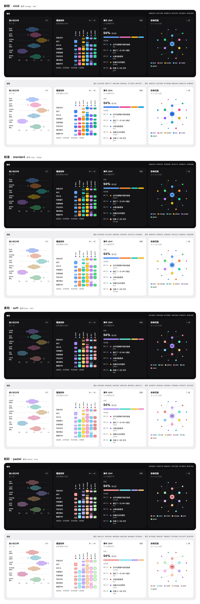

# 图表系列色预置色板

图表系列色 `semantic.color.dataViz.series.1…6` 与填充色 `semantic.color.dataViz.seriesFill.1…6` 从这里的四套色板选一套，不从品牌色派生。规则在 [BD-TOKEN-001](../../references/system.md#bd-token-001) 第 8 步，机读数据在 [presets.json](presets.json)。每套有 6 个系列色和 2 个备用色，每色三个值：

| 值 | 写进 | 用在 |
| --- | --- | --- |
| 浅色描边 `light` | 浅色模式的 `series.<n>` | 折线、散点、轮廓、图例里的线；对四层表面 ≥ 3:1 |
| 浅色填充 `lightFill` | 浅色模式的 `seriesFill.<n>` | 柱、面积、热力格、扇区、关系图节点 |
| 暗色 `dark` | 暗色模式的 `series.<n>`，暗色 `seriesFill.<n>` 指向同一个色值 | 暗色模式的全部标记 |

填充色对表面低于 3:1 时，填充标记加 1 px 系列色描边。鲜明的浅色填充对白色 2.15–4.23:1，其余三套都低于 3:1，所以浅色模式的填充标记一律带描边。

预览图由 `node <skill>/scripts/dataviz-preview.mjs --out preview.html` 生成；加 tokens 目录参数时换成该品牌的表面与文字色。

## 选哪一套

默认选「鲜明」：浅色填充 L 0.61–0.77、彩度 0.15–0.22，图表一眼分得清。下面的条件命中时换：

| 色板 | 换用条件 | 代价 |
| --- | --- | --- |
| 标准 `standard` | 用户或品牌手册要求图表不压过品牌色，且强调色 OKLCH 彩度 < 0.15 | 浅色填充 L 0.71–0.86，比鲜明浅一档 |
| 柔和 `soft` | 品牌色（`primitive.color.brand.*`，没有这一组时取品牌资产里的主色、辅助色）彩度都 < 0.10，且图表不是产品的主要内容 | 浅色填充 L 0.75–0.91、相邻色盲 ΔE 6.6，4 个及以上系列要直接标注系列名 |
| 粉彩 `pastel` | 品牌参考或用户偏好里有粉彩、马卡龙一类浅色调 | 浅色填充彩度只有 0.08–0.11，对白色 1.13–1.91:1，靠描边分出边界 |

品牌把某个色相留给专门用途（例如未读角标的红色）时，套用时加 `--avoid <色相>`，脚本会指出靠近这个色相的系列号；这时换备用色或换一套，或者让那一号系列不出现在该用途旁边。

选定的色板写进 dataViz 组的 `$description` 和 DESIGN.md。

## 色值

底色取自 Tailwind CSS v3 默认调色板（MIT，[v3.tailwindcss.com/docs/customizing-colors](https://v3.tailwindcss.com/docs/customizing-colors)）：浅色描边约 600–700 档，浅色填充约 300–500 档，暗色约 300–400 档。部分色值为过区分度门调过亮度，青、蓝绿的深色描边在 OKLCH 里重定以过彩度下限。粉彩的浅色填充是 Coolors 色板 FFADAD、FFD6A5、FDFFB6、CAFFBF、9BF6FF、A0C4FF、BDB2FF、FFC6FF（[coolors.co/palette](https://coolors.co/palette/ffadad-ffd6a5-fdffb6-caffbf-9bf6ff-a0c4ff-bdb2ff-ffc6ff-fffffc)）原值，第 9 色 FFFFFC 接近白色，不用；粉彩的暗色是这组色彩度提到 ≥ 0.10 的版本。

### 鲜明 `vivid`

| 号 | 色相 | 浅色描边 | 浅色填充 | 暗色 |
| --- | --- | --- | --- | --- |
| 1 | blue | `#2563EB` | `#3B82F6` | `#60A5FA` |
| 2 | pink | `#DB2777` | `#EC4899` | `#F472B6` |
| 3 | amber | `#B45309` | `#F59E0B` | `#FBBF24` |
| 4 | sky | `#0369A1` | `#0EA5E9` | `#5CC9FE` |
| 5 | violet | `#7C3AED` | `#8B5CF6` | `#A78BFA` |
| 6 | green | `#047857` | `#10B981` | `#34D399` |
| 备用 | orange | `#C2410C` | `#F97316` | `#FB923C` |
| 备用 | teal | `#018D82` | `#14B8A6` | `#2DD4BF` |

### 标准 `standard`

| 号 | 色相 | 浅色描边 | 浅色填充 | 暗色 |
| --- | --- | --- | --- | --- |
| 1 | blue | `#1D4ED8` | `#60A5FA` | `#60A5FA` |
| 2 | orange | `#C2410C` | `#FB923C` | `#FB923C` |
| 3 | teal | `#018D82` | `#2DD4BF` | `#2DD4BF` |
| 4 | yellow | `#A16207` | `#FACC15` | `#FACC15` |
| 5 | purple | `#7E22CE` | `#C084FC` | `#C084FC` |
| 6 | green | `#15803D` | `#4ADE80` | `#4ADE80` |
| 备用 | rose | `#BE123C` | `#FB7185` | `#FB7185` |
| 备用 | indigo | `#4338CA` | `#818CF8` | `#818CF8` |

### 柔和 `soft`

| 号 | 色相 | 浅色描边 | 浅色填充 | 暗色 |
| --- | --- | --- | --- | --- |
| 1 | violet | `#6D28D9` | `#C4B5FD` | `#A78BFA` |
| 2 | teal | `#018D82` | `#5EEAD4` | `#5EEAD4` |
| 3 | yellow | `#A16207` | `#FDE047` | `#F7D06C` |
| 4 | pink | `#BE185D` | `#F9A8D4` | `#E879A9` |
| 5 | sky | `#0369A1` | `#7DD3FC` | `#7DD3FC` |
| 6 | coral | `#B91C1C` | `#E79293` | `#FDA19E` |
| 备用 | blue | `#1D4ED8` | `#93C5FD` | `#7B9CFF` |
| 备用 | mint | `#047857` | `#6EE7B7` | `#7EE8B4` |

### 粉彩 `pastel`

| 号 | 色相 | 浅色描边 | 浅色填充 | 暗色 |
| --- | --- | --- | --- | --- |
| 1 | red | `#B91C1C` | `#FFADAD` | `#FDA0A2` |
| 2 | cyan | `#0784A3` | `#9BF6FF` | `#7DEFFB` |
| 3 | violet | `#6D28D9` | `#BDB2FF` | `#B6AAFF` |
| 4 | orange | `#B45309` | `#FFD6A5` | `#FFC986` |
| 5 | pink | `#A5004D` | `#FFC6FF` | `#F7B8F8` |
| 6 | green | `#238946` | `#CAFFBF` | `#B3F2A6` |
| 备用 | yellow | `#A16207` | `#FDFFB6` | `#E7E890` |
| 备用 | blue | `#1D4ED8` | `#A0C4FF` | `#8EB8FE` |

## 已经满足和要按品牌核对的门

色值换算成 8 位 sRGB。每套按上表顺序，过了 [tokens-schema](../../vendor/theme-extract/references/tokens-schema.md) §6.3 里与表面无关的门：

- 浅色描边与暗色：亮度带（浅 0.43–0.77、暗 0.60–0.92）、彩度 ≥ 0.10、相邻两号与系列 1–3 两两的色盲模拟 ΔE ≥ 8 和正常视觉 ΔE ≥ 15，以及本技能另加的全部两两正常视觉 ΔE ≥ 8；
- 浅色填充（填充档）：与同号描边色相差 ≤ 45°、彩度 ≥ 0.07、相邻两号与系列 1–3 两两色盲 ΔE ≥ 6、全部两两正常视觉 ΔE ≥ 8。

| 色板 | 相邻最差色盲 ΔE（描边 / 填充 / 暗色） | 全部两两最差正常视觉 ΔE（描边 / 填充 / 暗色） |
| --- | --- | --- |
| 鲜明 | 10.2 / 10.8 / 9.5 | 12.0 / 9.8 / 9.6 |
| 标准 | 13.1 / 15.3 / 15.3 | 8.8 / 9.6 / 9.6 |
| 柔和 | 8.7 / 6.6 / 12.5 | 8.2 / 9.4 / 10.0 |
| 粉彩 | 8.7 / 11.4 / 12.2 | 8.6 / 10.3 / 10.7 |

对四层表面 3:1 和离反馈色的距离取决于品牌的表面色和反馈色，由 `node <skill>/scripts/dataviz-preset.mjs <tokens 目录> --preset <id>` 按本品牌核对：某号的系列色在任一模式没过亮度带、彩度下限或 3:1，或填充色没过填充档的门时，换成第一个能过且换后整组仍过区分度的备用色；两个备用色都不行时脚本退出码为 1，这时换一套色板，或在 DESIGN.md 记下缺口并问用户。离反馈色 ΔE < 15 只报警告。
