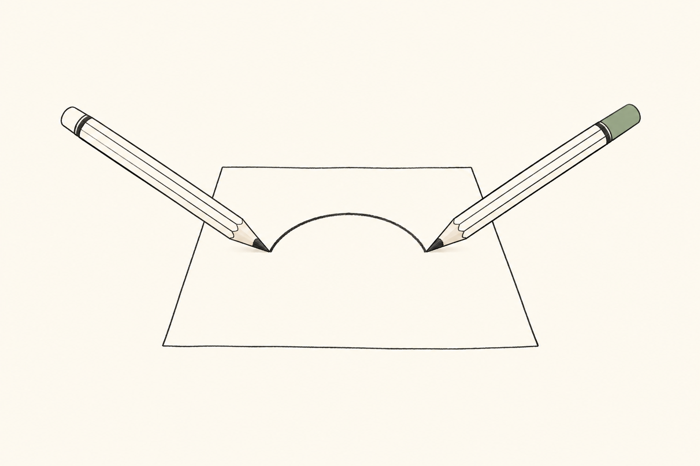
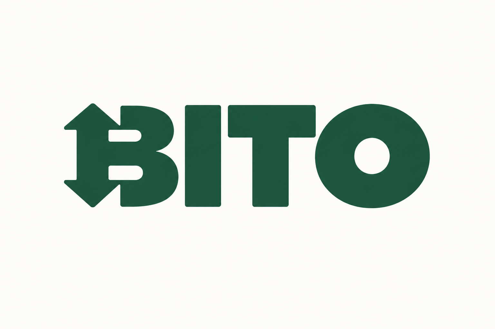
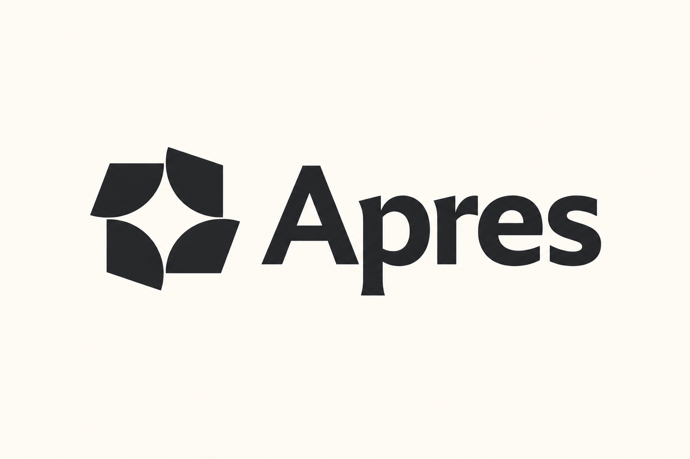
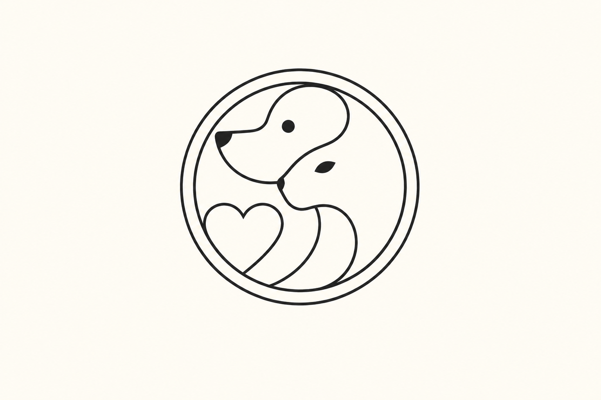
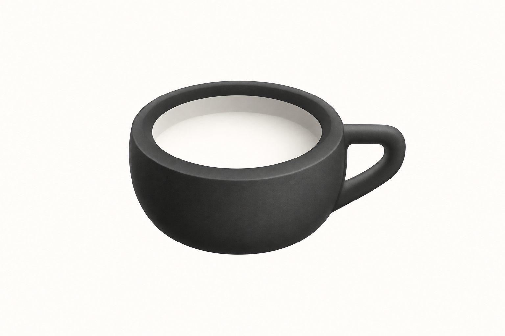
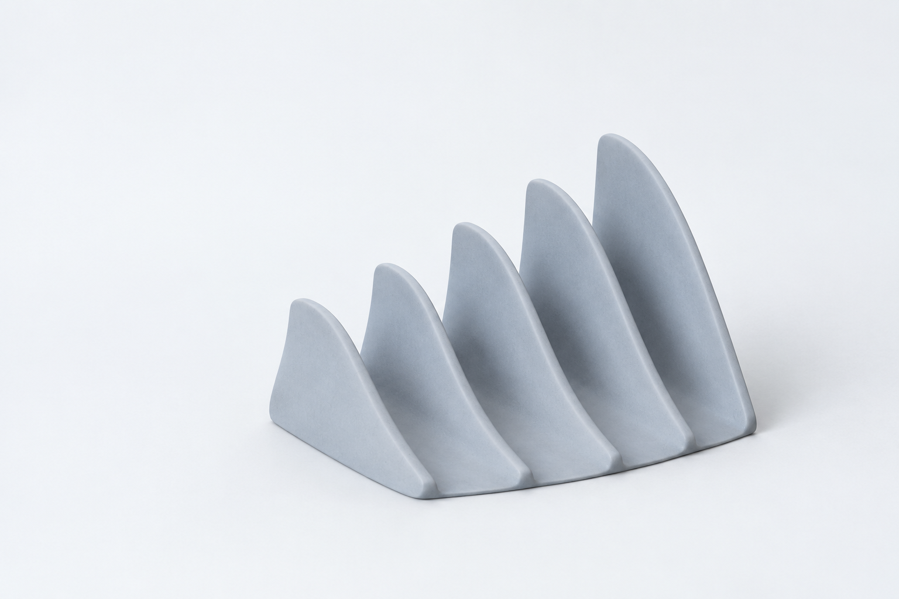

# 简约风格案例导航

这里展示本库 imagegen 研究图的代表：**12 类，每类至少 10 张，共 152 张**，其中 **119 张来源重新演绎＋33 张独立原创研究**。两类图分开标注。第三方来源共有 122 个样本，另保留 3 例未生成记录；原创研究不替这些来源补写生成通过。

## 内容与手绘

艺术感来自动作、线条与留白的关系。Anthropic、Perplexity、Notion、Intercom 的四个来源项目分别转成概念手绘、文字网格、人物关系与图文分工研究。[十张研究图](editorial-typographic-systems/EXAMPLES.md)包括四张来源重新演绎与六张原创概念；上图以两支铅笔共同完成弧线表达协作，需要制作时读[手绘方法](editorial-typographic-systems/HAND-DRAWN.md)。

## 文字与字母

完整名称与缩写符号是两种任务。[现代字标十例](modern-product-wordmarks/EXAMPLES.md)研究整词节奏；[几何字母十例](geometric-letter-monograms/EXAMPLES.md)研究共笔、开口与紧凑构造。源字形是研究参照，不是新品牌的可编辑字库。

## 图形与空白

从[负空间十例](geometric-negative-space/EXAMPLES.md)、[科技语义十例](semantic-tech-marks/EXAMPLES.md)和[现代主义十张研究图](modernist-corporate-symbols/EXAMPLES.md)比较：记忆点来自空白、产品关系，还是强轮廓。先确定一个关键关系，不把隐藏含义堆成谜题。

## 线条与路径

[单线十例](monoline-contour-marks/EXAMPLES.md)用线条语气与共用边界表达主体；[折带十例](folded-ribbon-paths/EXAMPLES.md)用转向与穿插组织连接。平面构造已经清楚时，材质保持安静。

## 产品意象

[完整 42 例](monochrome-product-marks/EXAMPLES.md)保留器物、功能隐喻、字形和抽象构成的差异。哑光体积只是可选表现，不能让所有产品都变成同一种黑色物件。

## 家族与离散单元

[模块化十例](modular-responsive-identities/EXAMPLES.md)研究固定单元和变化的容器；[像素网格十例](pixel-grid-identities/EXAMPLES.md)研究离散边界和阶梯节奏。两包各有两张来源重新演绎与八张原创研究；虚构名称与构思不归属于来源品牌。变化服务产品关系，文字仍要清楚。

## 曲面与边界

[参数化十例](parametric-science-visuals/EXAMPLES.md)包括两张来源重新演绎与八张原创曲面研究，保留柔和的雕塑感与连续边界。上图按翼片高度变化研究序列；静态图不提供真实数据、可运行生成器或已验证动效。

## 从示例继续

采用[艺术方向](ART-DIRECTION.md)中的比较方式，写明本次借用的变量、需要保留的自有品牌资产和实际交付尺度。每包 `generated.json` 保存来源重绘的实际 Prompt 与目检，有原创的包另以 `originals.json` 保存简报、方法与实际记录；`PROMPTS.md` 提供新任务模板。新品牌必须形成自己的识别，原品牌重绘图不能直接作为新品牌成品。
