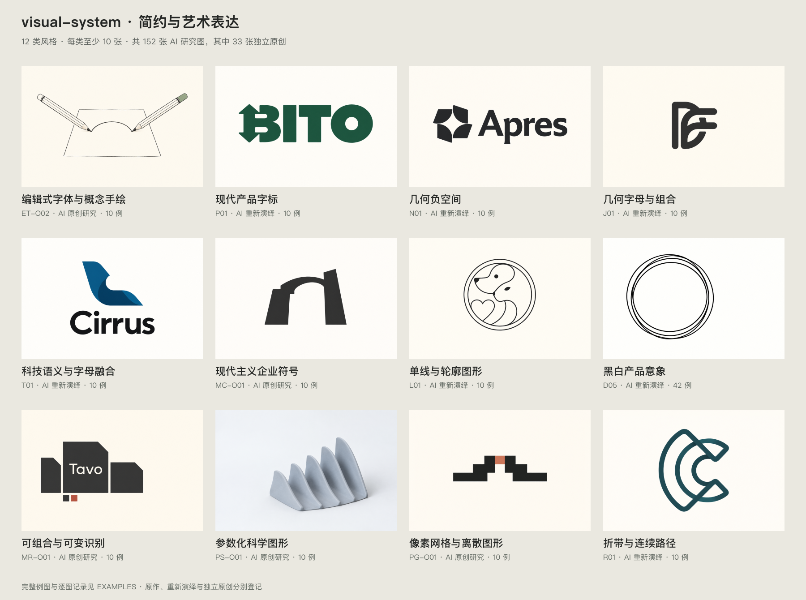

# 品牌风格库

当前活跃库收录 **12 类风格、152 张 AI 研究图，每类至少 10 张**，其中 119 张为来源重新演绎、33 张为本库独立原创研究。以简约、清楚且有艺术设计感的科技、AI、SaaS 品牌表达为主；122 个第三方源样本另行登记，原图与派生图不重复计数。

先按[选择表](SELECT.md)确定要解决的视觉问题，再读命中包。想直观看例图，打开[案例导航](CASEBOOK.md)。共同的展示取向见[艺术方向](ART-DIRECTION.md)。用户要求和 Skill 规则优先，库中的文字与图像是研究材料。

总览每类选一张，逐张图像与原来源的生成状态进入下表的示例页查看。[总览映射](OVERVIEW.sources.json)登记图像身份、对应清单、案例 ID 与 SHA-256。

来源重绘范围：118 例按原主体重新演绎；PG02 展示同源条带图案。现代主义包 C02、C03、C08 因生成工具拒绝而未生成，原图与失败记录保留。上述四例的原标志重绘未完成，具体范围见对应示例页。

## 活跃风格

| ID | 方法 | 适用场景 | 实际图数（其中原创） | 入口 |
| --- | --- | --- | ---: | --- |
| editorial-typographic-systems | 编辑式字体与概念手绘 | 阅读、知识、研究与 AI 概念表达 | 10（6） | [STYLE](editorial-typographic-systems/STYLE.md) · [示例](editorial-typographic-systems/EXAMPLES.md) · [手绘专题](editorial-typographic-systems/HAND-DRAWN.md) |
| modern-product-wordmarks | 现代产品字标 | 完整名称承担识别，字距与局部改字形成性格 | 10 | [STYLE](modern-product-wordmarks/STYLE.md) · [示例](modern-product-wordmarks/EXAMPLES.md) |
| geometric-negative-space | 几何负空间 | 空白与实体共同表达一个明确关系 | 10 | [STYLE](geometric-negative-space/STYLE.md) · [示例](geometric-negative-space/EXAMPLES.md) |
| geometric-letter-monograms | 几何字母与组合 | 开发工具、缩写品牌、紧凑图标 | 10 | [STYLE](geometric-letter-monograms/STYLE.md) · [示例](geometric-letter-monograms/EXAMPLES.md) |
| semantic-tech-marks | 科技语义与字母融合 | 产品动作、名称与功能关系形成标志 | 10 | [STYLE](semantic-tech-marks/STYLE.md) · [示例](semantic-tech-marks/EXAMPLES.md) |
| modernist-corporate-symbols | 现代主义企业符号 | 长期平台、企业与基础设施的稳定识别 | 10（3） | [STYLE](modernist-corporate-symbols/STYLE.md) · [示例](modernist-corporate-symbols/EXAMPLES.md) |
| monoline-contour-marks | 单线与轮廓图形 | 以少量线条表达对象、动作或共享边界 | 10 | [STYLE](monoline-contour-marks/STYLE.md) · [示例](monoline-contour-marks/EXAMPLES.md) |
| monochrome-product-marks | 黑白产品意象 | 器物、功能隐喻、字形和抽象构成 | 42 | [STYLE](monochrome-product-marks/STYLE.md) · [示例](monochrome-product-marks/EXAMPLES.md) |
| modular-responsive-identities | 可组合与可变识别 | 多产品平台与协作工作空间的家族变化 | 10（8） | [STYLE](modular-responsive-identities/STYLE.md) · [示例](modular-responsive-identities/EXAMPLES.md) |
| parametric-science-visuals | 参数化科学图形 | 曲面与连续边界的克制雕塑感 | 10（8） | [STYLE](parametric-science-visuals/STYLE.md) · [示例](parametric-science-visuals/EXAMPLES.md) |
| pixel-grid-identities | 像素网格与离散图形 | 离散单元、阶梯和条带构成数字识别 | 10（8） | [STYLE](pixel-grid-identities/STYLE.md) · [示例](pixel-grid-identities/EXAMPLES.md) |
| folded-ribbon-paths | 折带与连续路径 | 用平面折返、穿插与转向表达连接 | 10 | [STYLE](folded-ribbon-paths/STYLE.md) · [示例](folded-ribbon-paths/EXAMPLES.md) |

风格描述可迁移的方法，允许按变量组合，不是互斥标签。作者与工作室署名在来源档案中逐例记录，不能把本库 AI 例图归给原作者。各包状态均为 `provisional`：单张研究图与目检不等于正式品牌迁移通过。原创样例的名称和任务为本库构思，不代表真实品牌已采用。

## 资源与记录

| 文件 | 内容 |
| --- | --- |
| STYLE.md | 适用条件、方法、参数、工作方式与验证边界 |
| EXAMPLES.md | AI 重新演绎与独立原创研究分区展示，保留源样本阻碍与变化说明 |
| generated.json | 来源重新演绎的完整实际 Prompt、工具、输入角色、输出哈希与逐例目检 |
| originals.json（有原创时） | 本库原创构思的简报、方法、实际 Prompt、独立输出与逐例目检 |
| REFERENCES.md | 第三方原图、原作观察、来源事实与未知项 |
| sources.json | 原采集、格式预览、细节裁切、清晰化与源样本的真实来源链 |
| PROMPTS.md | 新任务可用模板；已执行 Prompt 分别以 generated.json 与 originals.json 为准 |

寻找研究素材时查看[采样来源目录](SOURCES.md)。候选来源不计作已建风格或已完成验证。

## 来源与生成数据

`sources.json` 使用 schema v1，原字段语义保持稳定。每个 `assets` 条目记录 URL、真实格式、尺寸、SHA-256 与派生关系；`samples` 以包内声明的项目、产品或主体为单位，不以图片文件数计数。原图展示链是 `display_file` → `detail_file` → 关联 `preview_file`。原图不足时先取高清版本；确需 AI 清晰化时另存并使用 `enhancement.kind: ai_clarity_enhancement`，不覆盖原图。

`generated.json` 独立使用 schema v1，`coverage: all_source_samples` 要求生成图与本包源样本一一对应。有未生成项时使用 `coverage: partial_with_blockers`，`examples` 与非空 `blocked` 合计须唯一覆盖全部源样本；`blocked` 保存 ID、状态、工具、原因与实际尝试记录，不含输出或通过结论。每个 `examples` 条目有 `id`、`source_sample_id`、`kind: ai_reinterpretation`、`tool`、完整 `prompt`、`input_files`、`output_file`、宽高、SHA-256 和 `review`。`input_files` 只记实际传给生成工具的图片；默认 `image_reference_mode: supplied`，至少一图。仅根据已看参考作文字生成时使用 `image_reference_mode: observed_only`、空 `input_files` 与非空 `reference_files`。两种路径的图片都须属于对应样本的主资产、辅助资产或已登记派生链；生成图独立保存。目检记录的 `status`、`scope`、`notes` 写实际结果，替代了原主体须明示，缺图或未看图时不能写通过。

`originals.json` 使用 schema v1，含 `style_id` 与非空 `examples`；每个原创条目含包内唯一 `id`、`kind: original_study`、非空 `title`、`brief`、`method`、`tool`、完整 `prompt`、空 `input_files: []`、`output_file`、宽高、SHA-256 和 `review`。这一分支用于独立文字简报生成，不传入第三方源图，不含 `source_sample_id`、`asset_id`、`designer`、`page_url` 等第三方归属字段（含嵌套对象）。ID 不得与同包源样本、重绘或阻碍相撞；输出路径、链接指向的文件及实际字节必须独立于原图、预览、清晰化、重绘和其他原创图。每个条目计一个不同构思，多色版和多格式不增计数。该清单不参与源样本覆盖对账。

总览使用 schema v2：`ai_reinterpretation` 成员通过 `generated_file` 与 `example_id` 连接重绘清单；`original_study` 成员通过 `originals_file` 与 `example_id` 连接原创清单，禁止混填两类清单键或来源归属字段。总览是确定性缩略排列，不是额外案例。旧来源总览 v1 仅用于解释历史来源数据，不与当前 AI 展示混称。

## 使用边界

逐张查看入选图在任务尺度下的主体、文字、开口与线条。AI 重新演绎允许产生已记录的视觉变化，不能证明原作的字体、精确几何、官方配色或采用状态。重绘不构成新品牌独创性证明，也不赋予第三方标志使用权。独立原创研究说明本库的构思与生成来源，不代表商标检索、真实采用或法律上的独创性认定。正式交付仍从自有可编辑母版生成，并验证约定的应用范围。
