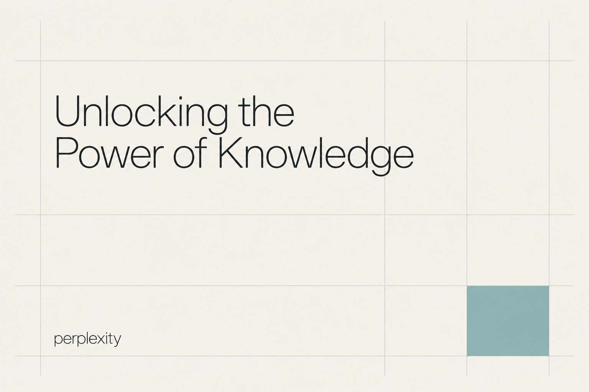
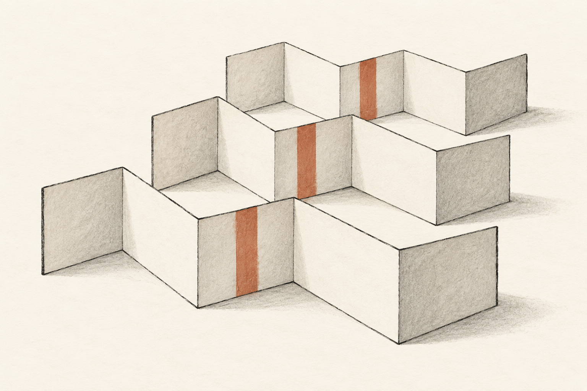

# 编辑式字体与概念手绘 · 10 张 AI 研究图

本包展示 **4 张来源重新演绎、6 张独立原创研究**。每张均由内置 imagegen 单独生成；颜色、几何、字体与生产应用按实际用途另验。方法见 [STYLE](STYLE.md)，共同展示取向见[艺术方向](../ART-DIRECTION.md)。

来源重新演绎见 [generated.json](generated.json)，原图与事实见 [REFERENCES](REFERENCES.md) / [sources.json](sources.json)。独立原创的简报、构思、实际 Prompt 与目检见 [originals.json](originals.json)；这些是本库提出的新研究主题，没有第三方原作或官方采用事实。 参考、生成与正式资产的验证范围分开，包保持 provisional。

## 来源重新演绎

保留源样本 ID；这些图不是原作者作品或官方改版。

### ET01 · Anthropic

**观察：** 四球与左侧抬起关系保留；框架、细线和克制陶土强调可辨，暖白背景统一。纸纹比源图更明显，属于AI表现变化，不代表原作。

**可研究的方法：** 先将真实概念改写为可画的动作与关系，再选笔触分支、图层分工及文字留白；保留自有品牌资产，中文与正式排版单独试排。

[原图档案](REFERENCES.md) · [实际输入](references/ET01-influence.png) · [原尺寸](generated/ET01.png)

### ET02 · Perplexity

**观察：** 标题两行与 perplexity 字样可读且匹配要求；网格减至疏线，浅青单点强调。生成字形及颜色不能当作原字体或品牌规范。

**可研究的方法：** 用真实长短文本分别试排阅读界面与传播物料，继承角色分工与对齐方法；不照搬具体网格、颜色或拉丁字体作为中文方案。

[原图档案](REFERENCES.md) · [实际输入](references/ET02-grid.jpg) · [原尺寸](generated/ET02.png)

### ET03 · Notion

**观察：** 两名背向同事、共用思考云和三种内容符号清楚；多彩原广告收敛为墨线与陶土文档，移除真实广告场景。人物线条、内容数量为重绘选择。

**可研究的方法：** 用新品牌的业务动词重写隐喻；宣传与产品界面分配不同色彩强度，分别重排横竖物料。

[原图档案](REFERENCES.md) · [实际输入](references/ET03-hero.png) · [原尺寸](generated/ET03.png)

### ET04 · Intercom

**观察：** Intercom 与 Connect the dots. 可读；衬线标题和手势图分工明确，三节点连接完整。蓝色比预期略明亮，面积局部且无光效，仍在克制范围。

**可研究的方法：** 先给展示、正文、批注分配角色，再确认团队能重复制作的插画复杂度；产品说明保留真实结构。

[原图档案](REFERENCES.md) · [实际输入](references/ET04-illustration.jpg) · [原尺寸](generated/ET04.png)

## 独立原创研究

每个 ID 对应一个不同的产品问题与构思，由文字简报生成，不绑定第三方样本。这里的“原创”说明构思与生成来源，不等于商标检索、独创性法律判断或正式品牌验收。

### ET-O01 · 证据归页

**简报：** 为文献溯源工具研究多份资料归入同一可追踪索引的封面。

**方法：** 用一根穿过纸页角部的线，把分散资料转译成可循迹的联系。

**目检：** 四张错位纸页和穿孔线迹清楚，单根陶土色线将独立页面连成可追踪关系；没有假文字。线较提示词设想更粗，仍保留清楚主次，未把它当真实引用数据。

[原尺寸](generated/ET-O01.png) · [实际 Prompt 与记录](originals.json)

### ET-O02 · 共同落笔

**简报：** 为协作写作工具研究两条思路形成共同成果的封面。

**方法：** 用两支相向的铅笔与一条共绘曲线表达协作，不使用人物或品牌符号。

**目检：** 清浅背景中，两支完整铅笔在纸上共同落到同一弧线两端，留白清楚。弧线构成连续笔迹，作为协作概念可读；没有文字与精确字体声明。

[原尺寸](generated/ET-O02.png) · [实际 Prompt 与记录](originals.json)

### ET-O03 · 上下文线轴

**简报：** 为长文理解工具研究从杂乱上下文中找到可延续线索的封面。

**方法：** 对照紧密卷绕与舒展路径，以同一根线保持结构连续。

**目检：** 线轴、两处舒展回环、折起蓝灰纸签和自由线头形成清楚起点—路径—定位关系。线轴有较细铅笔明暗，画面背景保持安静，未声明真实线结构算法。

[原尺寸](generated/ET-O03.png) · [实际 Prompt 与记录](originals.json)

### ET-O04 · 筛选与保留

**简报：** 为研究资料筛选工具研究按条件分组而非宣称答案正确的概念图。

**方法：** 以筛网、不同尺度形体和上下空间分区表达筛选动作。

**目检：** 筛网中四个较大形体与下落的三颗小粒分层清楚，单个浅赭色接收盘突出动作。网格比提示词的稀疏建议更密，但主体和上下关系仍可辨；不是模型正确率或真实筛选结果。

[原尺寸](generated/ET-O04.png) · [实际 Prompt 与记录](originals.json)

### ET-O05 · 版本层叠

**简报：** 为文档版本比较工具研究不同阶段之间可定位的变化。

**方法：** 以错位折页和共同穿行的标记展示时间层次与稳定参照。

**目检：** 三个错位折页的前后层次和对应的陶土色标记清楚。输出把一条跨页丝带改为三个对齐的色条，不宣称一根连续丝带；保留同一位置跨版本对照的主意。

[原尺寸](generated/ET-O05.png) · [实际 Prompt 与记录](originals.json)

### ET-O06 · 定位一页

**简报：** 为知识检索工具研究从资料集合中定位目标页面的封面。

**方法：** 用放大镜与一处留空书签建立焦点，避免用真实文字模拟搜索结果。

**目检：** 放大镜框住中间书签，文件夹的错位边缘与镜框分开，留白和单点青色焦点清楚；没有文字，不作为搜索结果或生产图标验收。

[原尺寸](generated/ET-O06.png) · [实际 Prompt 与记录](originals.json)
