# 编辑式字体与信息层级 · 逐例参考

本页是第三方来源档案。当前统一展示使用[逐例 AI 重新演绎](EXAMPLES.md)；这里保留原图、来源事实与观察，不把生成变化归给原作者。

本页来源按独立项目计数：**ET01 Anthropic、ET02 Perplexity、ET03 Notion、ET04 Intercom，共 4 项目、20 份原始参考**。ET01 有 9 份、ET02 有 3 份，ET03 / ET04 各有 4 份；2 份 SVG 各附一张等尺寸 PNG 预览，共 22 个图像文件。本页原始参考没有使用 AI 清晰化。来源重新演绎与独立原创研究见 [EXAMPLES](EXAMPLES.md)，原创简报及实际生成记录见 [originals.json](originals.json)。点击对应链接可查看完整文件；预览与同项目多图不重复计数。完整拆解与填写后的任务见[案例研究](CASE-STUDIES.md)。

来源事实只采信页面明确披露的内容；“观察”是对图片的目检，“迁移建议”是本库推导。页面对应案例时期，不作为当前线上 UI 的验收证据。

## ET01 · Anthropic / Geist

来源：[Geist 官方 Anthropic 案例](https://geist.co/work/anthropic)。页面明确说明 Geist 创作基础品牌身份与字标，并进一步建立数字品牌工具、插画及组件系统；选用 Commercial Type 的 Styrene 和 Klim 的 Tiempos。下面来自该案例的素材按 Geist 案例归属登记；来自 Anthropic 官方文章的独立主图另记发布来源，其单图作者和绘制日期未披露，不能一并推定为 Geist 创作。

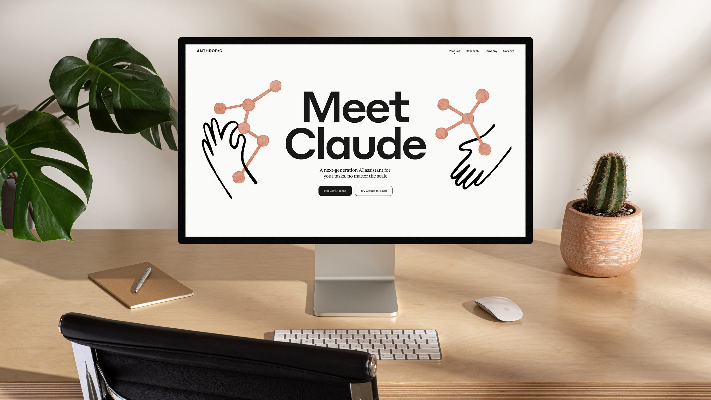

[原采集图：页面展示](references/ET01-page.jpg)。观察：大幅无衬线标题、较小衬线说明、短按钮与两侧线稿各有角色；品牌名称位于较安静的页头。屏幕处于环境展示图中，不能据此量 CSS 字号和间距。

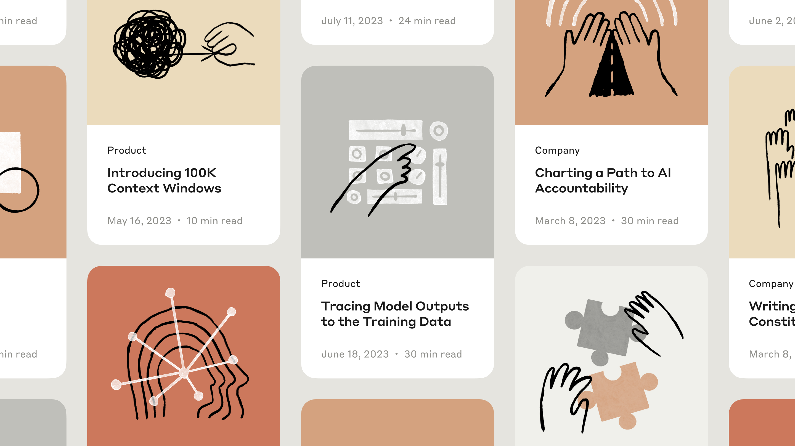

[原采集图：文章卡片](references/ET01-tiles.png)。观察：类别、粗标题、日期与阅读时长形成重复层级；插画色块与正文区分开。已分别看清中间三张卡片的标题、标签与线稿；边缘卡片在来源图中已被画布截断，不宣称看过其完整内容。

迁移建议：AI 研究、知识产品可让内容层级持续承担识别，再以自有插画表达语气。不能连同手势图形、原配色和品牌名一并迁移；中文字体和长标题必须单独试排。

清晰度：原图可辨识标题笔画、层级与辅助图形，直接展示。页面小导航仅用于位置关系；不以小字判断精确字体。

### ET01 字体与色板

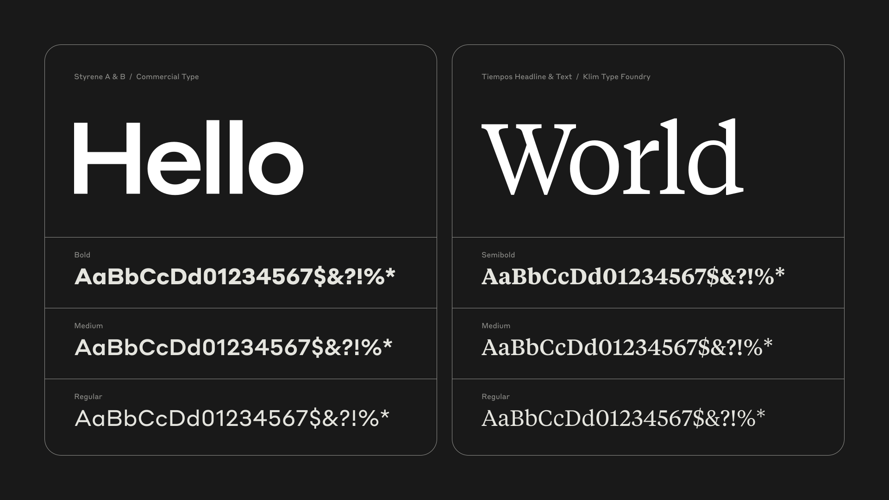

[SVG 原件](references/ET01-type.svg) · [等尺寸 PNG 预览](references/ET01-type.png)。字体板明确写出 **Styrene A & B** 与 **Tiempos Headline & Text**。观察：无衬线和衬线承担不同语气，图形的手绘感不意味着正文使用手写字体。该图没有提供可安装的字体文件、版本、中文覆盖或许可证明。

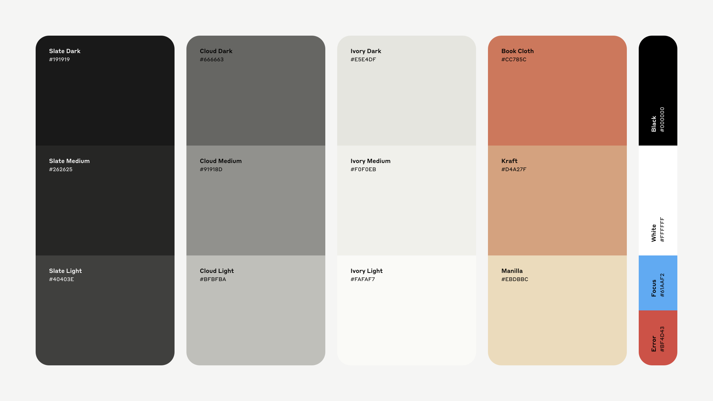

[SVG 原件](references/ET01-color.svg) · [等尺寸 PNG 预览](references/ET01-color.png)。观察：色板包含深墨色、成组中性色、书布／牛皮纸类背景和功能色；不是只有黑色加米白。本图只说明该案例的颜色角色，不把其原色直接写成目标产品 token 或已通过的状态色。

两份 SVG 以 `rsvg-convert` 按原尺寸 1920×1080 生成预览。已查看标签、字形和色块边界；这是格式转换，未重绘。

### ET01 独立插画与传播图

以下五图来自 Anthropic 官方文章。来源链接指文章页面与其实际图片，不将文章发布日期视为绘制日期，也不把当前主图与 Geist 案例中的同名文章卡片视作同一版本。

[原图](references/ET01-context.png) · [100K context windows](https://www.anthropic.com/news/100k-context-windows)。观察：黑色轮廓的指向手势叠在浅色控制部件上，暖色背景承托两层信息；长轮廓有自然起伏，线与浅色填形局部干涩。可研究“动作＋被操作对象”，不据此宣称图中控件是产品真实界面。

[原图](references/ET01-influence.png) · [Influence functions](https://www.anthropic.com/news/influence-functions)。观察：黑色器具轮廓、白色摆球与陶土色碰撞强调分工；碰触与传递成为主关系。可借“熟悉器物解释抽象关系”的构思方法，不能把装饰器具解读成论文实验装置或实测结论。

[原图](references/ET01-claude2.png) · [Claude 2](https://www.anthropic.com/research/claude-2)。观察：侧脸黑线重复，白色节点结构叠在前层，陶土底形成大色面。可研究重复、错位与图层区分；原图的侧脸轮廓、节点布局和组合不作为新品牌资产。

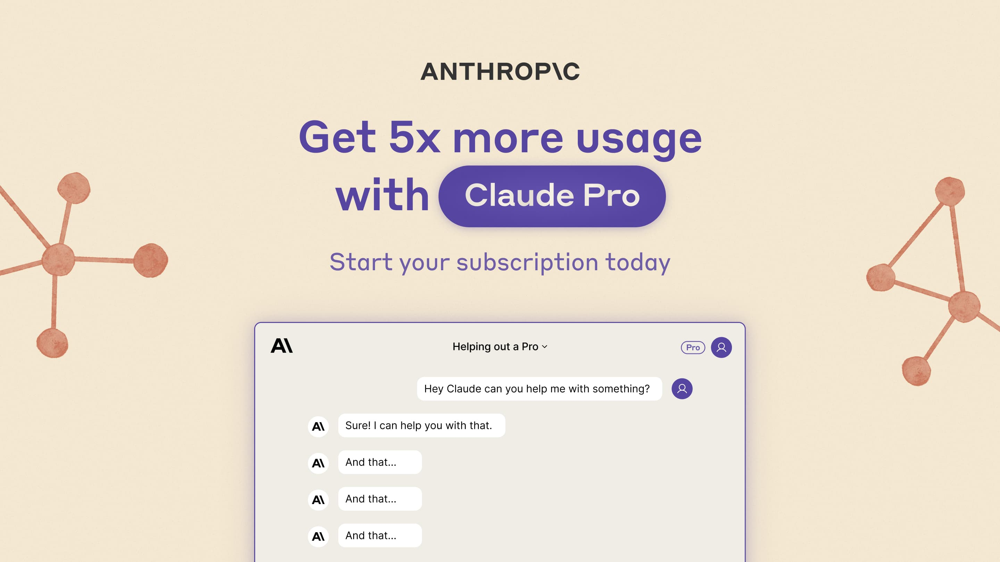

[原图](references/ET01-pro.jpg) · [Claude Pro](https://www.anthropic.com/news/claude-pro)。观察：中央正式标题、标识和产品展示，与两侧陶土色节点图分工；紫色文字表明传播配色可随用途变化。研究其角色关系，不从嵌入的小产品图量字体或界面参数。

[原图](references/ET01-policy.png) · [Usage policy update](https://www.anthropic.com/news/usage-policy-update)。观察：粉底、叠纸与手／羽毛笔组成主体；黑线较粗且平滑，有明显宽窄变化。这一具体参考提供另一种笔触分支，不能把它强行归为与前四图完全相同的干笔材质。

这五张原图均已逐张查看：主体轮廓、手部关系、器具、节点、图层与背景可辨；无需清晰化。迁移时先用自己的产品含义选择物件与动作，再从[手绘专题](HAND-DRAWN.md)选择笔触和系列保持项。图像仍为第三方研究素材，未验证跨品牌生成效果。

## ET02 · Perplexity / Smith & Diction

来源：[Smith & Diction 作者案例](https://smithdiction.substack.com/p/branding-perplexity-ai-70eb2cb2ef48)，页面注明原发于 Medium，文章日期为 2023-08-17。团队署名：Summer McClure（符号与品牌）、Hanna Karraby（字标）、Justin Lawes（动效）、Dayan D’Aniello（品牌）、Mike Smith（艺术指导）。本文仅归档静态参考，未观看或验证动效。

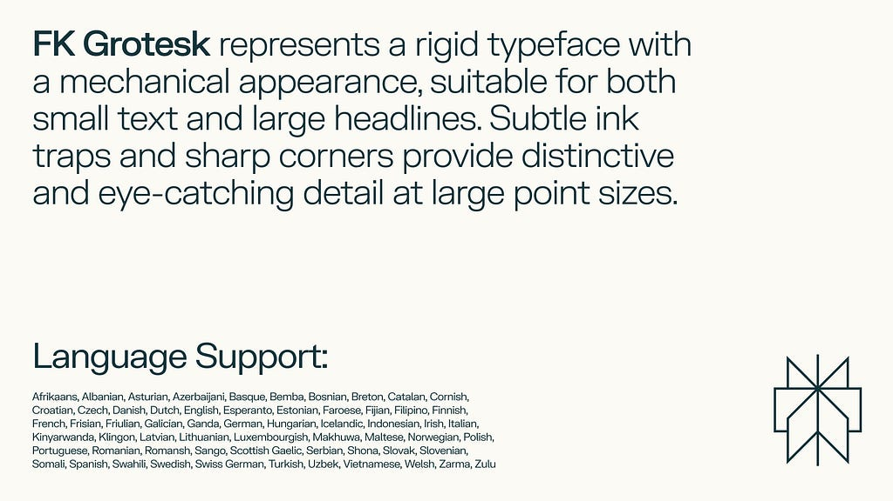

[原采集图：字体板](references/ET02-type.jpg)。来源明确说明字标使用 FK Display，品牌字体为 FK Grotesk，正文考虑 FK Grotesk Neue；本包没有下载字体文件，也未核实其许可或中文覆盖。观察：大字号说明和较小语言清单形成层级，图形标记保持独立。

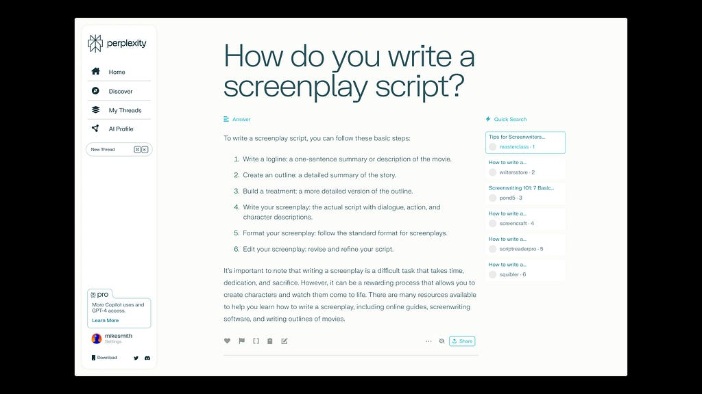

[原采集图：UI 样稿](references/ET02-ui.jpg)。观察：问题标题、回答正文、相关来源和侧边导航被分为独立区域；强调色出现在链接等局部。来源将其标为 UI mockup，不称本图为当前实装截图；小正文的可读性只在原采集宽度检查，缩略图仅看结构。

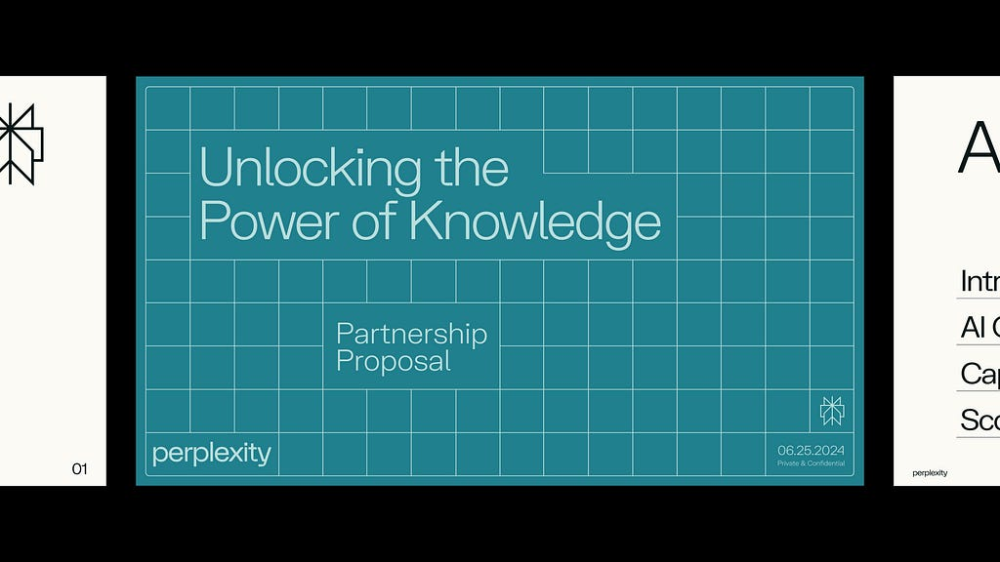

[原采集图：网格](references/ET02-grid.jpg)。观察：中心页由标题、副标题、页脚名称和日期占据不同的网格位置；两侧页在原图中已截断。来源中的文案和日期属于案例展示，不迁移为新品牌事实。

迁移建议：搜索、研究与知识 SaaS 可将展示标题和阅读正文分工，再用共同字面与对齐方式串联网站和演示文稿。不要把拉丁语言清单当作中文适配证据，也不要照搬网格数量或侧边栏行为。

清晰度：1024 像素原采集图中，字体板主文、中心演示页文字与格线清楚，UI 可检查层级；不放大、不补绘，也不把细小正文作为精确排版测量证据。

## ET03 · Notion / 2024 品牌传播

来源：[Notion 官方回顾](https://www.notion.com/blog/the-thinking-behind-our-latest-brand-campaign)（2024-07-10）、[BUCK 一手案例](https://buck.co/work/notion-think-it-make-it)。两页明确合作关系，Notion 将插画归给 Roman Muradov；BUCK 披露品牌策略、文案、设计与动效团队。插画作者、宣传排版和摄影不是同一署名。这里只研究这次 campaign，确切字体与字体许可未知。

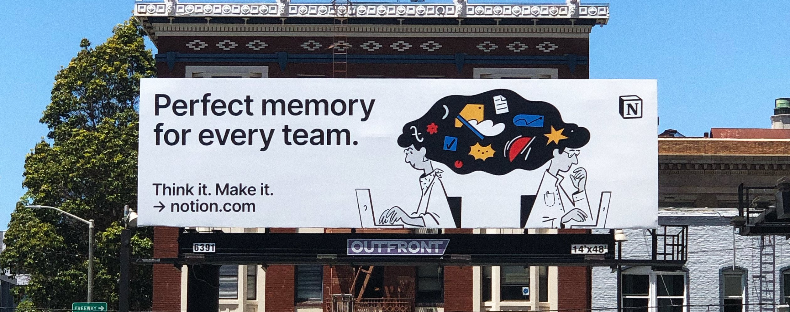

[原图：横幅广告](references/ET03-hero.png)。观察：左侧标题与次级行动文字分区，右侧两个人物通过共同黑色形态连接，彩色物件集中在该形态内；角部独立标志承担品牌识别。画面是广告实景照，不能当作平面印刷母版。

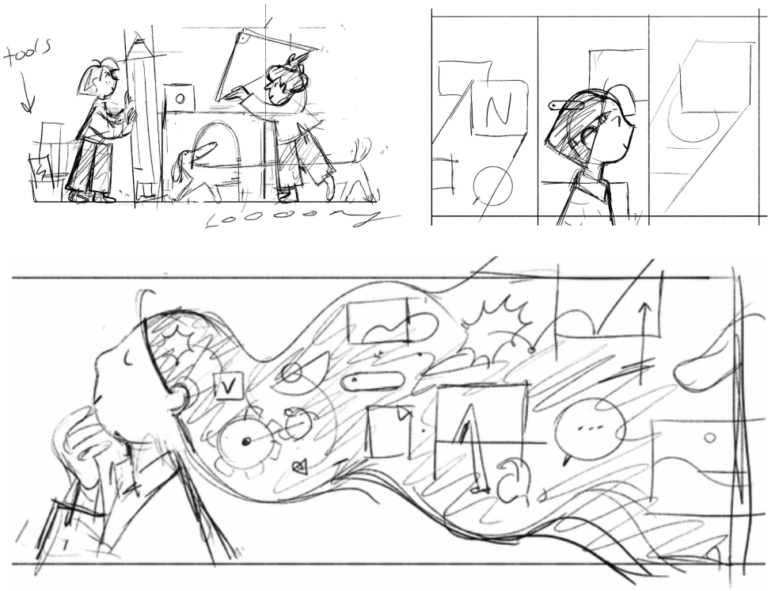

[原图：草图](references/ET03-sketch.png)。观察：三格图从全身场景、人物侧面到展开的思考空间，显示可以比较叙事距离与对象关系。它是过程稿；线条粗略程度不是成品必须保留的参数，也不能把草图标注当品牌手写字体。

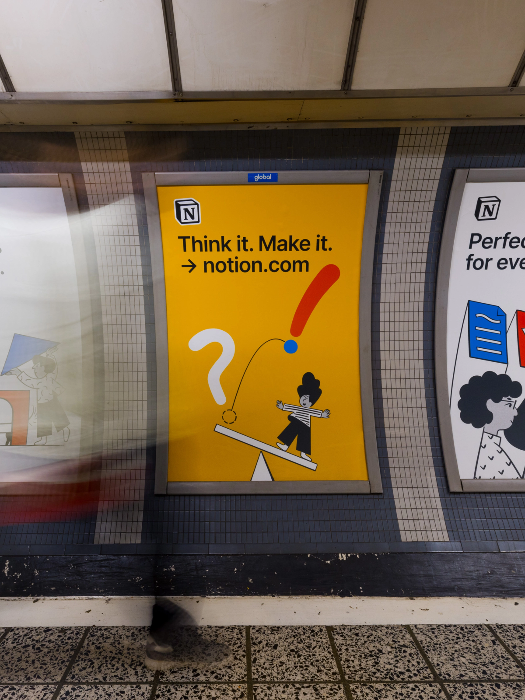

[原图：站台广告](references/ET03-transit.png)。观察：中央黄色竖幅上部集中标志、短句和入口，下部用人物、平衡板和标点形成动作；图像与标题按竖幅重新分区。左右相邻广告在照片中被截断，不计为完整已查看应用。来源为 BUCK 页面，CDN 返回宽 1200px 版本；没有本地放大。

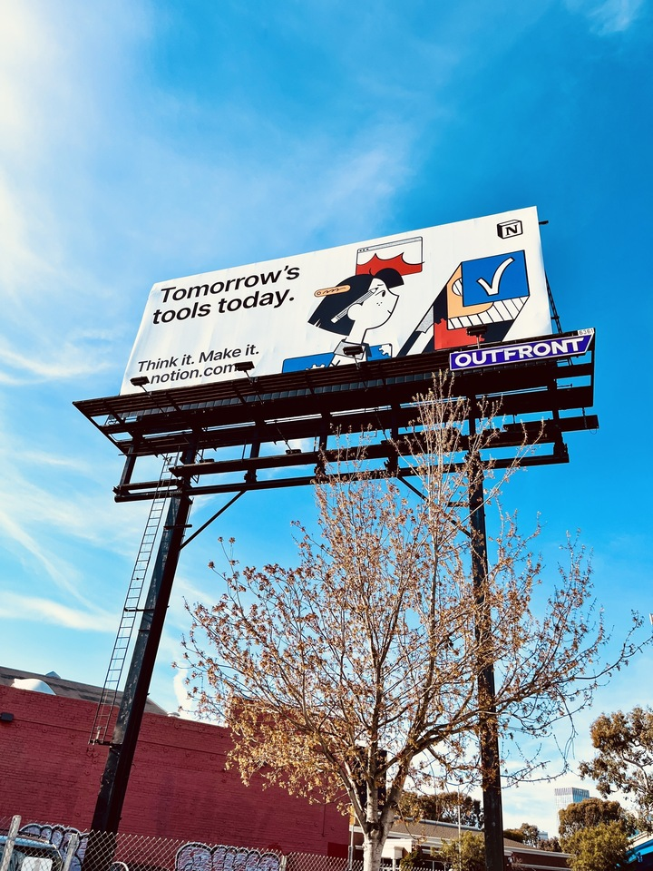

[原图：道路广告实景](references/ET03-street.jpg)。观察：强透视与远距离仍能辨别大字和人物轮廓，蓝、红色块承担局部注意点。小字、灯架遮挡与摄影透视只支持环境观察，不用于精确量字距、字号或设计尺寸。

四图逐张查看，标题、主体及主要动作关系可辨。迁移研究见 [Notion 完整案例](CASE-STUDIES.md#et03-notion-case)；不能把原侧脸、共享发形、标点组合、N 方块和广告口号复制到新品牌。

## ET04 · Intercom / 2021 品牌更新

来源：[Intercom 官方回顾](https://www.intercom.com/blog/how-and-why-we-refreshed-our-brand/)（2021-08-10，Scott Smith）。文章署名 Intercom Brand Studio，列 Kyle Benson 负责项目、美术指导、字体和色彩，Josh Miranda 负责插画和色彩等；不能据此将每张图板独立归给一人。文章解释 Honey 定制标题字体；图片标明 Graphik Semibold、Honey Extrabold、Smile Script，正文另提 Intercom Brand。未取得字体文件、完整字重表、中文覆盖或使用许可。

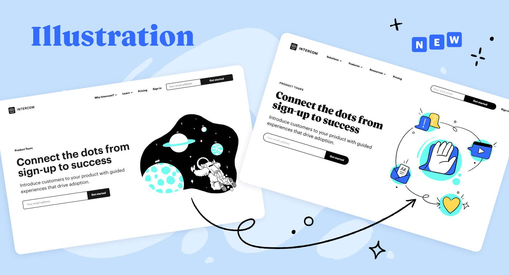

[原图：插画图板](references/ET04-illustration.jpg)。观察：左侧和标有 NEW 的右侧是案例前后对照；右侧大衬线标题、无衬线说明、输入操作和线稿分别承担语气、解释、行动与辅助叙事。不能把左侧旧方案也记为本案例采用方法。外侧箭头和星点是解释图板的图形，不证明产品界面内也有这些装饰。

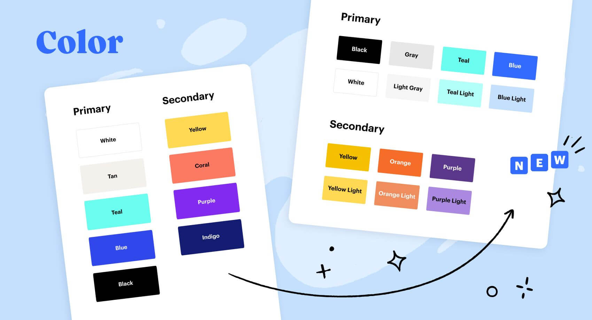

[原图：色板](references/ET04-color.jpg)。观察：右側把黑、灰、Teal、Blue 与浅色分支列为 Primary，Yellow、Orange、Purple 及浅色分支列为 Secondary。这里只记录可读标签和角色，不从压缩 JPG 采出所谓官方精确 token，也不推定其中任何颜色通过文字或状态对比度。

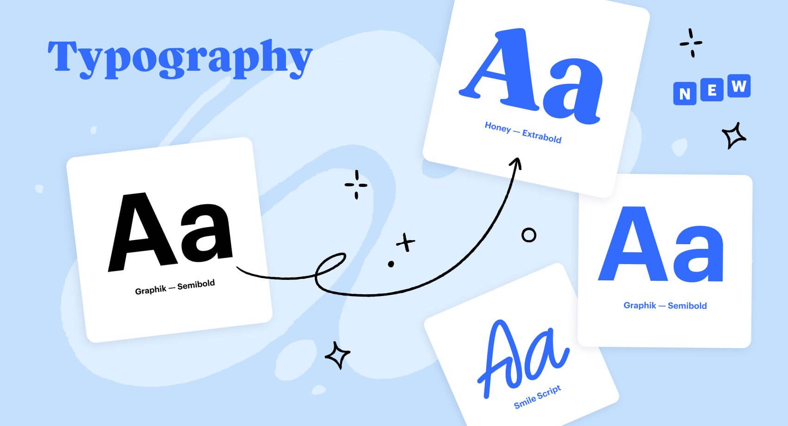

[原图：字体板](references/ET04-type.jpg)。观察：粗衬线、无衬线与手写短语的字形差异清楚；标题语气与正文阅读可以来自不同字形，而不要求所有文字手绘化。可见名称属于来源事实，字体文件与部署状态另行核验。

[原图：产品展示](references/ET04-product.jpg)。观察：右侧仍保留会话列表、内容区和浮层之间的结构，重点浮层靠视觉聚焦突出。与概念插画承担不同任务：前者解释价值，后者帮助看懂产品。源图右侧被截断，小字仅用于信息密度观察；它不是本轮运行的产品截图。

四张 1700×921 图板逐张查看，角色标签、标题及主要 UI 结构可辨。迁移研究见 [Intercom 完整案例](CASE-STUDIES.md#et04-intercom-case)。案例材料描述 2021 年的更新，不作为当前 Intercom 全套品牌规范或字体分发依据。

## 来源与使用范围

逐文件 URL、格式、尺寸和 SHA-256 见 [sources.json](sources.json)。作者文本采用摘要，图片分析与 Prompt 为本库整理；公开可访问不等于获得再分发或新品牌使用许可。对应方法仍为 provisional，跨品牌迁移尚未测试。
