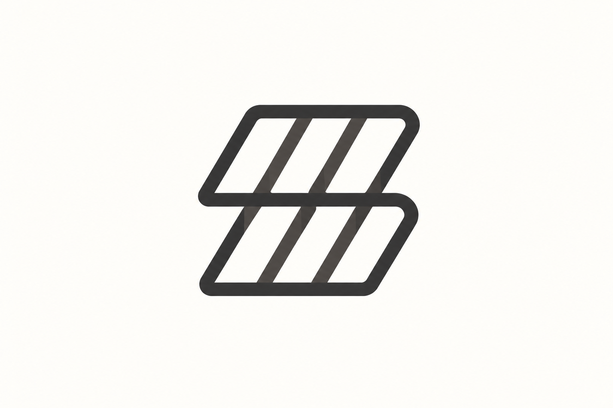
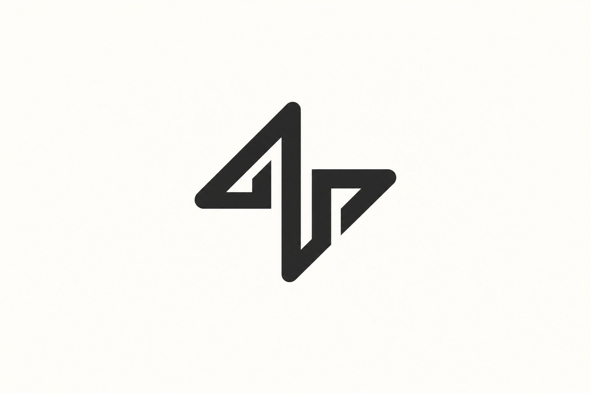
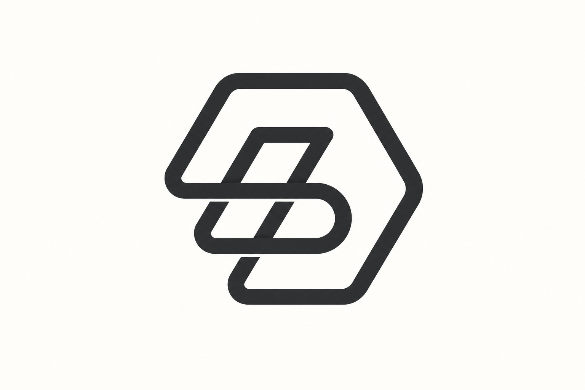

# 折带与连续路径 · 10 张 AI 研究图

本包展示 **10 张来源重新演绎**。每张均由内置 imagegen 单独生成；颜色、几何、字体与生产应用按实际用途另验。方法见 [STYLE](STYLE.md)，共同展示取向见[艺术方向](../ART-DIRECTION.md)。

来源重新演绎见 [generated.json](generated.json)，原图与事实见 [REFERENCES](REFERENCES.md) / [sources.json](sources.json)。 参考、生成与正式资产的验证范围分开，包保持 provisional。

### R01 · Corelo

**观察：** 已对照原图：外层 C、内弧和右侧上下折返点保留，交叉处有轻微明暗提示；深青色线带与暖白背景清楚，没有发光与新增部件。

**可研究的方法：** 从新字母骨架安排回绕关系，保留足够的开口和内层间隔。

[原图档案](REFERENCES.md) · [实际输入](references/R01.png) · [原尺寸](generated/R01.png)

### R02 · Play4ever

**观察：** 已对照原图：向右三角环、三处圆角和中央开口保留；浅陶土色哑光折面代替粉色发光环境，单一主体清楚。

**可研究的方法：** 以动作和环路关系建立形状，先确认是否确实需要闭合结构。

[原图档案](REFERENCES.md) · [实际输入](references/R02.png) · [原尺寸](generated/R02.png)

### R03 · My Market

**观察：** 已对照原图：两层倾斜格带与每层三个开口保留，中央共享横向连接清楚；用深灰平面显示，原发光渐隐效果被收敛，未当作精确母版。

**可研究的方法：** 研究多单元如何形成统一轮廓；减少小尺寸下互相粘连的细缝。

[原图档案](REFERENCES.md) · [实际输入](references/R03.png) · [原尺寸](generated/R03.png)

### R04 · Motor

**观察：** 已对照原图：左短、中长、右短三条斜向圆端路径及层叠分界保留；颜色统一为蓝灰青单色相，轮廓与间隙清楚。

**可研究的方法：** 用重复方向表达动势，单色版本单独检查相邻带是否还能分辨。

[原图档案](REFERENCES.md) · [实际输入](references/R04.png) · [原尺寸](generated/R04.png)

### R05 · Newation

**观察：** 已对照原图：两段相向折带共同构成 N，上下圆转角及中间斜向空隙保留；深青哑光面清楚，未把空隙连成实心条。

**可研究的方法：** 把曲折逻辑绑定新字母，检验去掉渐变后能否保留识别。

[原图档案](REFERENCES.md) · [实际输入](references/R05.png) · [原尺寸](generated/R05.png)

### R06 · Apex

**观察：** 已对照原图：左上尖峰与右下相向折返、中央竖段和两侧三角空隙保留；反白图转为暖白底黑线，轮廓清楚且无多余文字。

**可研究的方法：** 用少量转折建立首字母与方向，避免尖角在缩小后合并。

[原图档案](REFERENCES.md) · [实际输入](references/R06.png) · [原尺寸](generated/R06.png)

### R07 · WiFlag

**观察：** 已对照原图：三层波带、共有斜向接缝与左下旗杆保留，条带间留白清楚；炭灰平面关系统一，未引入实体旗帜道具。

**可研究的方法：** 从产品关系决定是否使用波动，重复线条的间隔需要随尺寸验证。

[原图档案](REFERENCES.md) · [实际输入](references/R07.png) · [原尺寸](generated/R07.png)

### R08 · Saferpay

**观察：** 已对照原图：上下宽带、外侧圆角、矩形留白与中央两处斜折保持 S 式结构；蓝灰色折面清楚，强蓝背景已简化为暖白。

**可研究的方法：** 把带状厚度与中央斜向留白一起调整，防止轮廓沦为普通方框。

[原图档案](REFERENCES.md) · [实际输入](references/R08.png) · [原尺寸](generated/R08.png)

### R09 · Beecomb

**观察：** 已对照原图：六边形外轮廓、内部斜方环、中部圆转与下方开口保留，交叉断开关系可辨；黑灰平面线带清楚，未简化为普通 B。

**可研究的方法：** 研究折线路径与字母共用边界，蜂巢含义需要来自当前业务。

[原图档案](REFERENCES.md) · [实际输入](references/R09.png) · [原尺寸](generated/R09.png)

### R10 · Northflank

**观察：** 已对照原图：两个六边形长环保持交锁与中部穿插，内孔和外轮廓清楚；蓝绿渐变收敛为深青同色相，单一图形留白充足。

**可研究的方法：** 借鉴路径间的协作关系；网格与色版是同一标志的辅助证据。

[原图档案](REFERENCES.md) · [实际输入](references/R10.png) · [原尺寸](generated/R10.png)
