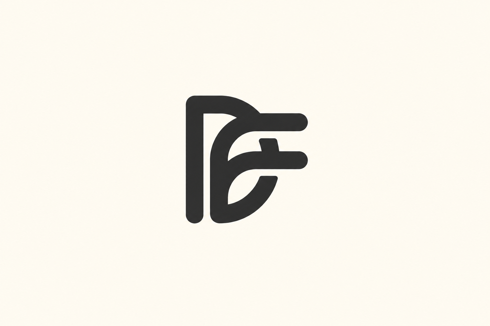
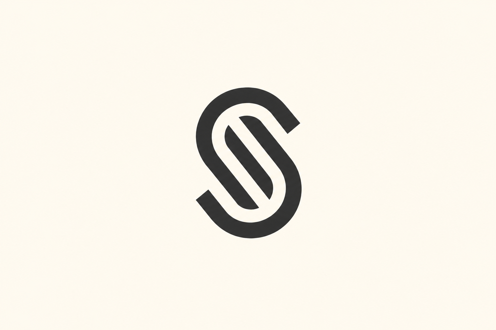
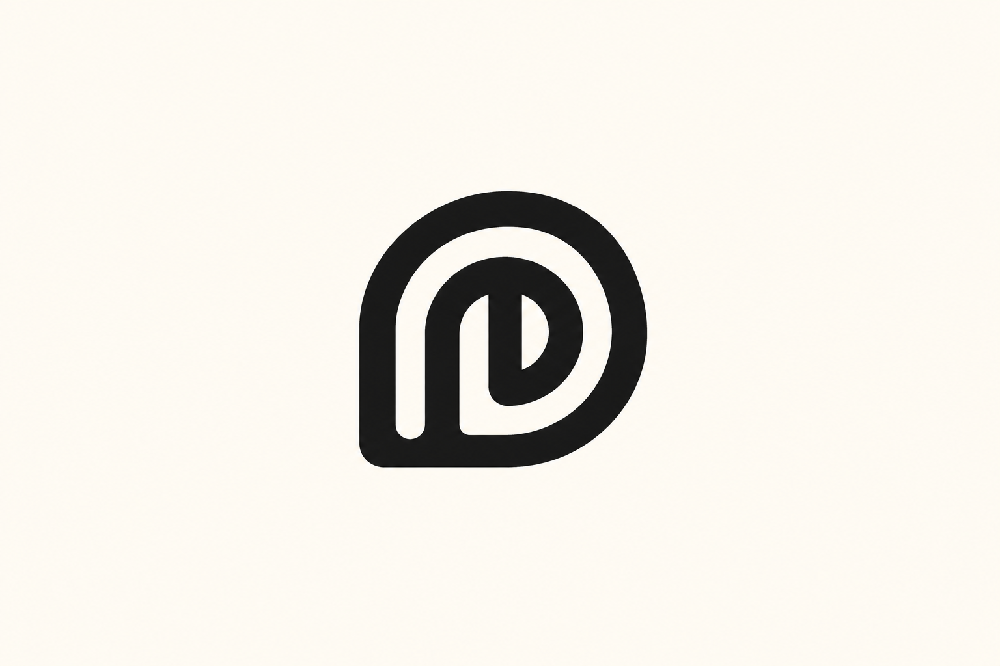
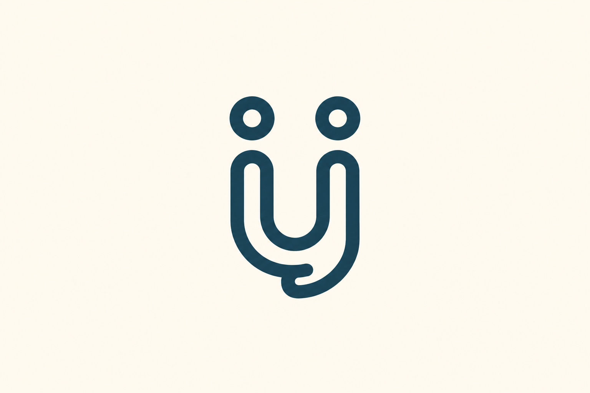
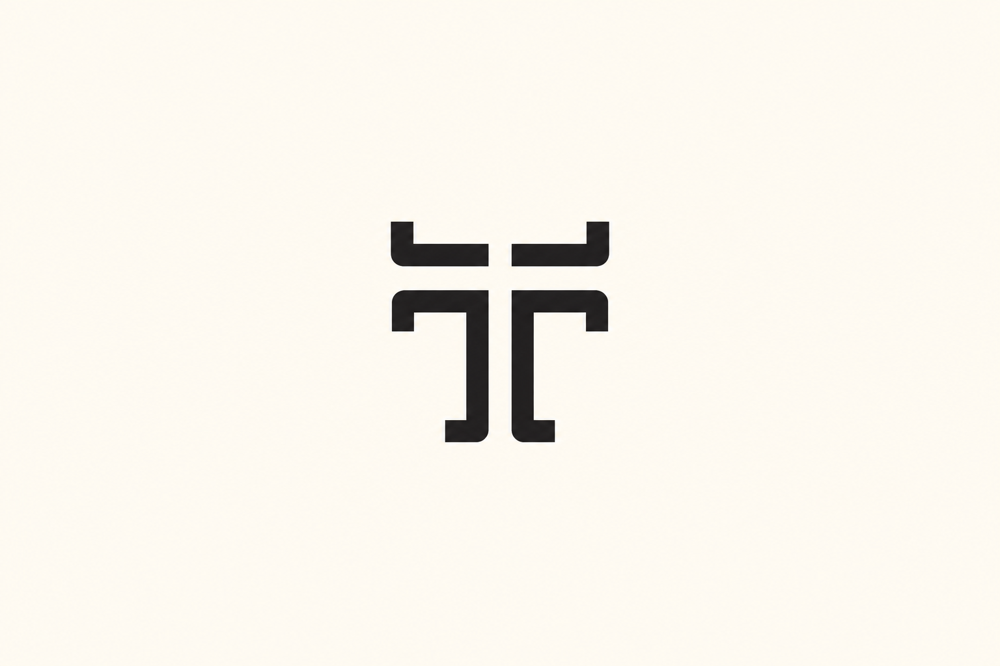
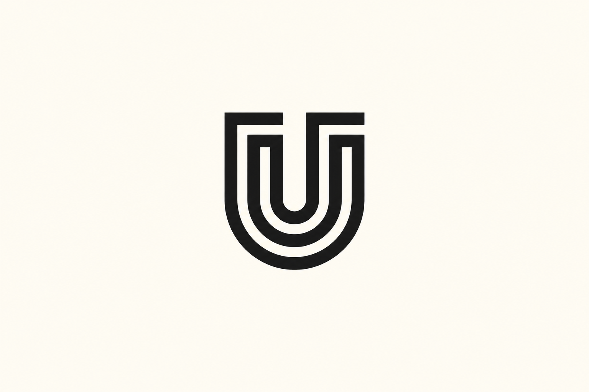
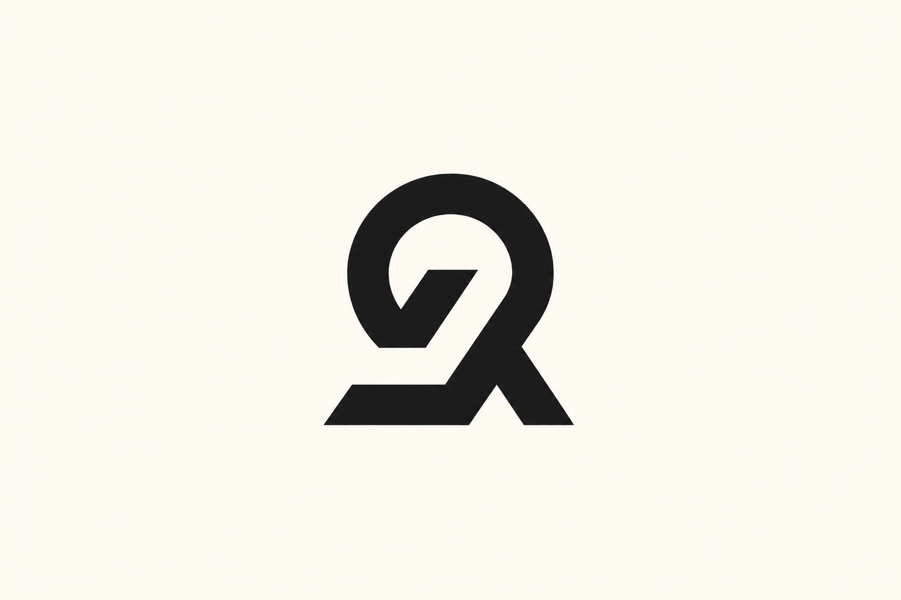
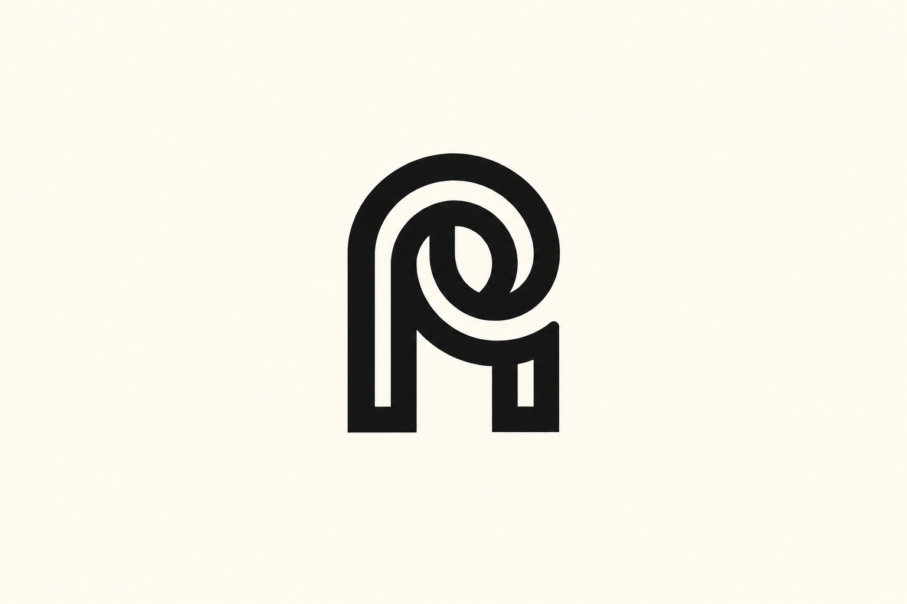
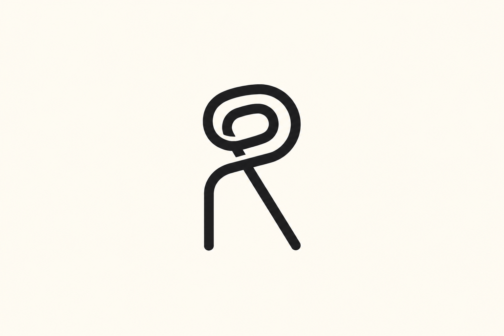

# 几何字母与组合 · 10 张 AI 研究图

本包展示 **10 张来源重新演绎**。每张均由内置 imagegen 单独生成；颜色、几何、字体与生产应用按实际用途另验。方法见 [STYLE](STYLE.md)，共同展示取向见[艺术方向](../ART-DIRECTION.md)。

来源重新演绎见 [generated.json](generated.json)，原图与事实见 [REFERENCES](REFERENCES.md) / [sources.json](sources.json)。 参考、生成与正式资产的验证范围分开，包保持 provisional。

### J01 · DF Monogram

**观察：** 共享竖向骨架、D 弧与 F 两横保留，圆头笔画清楚；单一墨色主体，暖白留白。

**可研究的方法：** 先安排主竖干和字腔，再让次字母通过短横画出现。

[原图档案](REFERENCES.md) · [实际输入](references/J01.png) · [原尺寸](generated/J01.png)

### J02 · S Monogram

**观察：** S 的平行回旋曲线与错位开口保持；从多色图板提炼为单一主形，无网格和重复色版。

**可研究的方法：** 控制开口与双轨间距；不要把盘绕关系直接搬到不兼容字母。

[原图档案](REFERENCES.md) · [实际输入](references/J02.png) · [原尺寸](generated/J02.png)

### J03 · D Monogram

**观察：** 圆弧 D 外缘和内竖线/回环结构清楚；仅保留一个成品符号，网格已移除。

**可研究的方法：** 先解决外框与内部竖画的关系，再微调曲线和空隙。

[原图档案](REFERENCES.md) · [实际输入](references/J03.png) · [原尺寸](generated/J03.png)

### J04 · Unii

**观察：** U 形双轨、两枚圆环点与下部钩形保留；暗青墨色、拟人结构清楚，单主体。

**可研究的方法：** 只有字母和品牌语义支持时加入圆点，避免无依据附加笑脸。

[原图档案](REFERENCES.md) · [实际输入](references/J04.png) · [原尺寸](generated/J04.png)

### J05 · T Monogram

**观察：** 四段分离结构和纵横白缝保留，镜像平衡；字母 T 的构造关系清楚。

**可研究的方法：** 通过短横端、折角和间隙组织对称关系，检查缩小可读性。

[原图档案](REFERENCES.md) · [实际输入](references/J05.png) · [原尺寸](generated/J05.png)

### J06 · U Monogram

**观察：** 嵌套 U 形路径、圆底和顶部横端清楚；源阴影已去除，单一黑色主形。

**可研究的方法：** 让内外 U 的间距连续，避免底部压扁或交汇。

[原图档案](REFERENCES.md) · [实际输入](references/J06.png) · [原尺寸](generated/J06.png)

### J07 · R Monogram

**观察：** 圆环、内斜切口和右下斜腿保留，抽象 R 关系清楚；网格和四种色版归为单色展示。

**可研究的方法：** 先检查 R 的环与腿关系，色版不重复算新的构思。

[原图档案](REFERENCES.md) · [实际输入](references/J07.png) · [原尺寸](generated/J07.png)

### J08 · F Monogram — fysiosportief

**观察：** 圆点头部、斜 F 主干与双横臂完整；从名片场景提炼为一个橙色平面图形，未加字样。

**可研究的方法：** 倾斜来自动作语义时再使用；正式形状需另外提供平视母版。

[原图档案](REFERENCES.md) · [实际输入](references/J08.png) · [原尺寸](generated/J08.png)

### J09 · AP Monogram

**观察：** AP 的上部圆弧交汇、中央小字腔和双竖槽保留，结构可辨；黑色平面展示。

**可研究的方法：** 明确两字母主次，优先保持字腔与连接处的分离。

[原图档案](REFERENCES.md) · [实际输入](references/J09.png) · [原尺寸](generated/J09.png)

### J10 · PR Monogram

**观察：** 上部双回环与下方竖腿、斜腿完整；细线性与圆端保留，暖白底留白充分。

**可研究的方法：** 将环与腿的接点作为细化重点，避免读成不相关数字。

[原图档案](REFERENCES.md) · [实际输入](references/J10.png) · [原尺寸](generated/J10.png)
