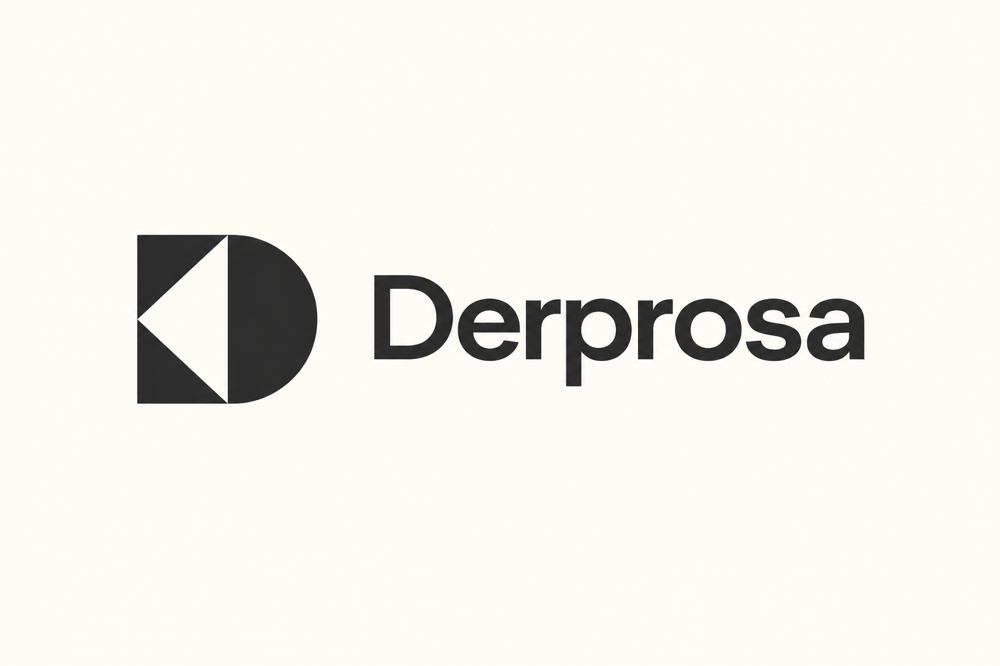
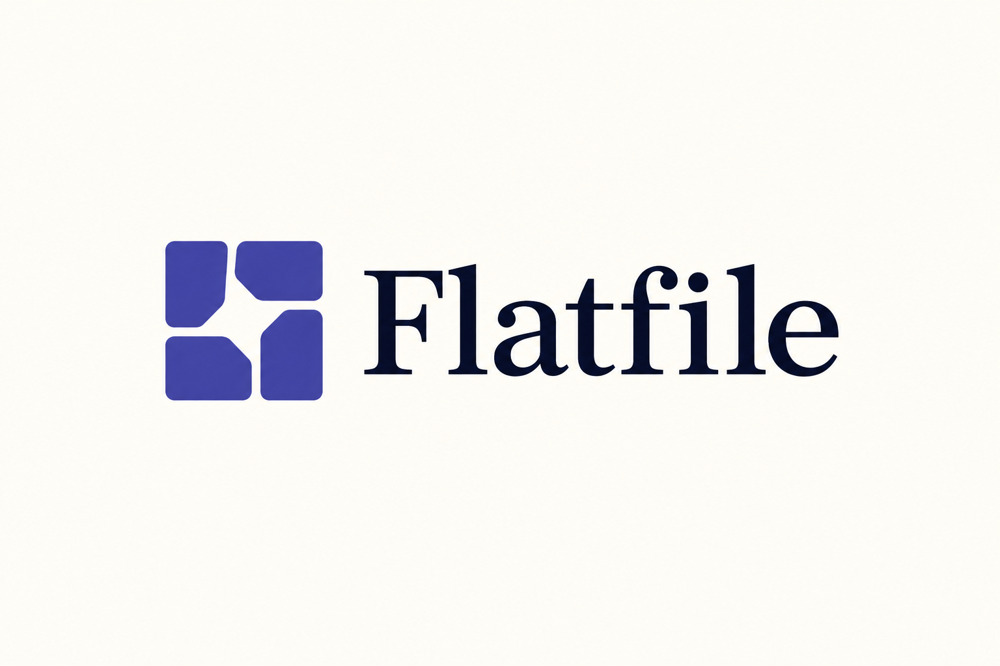

# 几何负空间 · 10 张 AI 研究图

本包展示 **10 张来源重新演绎**。每张均由内置 imagegen 单独生成；颜色、几何、字体与生产应用按实际用途另验。方法见 [STYLE](STYLE.md)，共同展示取向见[艺术方向](../ART-DIRECTION.md)。

来源重新演绎见 [generated.json](generated.json)，原图与事实见 [REFERENCES](REFERENCES.md) / [sources.json](sources.json)。 参考、生成与正式资产的验证范围分开，包保持 provisional。

### N01 · Apres

**观察：** 已逐图查看输入与输出：四块弧面和中央四角凹白保留，Apres 拼写正确；暖白底、大留白、黑色平面展示。

**可研究的方法：** 比较空白中心与外缘的节奏，改变单元形状和相接方式。

[原图档案](REFERENCES.md) · [实际输入](references/N01.png) · [原尺寸](generated/N01.png)

### N02 · Vertiv

**观察：** 已逐图查看：圆体内 V 切口和下方缺口清楚，VERTIV 拼写正确，留白与平面墨色统一。

**可研究的方法：** 研究圆与尖角的共用边界，不沿用原 V 形比例。

[原图档案](REFERENCES.md) · [实际输入](references/N02.png) · [原尺寸](generated/N02.png)

### N03 · Ternary

**观察：** 已逐图查看：大圆弧、小四分之一圆与下方方缺口关系保持；ternary 拼写正确；蓝色已收敛。

**可研究的方法：** 先决定开口如何连到外部，再调缺口宽度和弧面体量。

[原图档案](REFERENCES.md) · [实际输入](references/N03.png) · [原尺寸](generated/N03.png)

### N04 · Derprosa

**观察：** 已逐图查看：D 外形、左指三角负空间完整，Derprosa 拼写正确；无冗余装饰。

**可研究的方法：** 研究同一切口如何同时改变图形方向和内部层次。

[原图档案](REFERENCES.md) · [实际输入](references/N04.png) · [原尺寸](generated/N04.png)

### N05 · Cottage M

**观察：** 已逐图查看：斜屋顶、双竖腿、门洞和左侧独立短柱齐全，Cottage M 字样正确；竖式组合在横画布中留白充分。

**可研究的方法：** 将空间洞口与字母节奏结合；房屋解读属于观察推导。

[原图档案](REFERENCES.md) · [实际输入](references/N05.png) · [原尺寸](generated/N05.png)

### N06 · Flipboard

**观察：** 方形内 F 形白色阶梯清楚，FLIPBOARD 文字完整；红色降低饱和，黑字暖白底，留白充分。

**可研究的方法：** 用方格结构建立字母，先保证缩小后阶梯仍可区分。

[原图档案](REFERENCES.md) · [实际输入](references/N06.png) · [原尺寸](generated/N06.png)

### N07 · Enter Arkitektur

**观察：** 斜屋顶、上指白色负空间和双竖槽保留；纯符号展示，主体完整无新增文字。

**可研究的方法：** 用外形和内部空白表达相关但不同的空间层次。

[原图档案](REFERENCES.md) · [实际输入](references/N07.png) · [原尺寸](generated/N07.png)

### N08 · Flatfile

**观察：** 四块面、内斜切口和旋转中央留白可辨，Flatfile 拼写正确，蓝紫强调色与暖白底协调。

**可研究的方法：** 分别调整外角和内角，检查中央空白是否成为清晰主形。

[原图档案](REFERENCES.md) · [实际输入](references/N08.png) · [原尺寸](generated/N08.png)

### N09 · Trustly

**观察：** T 形块与右指箭头完整，Trustly 拼写正确；绿色收敛为深绿，平面清楚。

**可研究的方法：** 从品牌动作决定方向，避免照搬 T 与箭头的具体嵌合。

[原图档案](REFERENCES.md) · [实际输入](references/N09.png) · [原尺寸](generated/N09.png)

### N10 · Immuta

**观察：** 矩形和偏右白槽完整；与来源一致，图形承担 I 的读法，右侧是 MMUTA；保持组合读取而非补造独立 I。

**可研究的方法：** 比较内槽位置、开合和边框厚度，不推断原作的精确网格。

[原图档案](REFERENCES.md) · [实际输入](references/N10.png) · [原尺寸](generated/N10.png)
