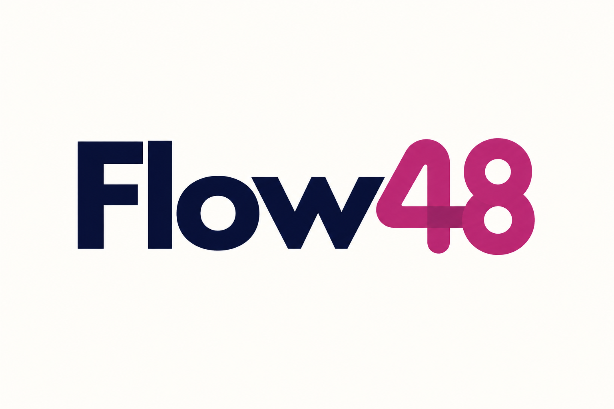
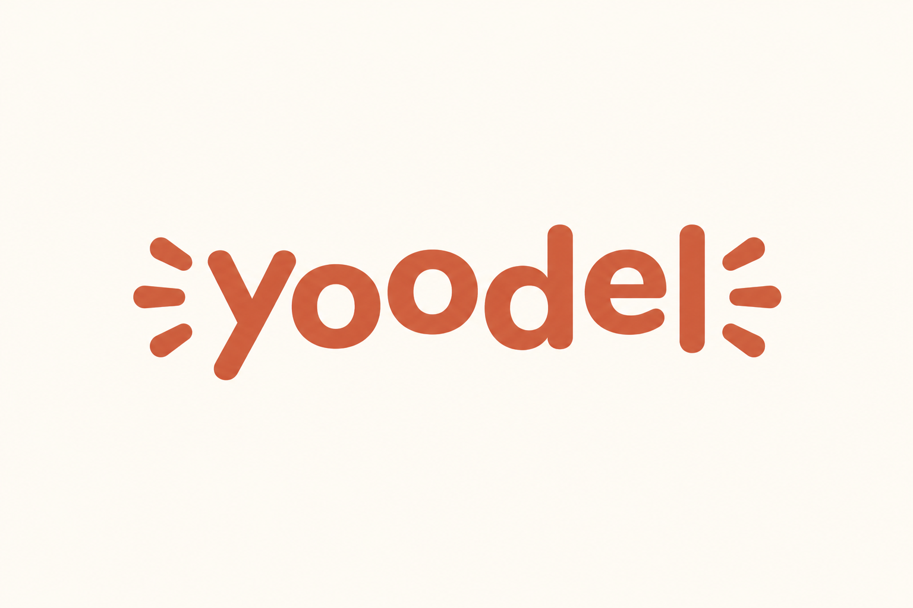
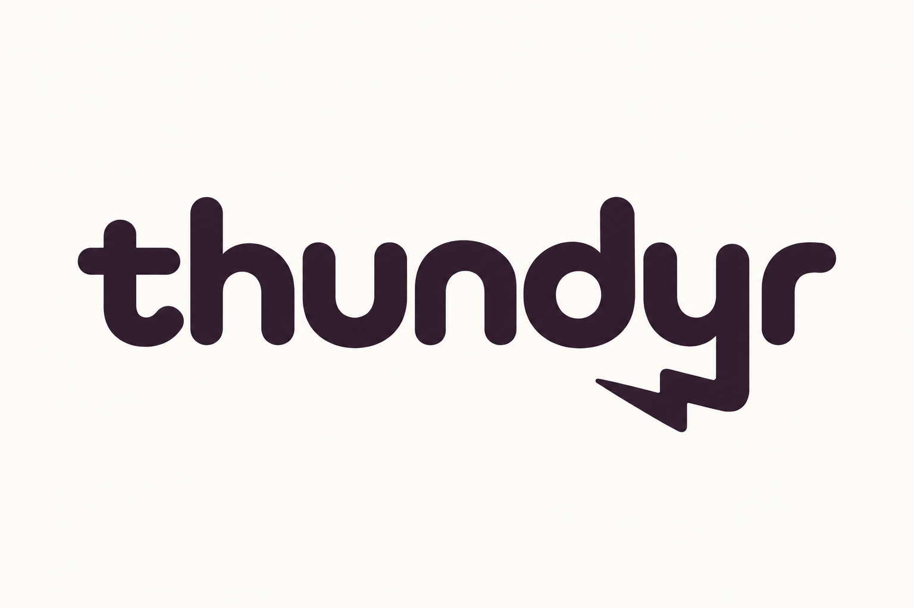
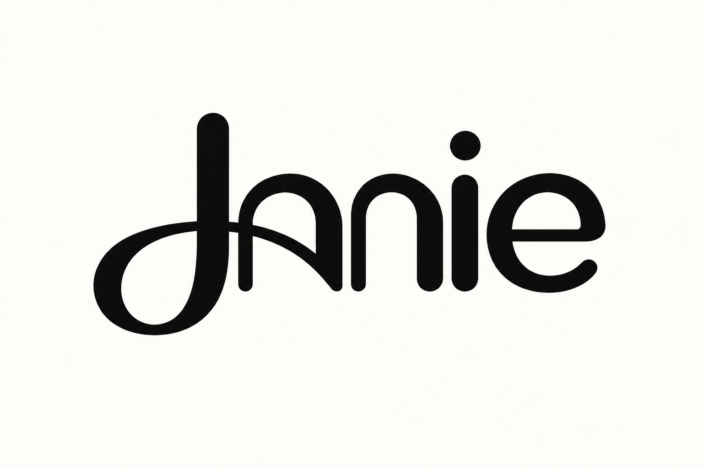
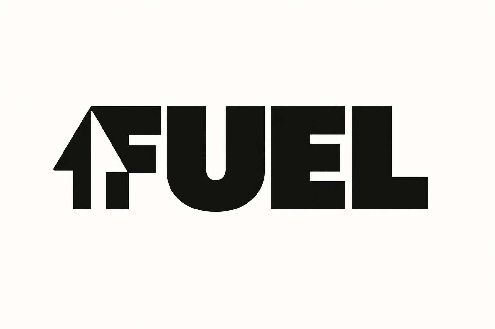
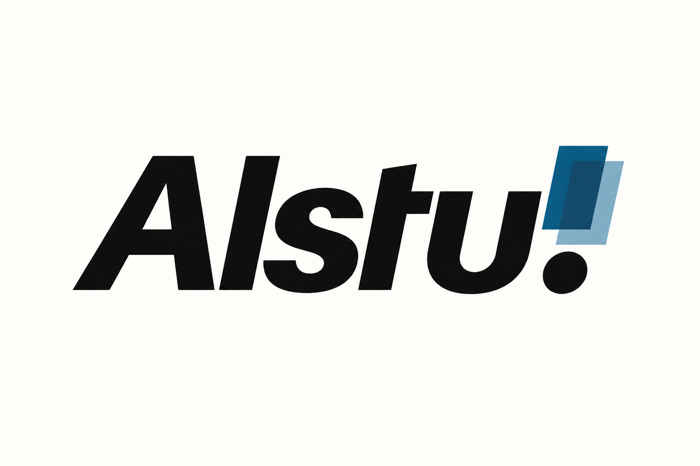
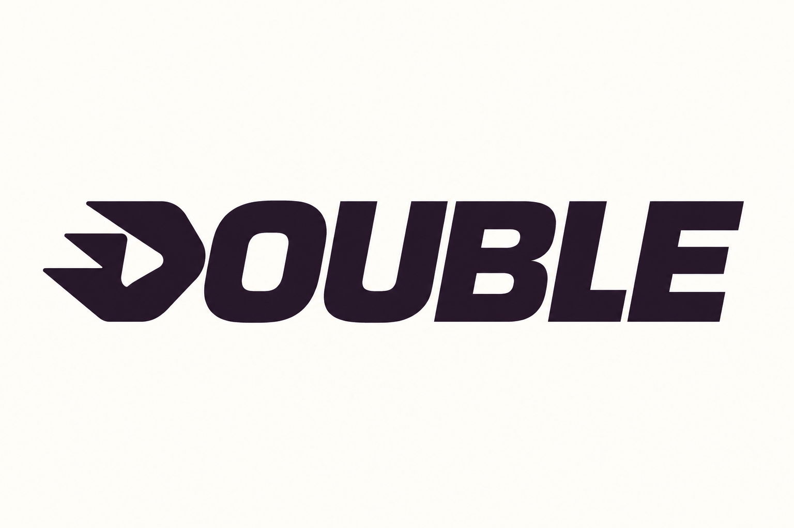

# 现代产品字标 · 10 张 AI 研究图

本包展示 **10 张来源重新演绎**。每张均由内置 imagegen 单独生成；颜色、几何、字体与生产应用按实际用途另验。方法见 [STYLE](STYLE.md)，共同展示取向见[艺术方向](../ART-DIRECTION.md)。

来源重新演绎见 [generated.json](generated.json)，原图与事实见 [REFERENCES](REFERENCES.md) / [sources.json](sources.json)。 参考、生成与正式资产的验证范围分开，包保持 provisional。

### P01 · BITO

**观察：** 已对照原图：BITO 大写完整，B 左侧上下箭头与两个内部留白、厚重 O 均可辨；深松绿替代亮绿色，粗字形和留白统一。

**可研究的方法：** 把语义集中在一个字母，其余名称保持清楚的阅读节奏。

[原图档案](REFERENCES.md) · [实际输入](references/P01.png) · [原尺寸](generated/P01.png)

### P02 · Flow48

**观察：** 已对照原图：Flow48 完整清楚，圆滑 4 与 8 的连接关系仍在；数字单独用克制莓红，主体字形与画布边缘有清楚留白。

**可研究的方法：** 对数字有业务意义的名称，比较文字与数字的层级，而非给整词平均加效果。

[原图档案](REFERENCES.md) · [实际输入](references/P02.png) · [原尺寸](generated/P02.png)

### P03 · Yoodel

**观察：** 已对照原图：yoodel 的两个 o 和圆头字形完整，两侧各三条发声短线保留；土橙配色、字形高低节奏与留白清楚。

**可研究的方法：** 以重复端点和节奏表达性格；声音含义是视觉推导，原行业未确认。

[原图档案](REFERENCES.md) · [实际输入](references/P03.png) · [原尺寸](generated/P03.png)

### P04 · thundyr

**观察：** 已对照原图：thundyr 七个字母完整，y 的下降笔画保留向左闪电折角且与 r 分开；近黑紫平面字标收敛，未增加独立装饰。

**可研究的方法：** 让一个降部承担产品含义，同时检查是否仍能正确读出 y。

[原图档案](REFERENCES.md) · [实际输入](references/P04.png) · [原尺寸](generated/P04.png)

### P05 · Janie

**观察：** 已对照原图：Janie 的大 J 环线、跨过 a 的曲线与右侧 nie 的连续关系保留；黑色平面笔画、i 点和 e 开口清楚，未增加多余花饰。

**可研究的方法：** 在局部连笔中加入亲和感，重点验证交叉处的字母分界。

[原图档案](REFERENCES.md) · [实际输入](references/P05.png) · [原尺寸](generated/P05.png)

### P06 · ClipHire

**观察：** 已对照原图：ClipHire 大小写与名称完整，Hire 下方保留独立浅斜下划线；主体改近黑，强调只留苔绿色线条，留白充足。

**可研究的方法：** 先通过大小写和间距组织复合名称，再加入独立而克制的强调线。

[原图档案](REFERENCES.md) · [实际输入](references/P06.png) · [原尺寸](generated/P06.png)

### P07 · FUEL

**观察：** 已对照原图：FUEL 四字母、粗重 U 与 F 内白色上箭头通道完整；单色大字重与暖白背景清楚，未增加额外符号。

**可研究的方法：** 用正负形增加含义时先保护 F 的阅读，箭头并非金融或科技品牌的通用要求。

[原图档案](REFERENCES.md) · [实际输入](references/P07.png) · [原尺寸](generated/P07.png)

### P08 · Rplay

**观察：** 已对照原图：Rplay 拼写完整，R 内播放三角与外部斜切保留，play 的粗字形可辨；红色收敛为砖红，平面关系清楚。

**可研究的方法：** 把核心动作融入首字母，避免每个字形重复播放符号。

[原图档案](REFERENCES.md) · [实际输入](references/P08.png) · [原尺寸](generated/P08.png)

### P09 · Alstu!

**观察：** 已对照原图：Alstu! 斜体节奏完整，感叹号仍由两片错位矩形和圆点组成；青洋红双色改为同一蓝色相，未改变关键叠置关系。

**可研究的方法：** 名称保持同一倾向，利用标点承接可控的颜色与层次变化。

[原图档案](REFERENCES.md) · [实际输入](references/P09.png) · [原尺寸](generated/P09.png)

### P10 · DOUBLE

**观察：** 已对照原图：DOUBLE 六字母顺序正确，D 的左侧三层速度尖角与播放式空白保留；近黑紫取代亮紫，圆角方孔和倾斜节奏清楚。

**可研究的方法：** 统一笔画倾向与孔洞，再决定一个方向切口是否能增加识别。

[原图档案](REFERENCES.md) · [实际输入](references/P10.png) · [原尺寸](generated/P10.png)
