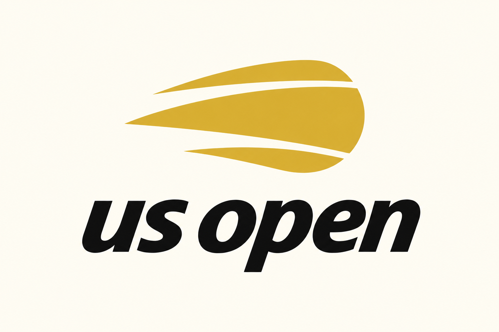
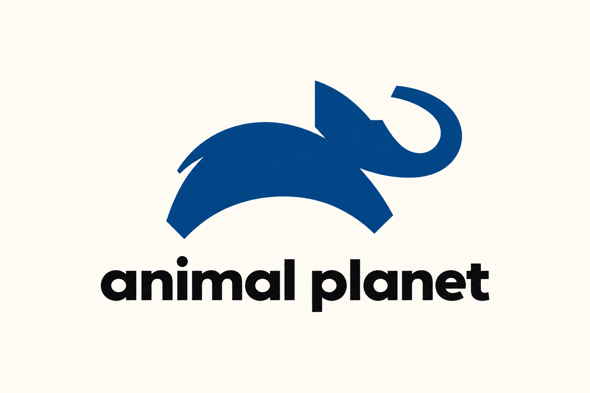
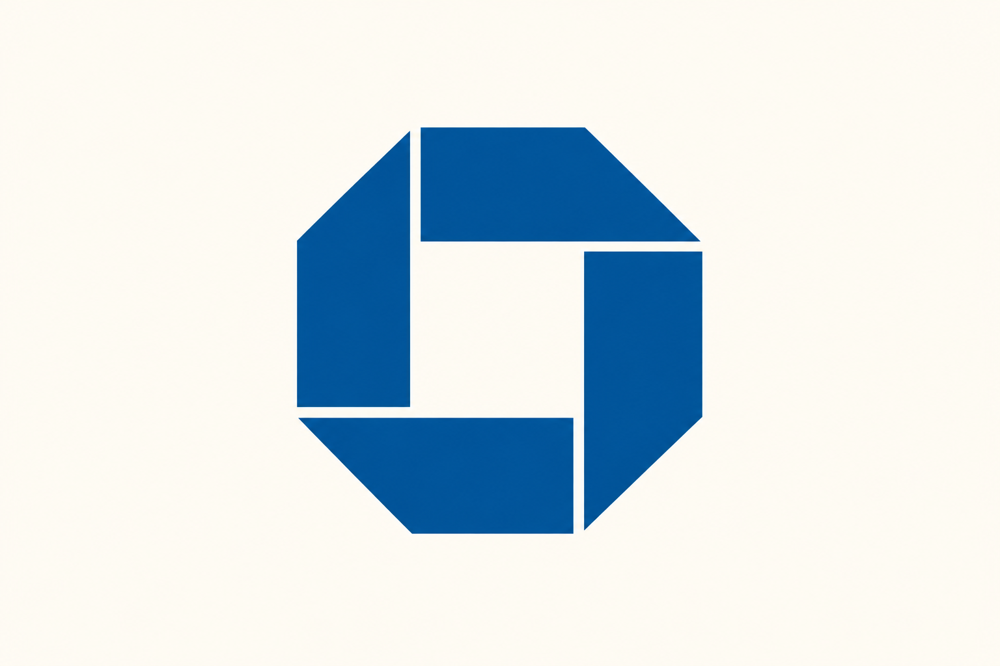
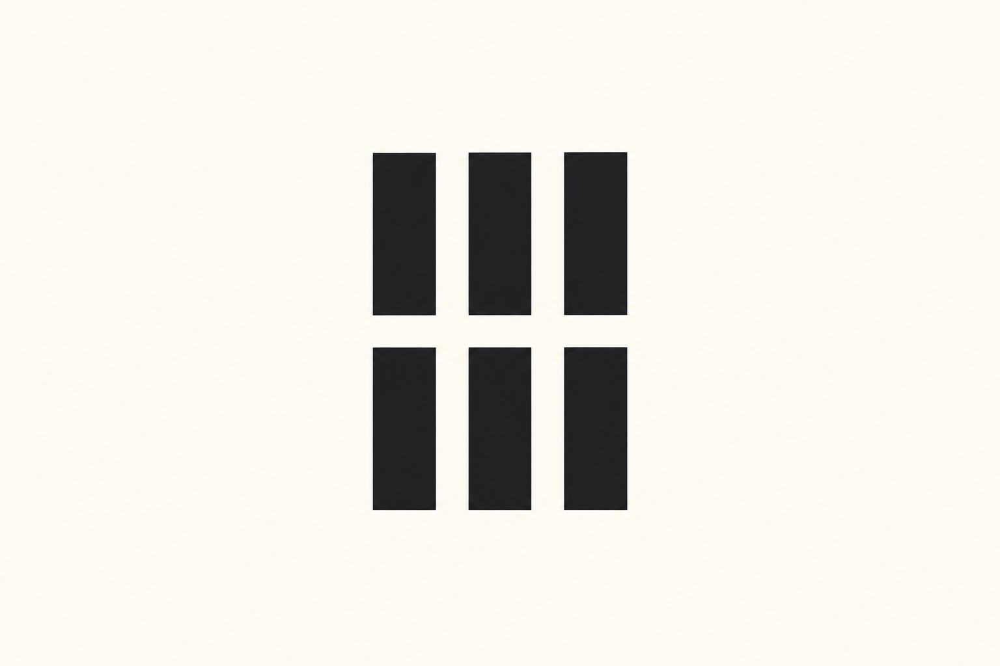
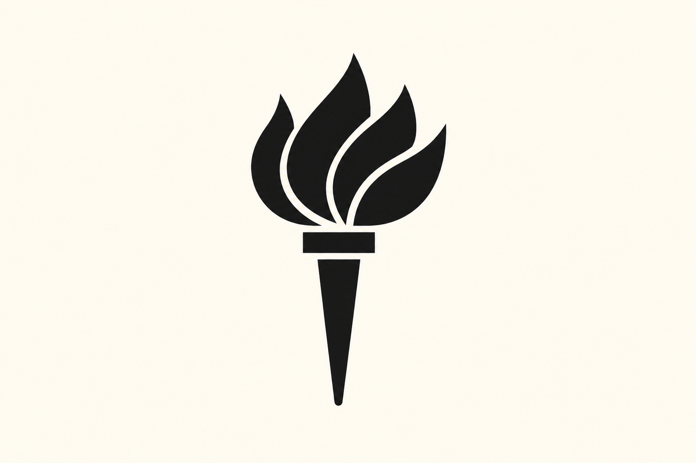
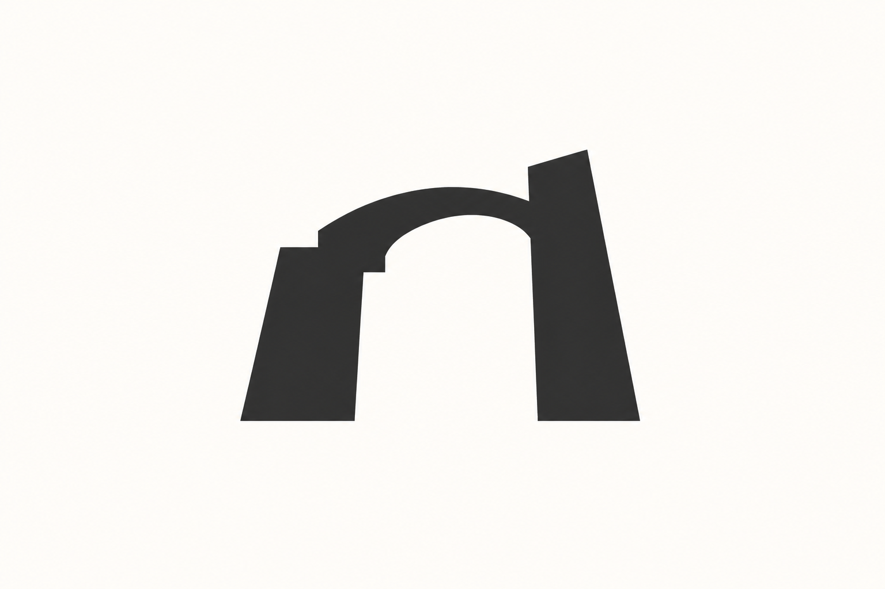

# 现代主义企业符号 · 10 张 AI 研究图

本包展示 **7 张来源重新演绎、3 张独立原创研究**。每张均由内置 imagegen 单独生成；颜色、几何、字体与生产应用按实际用途另验。方法见 [STYLE](STYLE.md)，共同展示取向见[艺术方向](../ART-DIRECTION.md)。

来源重新演绎见 [generated.json](generated.json)，原图与事实见 [REFERENCES](REFERENCES.md) / [sources.json](sources.json)。独立原创的简报、构思、实际 Prompt 与目检见 [originals.json](originals.json)；这些是本库提出的新研究主题，没有第三方原作或官方采用事实。 参考、生成与正式资产的验证范围分开，包保持 provisional。

## 来源重新演绎

保留源样本 ID；这些图不是原作者作品或官方改版。

### C01 · U.S. Open

**观察：** 三条左向带形、圆右缘和两道白色切口完整；us open 拼写正确且斜体动势保持，黄蓝原配色改暖白赭黄。

**可研究的方法：** 以品牌动作压缩成少量动势线，不借用现有运动赛事轮廓。

[原图档案](REFERENCES.md) · [实际输入](references/C01.png) · [原尺寸](generated/C01.png)

### C04 · Animal Planet

**观察：** 跳跃象侧影、耳、尾部切口与卷鼻清楚；animal planet 拼写正确，蓝黑暖白层次克制。

**可研究的方法：** 用姿态差异表达品牌气质；不能把通用动物轮廓视为足够独特。

[原图档案](REFERENCES.md) · [实际输入](references/C04.png) · [原尺寸](generated/C04.png)

### C05 · Chase Bank

**观察：** 四片折面、八边外缘与方形中央留白保持，细缝清楚；深蓝单形，轮廓完整。

**可研究的方法：** 用模块的方向与中间空间建立整体，保持组装逻辑清楚。

[原图档案](REFERENCES.md) · [实际输入](references/C05.png) · [原尺寸](generated/C05.png)

### C06 · Harvard University Press

**观察：** 两行三列共六个竖块完整，横向中缝和列距清楚；改为黑色暖白展示，秩序保留。

**可研究的方法：** 用最少模块组织字母或机构概念，控制间隙和整体宽高。

[原图档案](REFERENCES.md) · [实际输入](references/C06.png) · [原尺寸](generated/C06.png)

### C07 · National Aquarium in Baltimore

**观察：** 圆形边界、七枚鱼形眼点和斜向波浪留白保留，深蓝克制，连续正负形节奏可辨。

**可研究的方法：** 让重复与裁切共同表达群体或环境，检查边缘残缺是否有秩序。

[原图档案](REFERENCES.md) · [实际输入](references/C07.png) · [原尺寸](generated/C07.png)

### C09 · Smithsonian Institution

**观察：** 圆形外缘及直尖、曲尖交替太阳完整；单色赭黄盘与暖白太阳关系清楚，原双色转为克制正负形。

**可研究的方法：** 用轮廓节奏表达能量，选择适合品牌的单元与重复方式。

[原图档案](REFERENCES.md) · [实际输入](references/C09.png) · [原尺寸](generated/C09.png)

### C10 · New York University

**观察：** 四片焰形、横托和细长锥形手柄完整；去紫色底块后仍保持火炬读法，黑白轮廓清楚。

**可研究的方法：** 将对象压缩为必要部件，明确容器与图形是否需要同时存在。

[原图档案](REFERENCES.md) · [实际输入](references/C10.png) · [原尺寸](generated/C10.png)

## 独立原创研究

每个 ID 对应一个不同的产品问题与构思，由文字简报生成，不绑定第三方样本。这里的“原创”说明构思与生成来源，不等于商标检索、独创性法律判断或正式品牌验收。

### MC-O01 · 汇入拱门

**简报：** 为虚构基础设施协作平台研究多个入口汇向共同空间的独立符号。

**方法：** 以两块不对称实形与中央拱形负空间形成紧凑而稳定的识别。

**目检：** 粗拱、左右不等高立柱与台阶状肩部形成清楚负空间，整体单色、留白充足；两端重心不对称但稳定。仅为新概念位图，不声称几何可编辑或商标独创性已核验。

[原尺寸](generated/MC-O01.png) · [实际 Prompt 与记录](originals.json)

### MC-O02 · 连续刻口

**简报：** 为虚构开发版本平台研究连续推进但保留可回溯节点的符号。

**方法：** 用三个错位的水平实体与一条纵向负空间刻口组织连续节奏。

**目检：** 三条错位实体以相同纵向切口定位，横向间隙和底部未切断部分可辨。没有字样或多余装饰；输出端部圆角不完全一致，正式母版需后续统一几何。

[原尺寸](generated/MC-O02.png) · [实际 Prompt 与记录](originals.json)

### MC-O03 · 偏心容纳

**简报：** 为虚构隐私计算平台研究外部边界保护内部开放空间的标志概念。

**方法：** 用偏心留白与单侧开口表达容纳关系，区别于盾牌和锁的直接图示。

**目检：** 偏心椭圆留白与右侧开口组成包容关系，底边略平、上下墨量不同，单色轮廓清楚。可能被读为字母e，作为概念研究记录这一联想；未进行识别测试或商标检索。

[原尺寸](generated/MC-O03.png) · [实际 Prompt 与记录](originals.json)

## 来源重绘的未生成记录

下列原图形仍未生成；独立原创研究采用其他新构思，不覆盖这些状态，也不计作同一主体的完成结果。

### C02 · NBC

**未生成：** 原图形再演绎与内容不同的纯字形研究均被内置工具输出审核拒绝（moderation_blocked，category other）；没有生成输出。

[原图档案](REFERENCES.md) · [实际尝试记录](generated.json)

### C03 · National Geographic

**未生成：** 原图形再演绎与内容不同的纯字形研究均被内置工具输出审核拒绝（moderation_blocked，category other）；没有生成输出。

[原图档案](REFERENCES.md) · [实际尝试记录](generated.json)

### C08 · PBS

**未生成：** 原图形再演绎与内容不同的纯字形研究均被内置工具输出审核拒绝（moderation_blocked，category other）；没有生成输出。

[原图档案](REFERENCES.md) · [实际尝试记录](generated.json)
