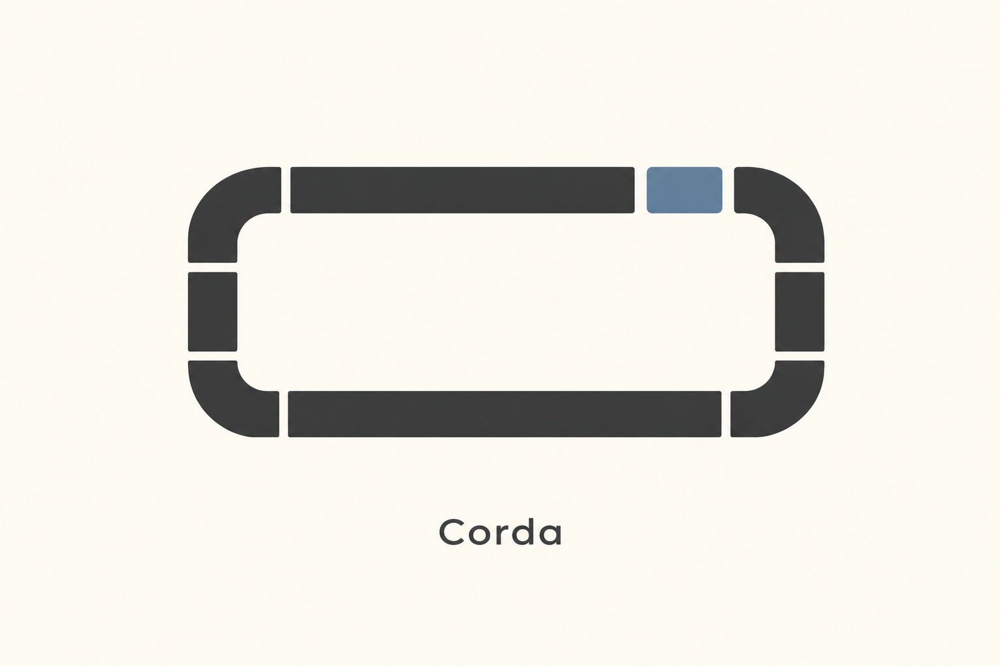
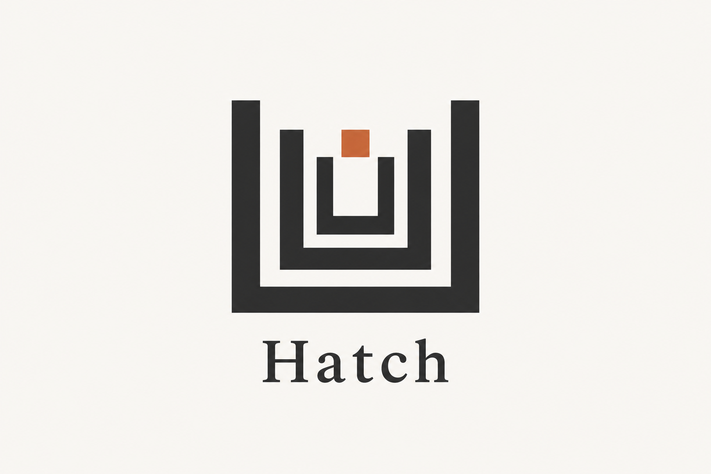
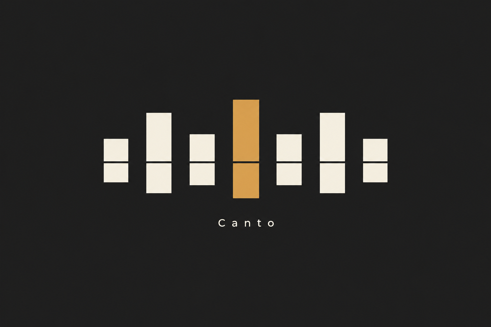
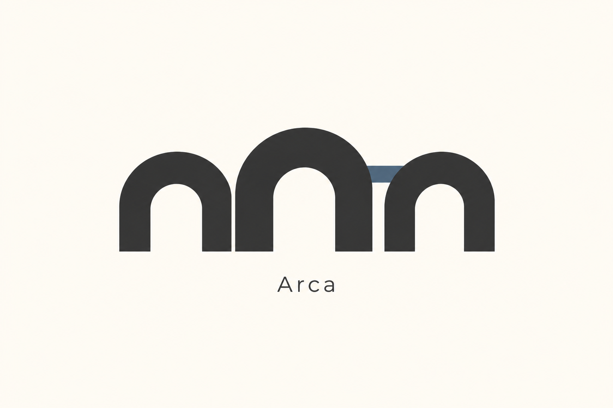
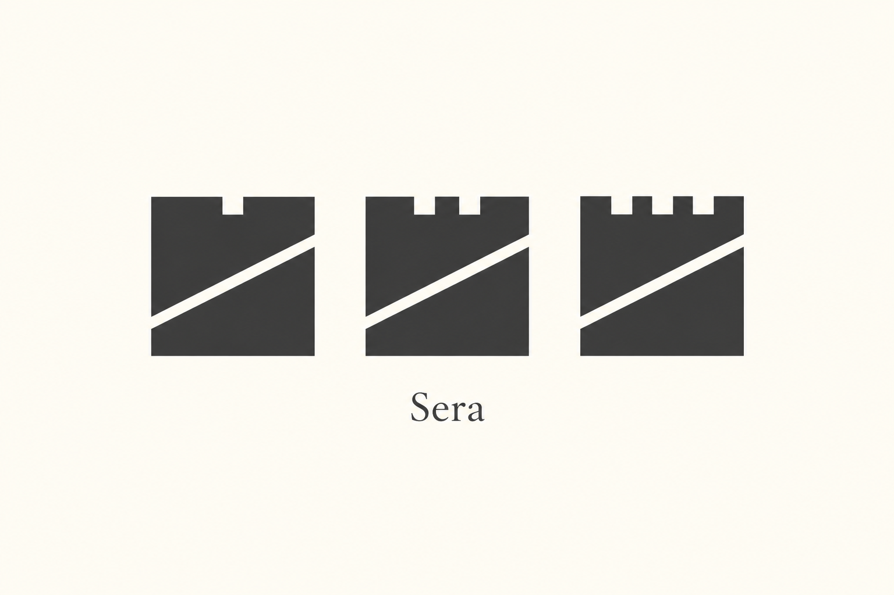
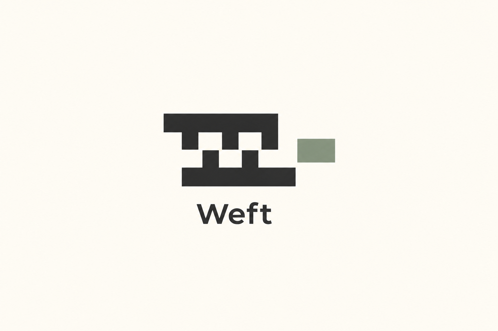

# 可组合与可变识别 · 10 张 AI 研究图

本包展示 **2 张来源重新演绎、8 张独立原创研究**。每张均由内置 imagegen 单独生成；颜色、几何、字体与生产应用按实际用途另验。方法见 [STYLE](STYLE.md)，共同展示取向见[艺术方向](../ART-DIRECTION.md)。

来源重新演绎见 [generated.json](generated.json)，原图与事实见 [REFERENCES](REFERENCES.md) / [sources.json](sources.json)。独立原创的简报、构思、实际 Prompt 与目检见 [originals.json](originals.json)；这些是本库提出的新研究主题，没有第三方原作或官方采用事实。 参考、生成与正式资产的验证范围分开，包保持 provisional。

## 来源重新演绎

保留源样本 ID；这些图不是原作者作品或官方改版。

### MR01 · Cohere

**观察：** 两行五块模块、Welcome/to/NLP/Now 和箭头均清楚，宽窄和切边保持模块语法；去除原高光体块。字面有轻微明暗，不当作实际字体文件。

**可研究的方法：** 从自有品牌的产品关系定义容器与辅助图形的变化语法，分别维护固定 Logo 和可变传播组合；不迁移三形符号、原字形或专用生成算法。

[原图档案](REFERENCES.md) · [实际输入](references/MR01-cells.jpg) · [原尺寸](generated/MR01.png)

### MR02 · Slack

**观察：** 圆头条与圆角水滴同高度扩展，slack 字样正确，左侧图形与右侧留白清楚。实际模块约三十个，多于prompt建议数量，但单列条带、两色和大留白保持克制；不是原四色官方资产。

**可研究的方法：** 把自有图形的有限部件用于辅助传播，标准 Logo 保持固定；单独检查小识别与大版面，不照搬四向结构、四色组合或用装饰模块替代功能图标。

[原图档案](REFERENCES.md) · [实际输入](references/MR02-application.jpg) · [原尺寸](generated/MR02.png)

## 独立原创研究

每个 ID 对应一个不同的产品问题与构思，由文字简报生成，不绑定第三方样本。这里的“原创”说明构思与生成来源，不等于商标检索、独创性法律判断或正式品牌验收。

### MR-O01 · Tavo · 证据索引

**简报：** 虚构 AI 研究工具 Tavo 需要把长短证据片段组织为可追溯结论，并保持摘要与资料卡同属一个品牌。

**方法：** 以统一折角与等宽分隔定义文档单元，改变卡片宽高并保留附属引文方块。

**目检：** 通过 view_image 逐张查看：三张不同宽高的深色折角卡片共用底线，Tavo 拼写准确，中央卡片下方两个引文方块清楚；轮廓语法一致，暖白留白与单个陶土强调块保持克制。

[原尺寸](generated/MR-O01.png) · [实际 Prompt 与记录](originals.json)

### MR-O02 · Corda · 计算时隙

**简报：** 虚构云计算调度工具 Corda 需要让不同长度的计算任务与共享时隙形成同一套可扩展识别。

**方法：** 以等宽直段与圆角接头拼成调度回路，让独立强调块占据一个标准时隙。

**目检：** 通过 view_image 逐张查看：直段与四个圆角接头构成单一矩形回路，连接处有清楚间隙，蓝色独立块嵌入顶部时隙；Corda 拼写准确，图形与字标分工清楚。

[原尺寸](generated/MR-O02.png) · [实际 Prompt 与记录](originals.json)

### MR-O03 · Hatch · 权限门框

**简报：** 虚构开发者权限平台 Hatch 需要以共同识别覆盖个人密钥、团队边界与组织级访问范围。

**方法：** 使用共用直角轮廓的三组 U 形门框，以开口尺度和层级间距表达不同访问范围。

**目检：** 通过 view_image 逐张查看：三层开口向上的 U 形门框嵌套，中心钥匙方块独立悬置，Hatch 拼写准确；深浅图底和层间留白清楚，内外框厚随层级有变化，作为静态构思研究使用。

[原尺寸](generated/MR-O03.png) · [实际 Prompt 与记录](originals.json)

### MR-O04 · Canto · 语音片段

**简报：** 虚构语音转写与配音平台 Canto 需要让短音节、长句和多说话人内容保持同一家族识别。

**方法：** 以带中央横向切口的竖条作为语音单元，按长短节奏成组排列并保留共同切口基线。

**目检：** 通过 view_image 逐张查看：七个方端竖条在共同横轴处断开，长短节奏左右平衡，中央赭色单元保留相同断口；Canto 文字准确可读，深底留白充足。

[原尺寸](generated/MR-O04.png) · [实际 Prompt 与记录](originals.json)

### MR-O05 · Arca · 数据桥跨

**简报：** 虚构数据连接平台 Arca 需要把不同来源和宽度的数据通道纳入共同的连接服务识别。

**方法：** 用直柱与半圆拱顶组成不同尺度的桥跨，保留接点间隙并以横向连接片扩展模块家族。

**目检：** 通过 view_image 逐张查看：三个深色拱形单元形成小、大、小的节奏，底线统一，拱内负空间完整；中右两拱之间的蓝色连接片可辨，Arca 文字准确，未加入场景装饰。

[原尺寸](generated/MR-O05.png) · [实际 Prompt 与记录](originals.json)

### MR-O06 · Sera · 评测切片

**简报：** 虚构 AI 评测平台 Sera 需要区分模型、数据与评审三个产品分支，同时维持同一套母品牌结构。

**方法：** 以同一方形切片和对角缝隙为骨架，通过一、二、三个边缘缺口区分家族成员。

**目检：** 通过 view_image 逐张查看：三张相同方形切片共用斜向白缝，顶部缺口分别为一、二、三个，形状本身可区分家族；Sera 拼写准确，整体单色且留白清楚。

[原尺寸](generated/MR-O06.png) · [实际 Prompt 与记录](originals.json)

### MR-O07 · Weft · 自动化咬合

**简报：** 虚构自动化编排工具 Weft 需要让输入适配器与执行步骤具有同族关系，并清楚表现可连接与待连接。

**方法：** 将等距齿梳模块相向排列，以同宽齿距和一处尚未咬合的任务块表达扩展接口。

**目检：** 通过 view_image 逐张查看：上三齿、下两齿的两条梳形骨架相向错位，负空间清楚且右侧保持可接入口；外侧鼠尾草色任务块独立，Weft 拼写准确，未形成复杂电路或装饰纹样。

[原尺寸](generated/MR-O07.png) · [实际 Prompt 与记录](originals.json)

### MR-O08 · Nodi · 边缘节点簇

**简报：** 虚构边缘 AI 设备管理平台 Nodi 需要在单设备与多区域设备簇之间保持共同身份，同时允许节点按需加入。

**方法：** 以留有同向接入口的六边形框为节点单元，沿六十度网格形成非对称可增长簇。

**目检：** 通过 view_image 逐张查看：五个浅色开口六边形组成非对称上升簇，右上开口方向一致，右侧陶土色菱形与主体分离；Nodi 拼写准确，节点框间仍有深色间隙，构思清楚。

[原尺寸](generated/MR-O08.png) · [实际 Prompt 与记录](originals.json)
