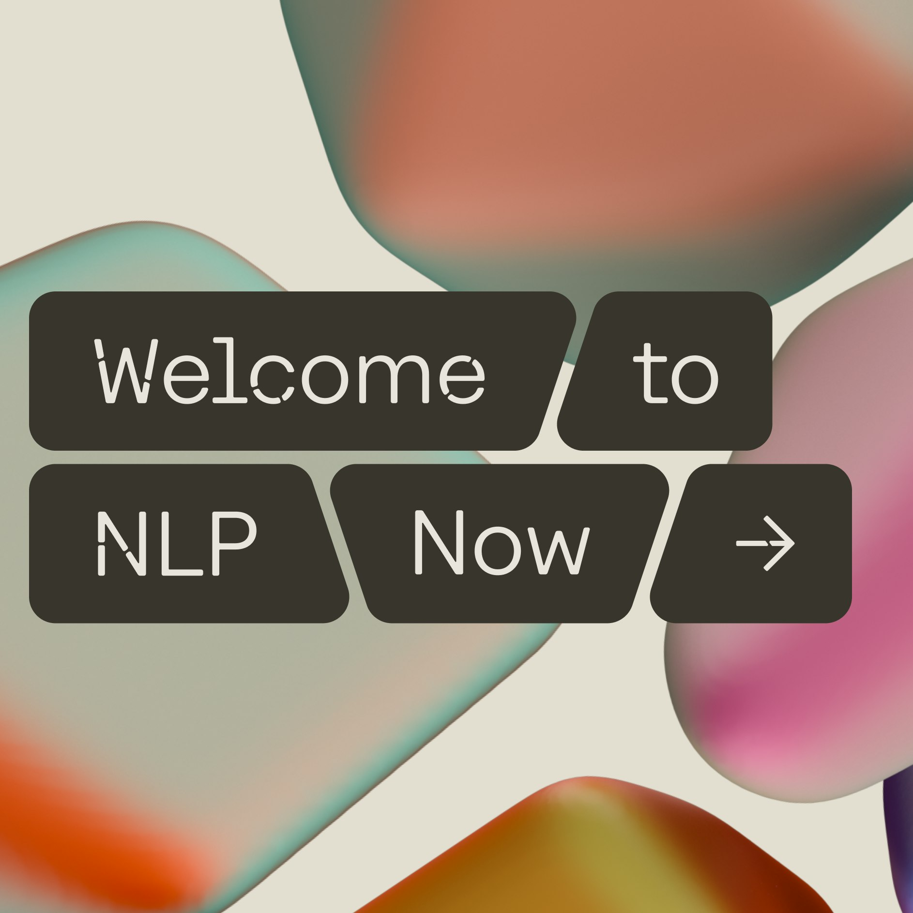
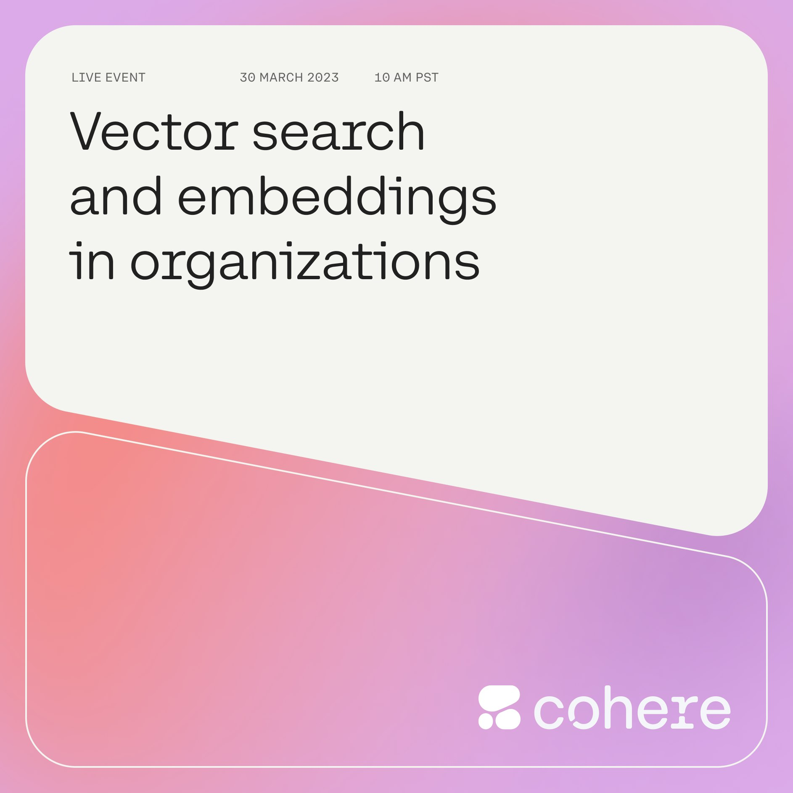
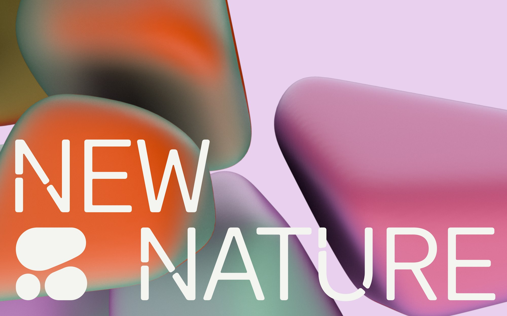
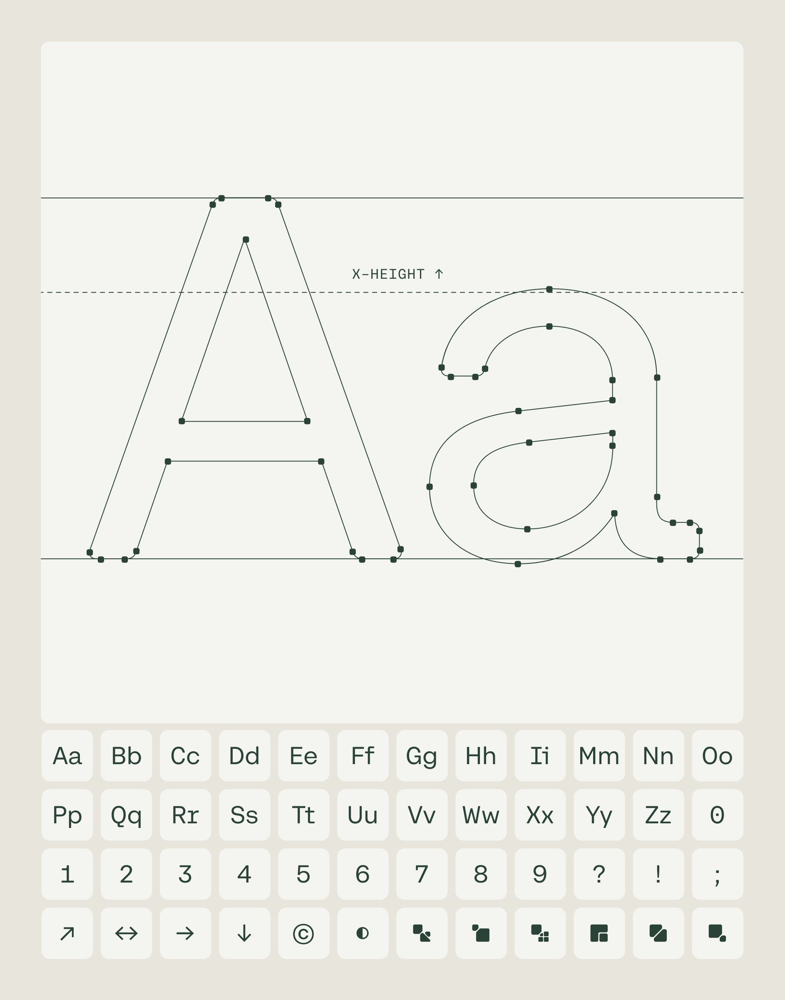
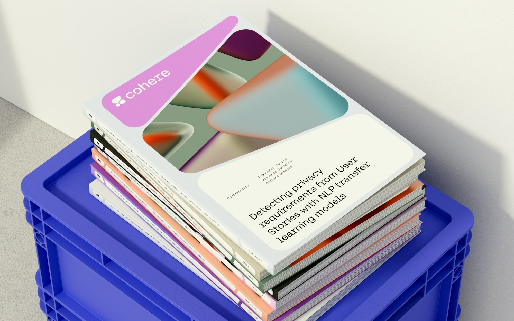
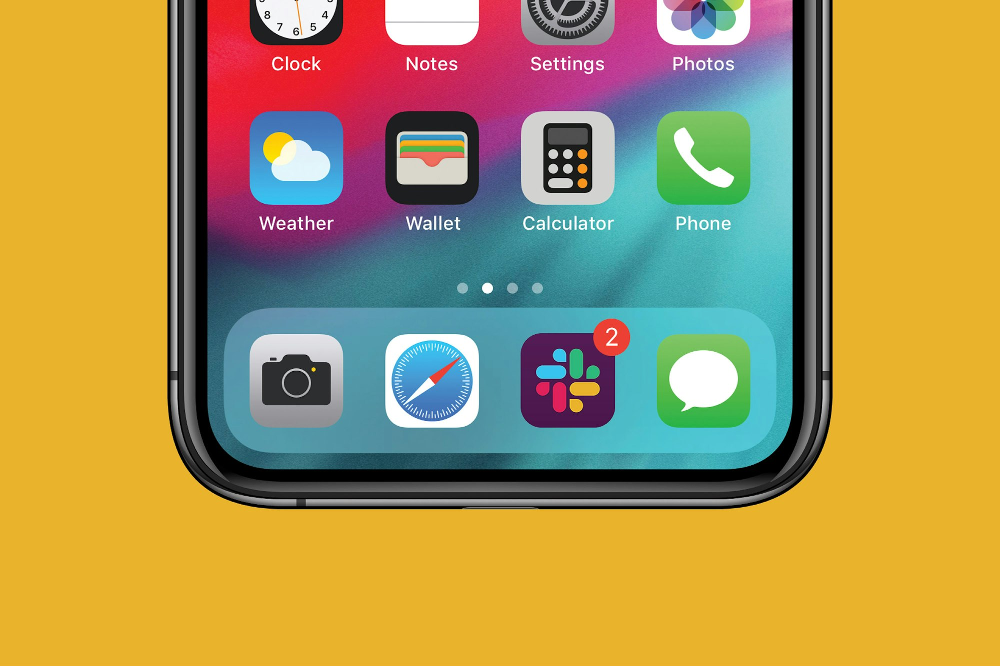
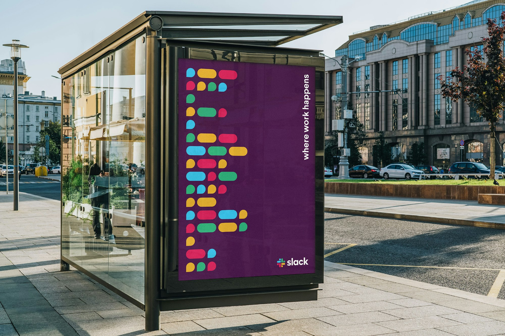

# 可组合与可变识别 · 逐例参考

本页是第三方来源档案。当前统一展示使用[逐例 AI 重新演绎](EXAMPLES.md)；这里保留原图、来源事实与观察，不把生成变化归给原作者。

**MR01 Cohere、MR02 Slack：2 个独立项目，7 张静态图。** 图中的不同应用、尺寸和材料不增加独立项目数。全部图片为公开案例页面引用资源的原采集字节，直接作为预览；未做 AI 清晰化。

“来源”记作者明确披露的信息；“观察”只描述实际看到的图片；“迁移建议”为本库推导。原作的精确参数、专用工具和未查看的视频不作为已取得能力。

## MR01 · Cohere / Pentagram

来源：[Pentagram 官方 Cohere 案例](https://www.pentagram.com/work/cohere)。归属为 Pentagram 团队，页面列合作伙伴 Jody Hudson-Powell、Luke Powell。来源将细胞和 Voronoi 作为构思依据，并说明其专用字体、工具与平台视觉工作；这些专用资产没有随本包取得。

[原采集图：单词容器](references/MR01-cells.jpg)。观察：每个词及箭头占有自己的深色容器，宽度随内容不同；背景体块与前景信息分离。标题有局部切口，但本包不从此图重建原字形或切口分布算法。

[原采集图：活动图](references/MR01-pattern.jpg)。观察：主标题位于大面积浅色框，日期等元数据在上方，底部品牌组合处于另一个边界区。该图支持信息容器跨内容变化，不证明按钮也需要同样轮廓。

[原采集图：传播主图](references/MR01-identity.jpg)。观察：固定浅色符号与切口大字叠在体块背景上；体块可变化，完整识别仍有明确位置。渐变边界本身柔和，不误判为需要锐化的模糊。

[原采集图：字体板](references/MR01-type.jpg)。观察：大字轮廓、节点展示及下方字形/符号序列可辨。来源说明专用字体有多种角色；没有字体二进制、授权或中文实测，不能把图中的字形清单当作覆盖验证。

[原采集图：报告封面](references/MR01-application.jpg)。观察：封面把品牌名、图形和报告标题分区；堆叠的色彩与图形变化仍受共同框架组织。图为案例中的应用展示，印刷落地未核实。

迁移建议：AI 平台与多产品 SaaS 可从自身的输入、对象和协作关系建立容器语法，再将其用于不同内容。核心标志、辅助容器和背景表现分别维护。不要把“细胞/Voronoi/三块”固化为科技品牌要求，也不要将专用字体切口直接移植到正文。

清晰度：逐张查看单词与活动图的边界、文字和间隔，传播图的固定符号、字体板大字轮廓及报告封面主标题均可辨；报告背脊等微小字不用于精确测量。直接展示原图。

## MR02 · Slack / Pentagram 与内部团队

来源：[Pentagram 官方 Slack 案例](https://www.pentagram.com/work/slack)。页面列 Michael Bierut 及项目团队 Britt Cobb、Daisy Lee、Abby Matousek，并说明与 Slack 内部设计和品牌团队合作。来源将基础图形描述为气泡与圆端条；本包未核实该历史展示图是否仍是当前品牌规范。

[原采集图：图标应用](references/MR02-scale.jpg)。观察：四向彩色组合在紧凑图标内保持完整，颜色背景与周围系统图标不同。图片是案例的设备展示，不是本轮对手机平台适配的测试。

[原采集图：广告应用](references/MR02-application.jpg)。观察：圆端条与气泡状色块被拆成排列，完整品牌组合保留在右下角。来源明确将其称为潜在广告设计，不能写成“已投放广告”。

迁移建议：协作平台可让自有符号的有限部件扩展成内容图形，同时保留标准识别的稳定性。不要让每个产品任意重新排列正式 Logo，也不要复制四向结构和四色组合。界面功能图标仍需按语义独立设计。

清晰度：图标中的部件关系、广告单元和完整字标可辨；照片背景不参与品牌参数提取。原文件直接展示，不依赖裁切放大或补绘。

## 证据边界

文件格式、实际尺寸、SHA-256 与来源 URL 见 [sources.json](sources.json)。公开来源不证明再分发授权；本页保存的第三方图片是研究档案，不能作为新品牌资产。通用 Prompt 模板与完整品牌迁移尚未实测；已执行的原创静态研究见 [originals.json](originals.json)，状态仍为 provisional。
