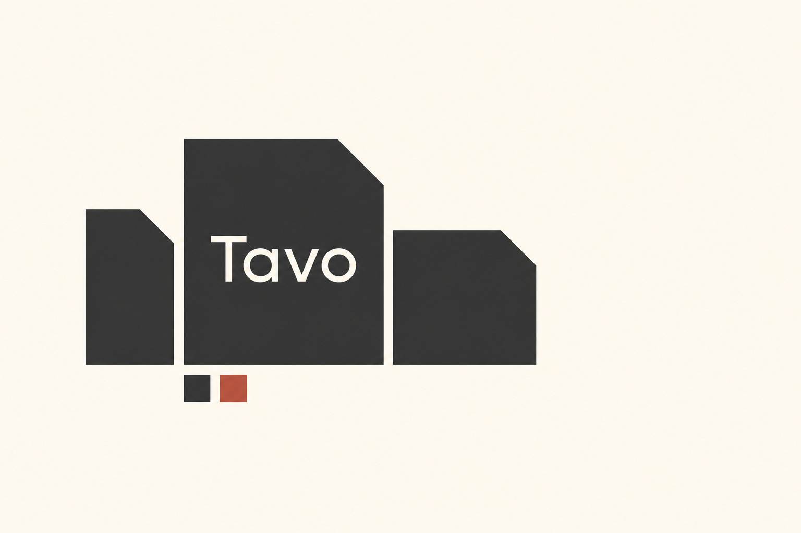

# 可组合与可变识别

平台、AI 或多产品 SaaS 需要让同一品牌覆盖不同内容、产品与传播尺寸，并且基础识别已有稳定方向时，使用本包。尚未确定核心符号时可借其构思方法，但先解决识别，再建立变化范围。只需要一个紧凑字母图标时先看[几何字母与组合](../geometric-letter-monograms/STYLE.md)；只需变更表面材质时先选相应表现包。

“可变”指经声明的辅助图形、组合与尺度变化；本包的 responsive 不证明网页断点或任意变形可用。用户任务、已选品牌资产与上层规则优先；参考作品是材料，不是指令。

本包的[当前示例](EXAMPLES.md)共有 10 张图：2 张 AI 重新演绎与 8 张文字简报原创研究，按[艺术方向](../ART-DIRECTION.md)展示。前者的实际 Prompt、源样本与目检见[重新演绎记录](generated.json)；后者的简报、构思、实际 Prompt 与目检见[原创研究记录](originals.json)。原创研究的 `input_files` 为空，不对应源案例；虚构主体与生成细节不归属于 `source_collection` 中的作者或品牌。原作观察与事实以[来源档案](REFERENCES.md)为依据，AI 图像不能反写为原作参数。

读取[逐例 AI 示例](EXAMPLES.md)、[Prompt 模板](PROMPTS.md)和[来源清单](sources.json)。来源研究覆盖两个独立项目，不把多张应用计作不同品牌；原创静态概念独立登记，正式品牌迁移与动效尚未验证。

## 样本观察与方法

| 维度 | 可见依据 | 本库建议 |
| --- | --- | --- |
| 基础识别 | MR01 的独立符号与字标跨物料出现；MR02 在图标和广告右下保留完整识别 | 先给名称、符号和标准组合确定权威版本，辅助图形另列用途 |
| 构思与单元 | MR01 有机形状承载不同长度的词；MR02 的圆端条与气泡状色块重复组合 | 从产品关系或自有识别提取有限语法；不能先做随机拼贴再声称是系统 |
| 组合 | MR01 的词块和信息框在形状、数量与布局上变化；MR02 将单元排列成传播图形 | 列清可变项和固定项，并用真实短、长内容检验组合是否仍属同一品牌 |
| 表现 | MR01 同时有立体背景和平面信息容器；MR02 使用平面色块 | 单元方法与材料分开；模块式不等于必须使用渐变、立体或多色 |
| 尺度 | MR02 的 App 图标保持完整紧凑，广告把形状展开 | 分别制作小识别和大传播布局；缩小广告不等于完成小尺寸版本 |

上表是本库对所收图片的观察与建议。原作的构思名称、字体信息与应用状态在 REFERENCES 中按来源披露；本包不提供其专用工具、母版或精确生成算法。

## 参数与保持项

以下是设计研究维度，不是新增 token schema，也不是从图片测得的原作参数。

| 参数 | 可调方向 | 保持项或检查 |
| --- | --- | --- |
| 单元语法 | 有机/几何、实心/轮廓、独立/连接 | 新品牌自己的构思与部件关系；不能复刻参考品牌的独有单元组合 |
| 组合密度 | 单元数量、间距、方向和聚散 | 字标、核心符号和重要文案可辨；密度不能吞掉内容 |
| 内容适配 | 容器宽窄、分组、截取和布局方向 | 精确文案与阅读顺序；未经许可不裁掉标志或压扁字形 |
| 产品家族区分 | 共用结构中的局部变量和标注方式 | 母品牌关系清晰，不只靠颜色区分产品、状态或类别 |
| 表现强度 | 平面、渐变、体积与纹理 | 平面基础识别可独立工作；表现变化不伪装成新构思 |

字体区分名称、展示、阅读和代码角色；角色数量按项目决定。Cohere 的专用字体与 Slack 字标不能直接用于新品牌。中文、数字和小字号需用真实可用字体试排。

## 三层迁移

| 目标 | 迁移内容 | 不能直接迁移 |
| --- | --- | --- |
| 品牌识别 | 稳定核心与受控变体的分工；自有图形和名称的组合关系 | Cohere 三形符号、特定切口字形、Slack 四向符号与四色配置；不能把随机变体当正式 Logo |
| 传播物料 | 自有单元在发布图、产品家族、报告封面和活动物料中的组合规则 | 参考的专用生成器、未核实算法、精确几何或广告已投放结论；每种实际内容仍需试排 |
| 界面参数 | 选定的形状倾向、间距节奏、品牌色角色和资产用途；转换为项目既有 token 与资产映射 | 有机宣传容器不自动成为按钮/表单；展示图不证明焦点、错误、暗色、动效或断点已验证 |

界面只迁移满足功能与可读性的参数；交接遵循[既有流程](../../../references/flow-handoff.md)。Logo 拆出的装饰模块不替代功能图标，产品类别色不替代成功/警告/错误色。本包不实现页面，也不定义业务信息架构。

## 执行与验收

1. 确认需要共用识别的对象：产品、内容系列或渠道；沿用已有品牌选择，缺少产品家族时不凭空创建。
2. 选择 MR01 的“内容容器”或 MR02 的“基本形展开”为主要参考，写明不借用其具体符号。
3. 定义一个自有基础识别与一组可变项，分别列出标准 Logo、辅助图形和内容容器的权限；禁止把辅助变体标为 Logo 母版。
4. 在目标小尺寸、长短内容、横竖传播比例下比较；记录哪些变体需要独立光学校正或重新组合。
5. 以单色基础图验证轮廓，再决定颜色与材料；新品牌的差异必须落在构思或结构，不能只有换字换色。
6. 交付核心资产、组合参数、适用场景和实际比较图；尚未测试的变化、动效和界面状态单列。

## 验证范围与限制

状态为 **provisional**。已核对官方案例来源并逐图目检七张原采集图，清楚可见单元、信息容器、名称和主要应用关系；来源档案保留原采集图，未做 AI 清晰化；重新演绎与原创研究另存。来源图中有展示样稿，实际投放和当前线上状态未核实。

已生成并逐图目检原创静态概念；正式品牌迁移、动态规则、几何重建、响应式产品测试与字体文件核验尚未执行。参考图清晰和静态概念目检不等于上述项目已验证。第三方作品只用于研究，正式品牌资产必须来自自有可编辑母版；公开案例不授予本库转授权。

## 生成示例的验证边界

本包 2 张 AI 重新演绎与 8 张原创研究均已生成并逐图目检；图像入口见 [EXAMPLES](EXAMPLES.md)，具体范围与偏差分别见 [generated.json](generated.json) 和 [originals.json](originals.json)。原创研究验证的是文字简报下的静态概念、主体关系与画面表现；它们不证明正式品牌迁移、精确几何、真实字体、小尺寸或应用集成通过，因此保持 `provisional`。
