# 黑白产品意象 · 42 张 AI 研究图

本包展示 **42 张来源重新演绎**。每张均由内置 imagegen 单独生成；颜色、几何、字体与生产应用按实际用途另验。方法见 [STYLE](STYLE.md)，共同展示取向见[艺术方向](../ART-DIRECTION.md)。

来源重新演绎见 [generated.json](generated.json)，原图与事实见 [REFERENCES](REFERENCES.md) / [sources.json](sources.json)。 参考、生成与正式资产的验证范围分开，包保持 provisional。

## A · 灰阶立体单体

### A01 · Theine

**观察：** 杯口厚壁、右侧杯把和浅色内壁清楚；高光收敛为哑光灰阶，主体完整。

**可研究的方法：** 从产品动作寻找器物；先做可辨轮廓，再决定表面。

[原图档案](REFERENCES.md) · [实际输入](references/catalog-theine.png) · [原尺寸](generated/A01.png)

### A02 · Mononote

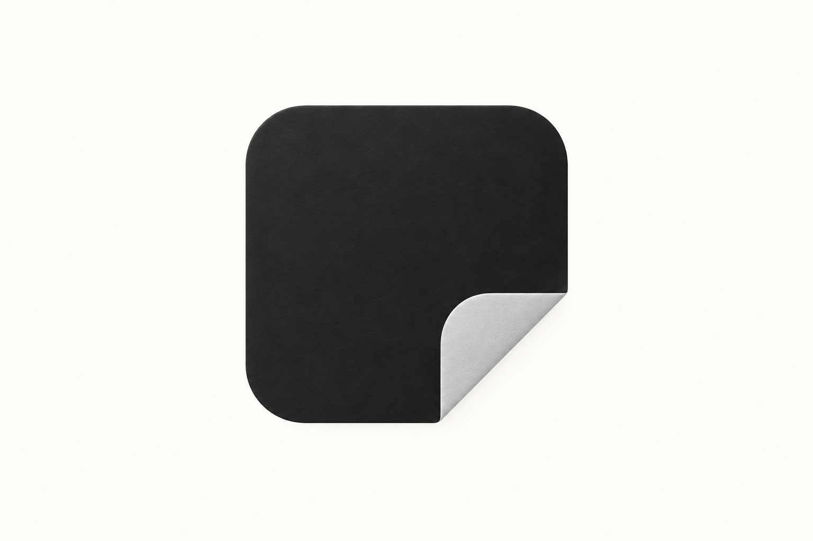

**观察：** 保留单一黑便签与右下浅色卷角；纸张浅体积、连续边缘和宽留白清楚。

**可研究的方法：** 用一个局部转折说明材质，避免全画布同时发亮。

[原图档案](REFERENCES.md) · [实际输入](references/catalog-mononote.png) · [原尺寸](generated/A02.png)

### A03 · ScreenFast

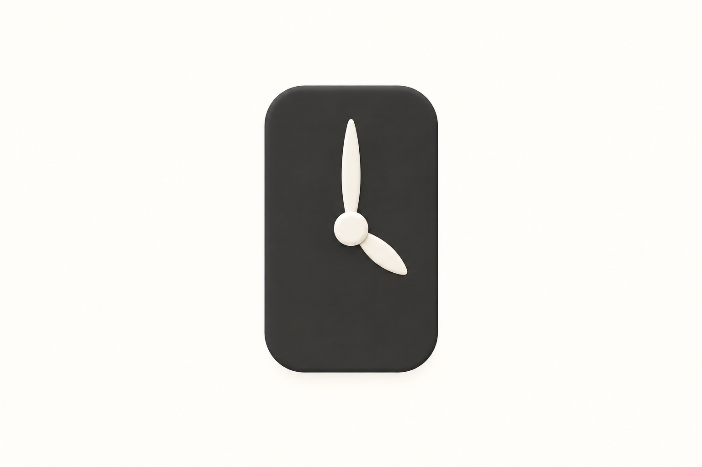

**观察：** 竖向底板、中心圆轴、上向长针和右下短针均保留，浅浮雕对比可辨。

**可研究的方法：** 用简单功能符号承载立体底板，分别控制主体与载体。

[原图档案](REFERENCES.md) · [实际输入](references/catalog-screenfast.png) · [原尺寸](generated/A03.png)

### A04 · Lettera Markdown

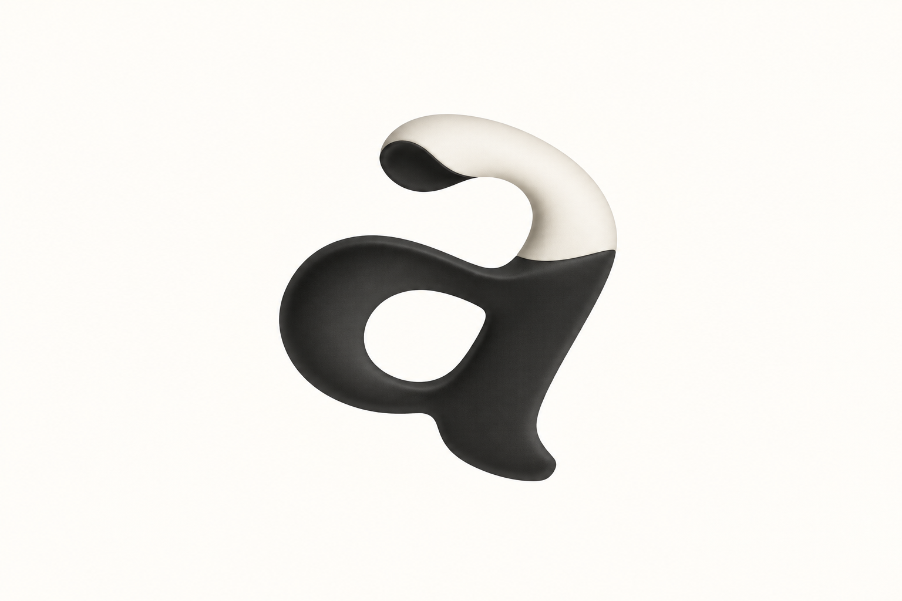

**观察：** 保留小写 a 的下环、开放上钩与右侧收笔；黑白带面翻转清楚，没有转成普通圆环。

**可研究的方法：** 在保持字母辨识的前提下试验带面翻转。

[原图档案](REFERENCES.md) · [实际输入](references/catalog-lettera-markdown.png) · [原尺寸](generated/A04.png)

### A05 · Center

**观察：** 完整分段圆环、左上暗弧与明亮主弧可辨；平面深底和克制明暗保留原构思。

**可研究的方法：** 用圆环的明暗分段与厚度组织体积；不要只套同一高光。

[原图档案](REFERENCES.md) · [实际输入](references/catalog-center.png) · [原尺寸](generated/A05.png)

### A06 · Emphasis

**观察：** 三枚尖椭圆叶形数量正确，上下位置和间隙清楚；体积弱化为轻微边缘。

**可研究的方法：** 将自然形压缩到几片关键轮廓，再建立柔和体积。

[原图档案](REFERENCES.md) · [实际输入](references/catalog-emphasis.png) · [原尺寸](generated/A06.png)

### A07 · Min Habit

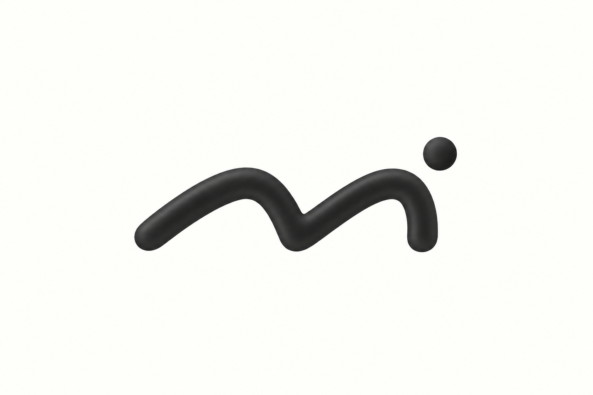

**观察：** 保留两次起伏的圆端弯线、右端下折与独立圆点；线走势没有变成同心环或直角符号。

**可研究的方法：** 让线条成为有厚度的材料，同时保留识别转折。

[原图档案](REFERENCES.md) · [实际输入](references/catalog-min-habit.png) · [原尺寸](generated/A07.png)

### A08 · Particle News

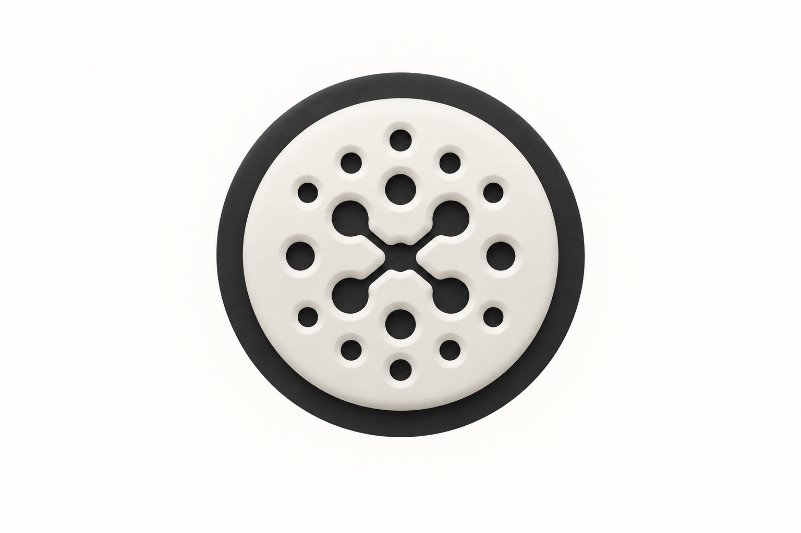

**观察：** 浅色打孔圆盘、中心四瓣斜向连通与周边独立孔洞清楚；圆盘外缘改为深色承托，未当作精确孔径复制。

**可研究的方法：** 用凹孔、连接与实体边缘表现结构，不依赖复杂场景。

[原图档案](REFERENCES.md) · [实际输入](references/catalog-particle-news.png) · [原尺寸](generated/A08.png)

### A09 · Opal

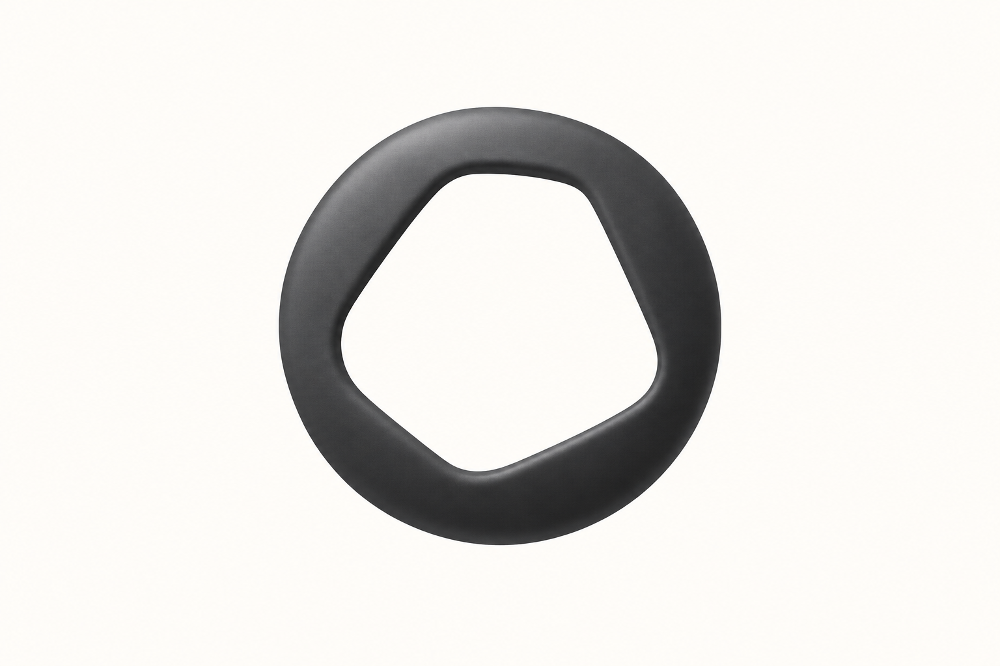

**观察：** 保留不规则内孔与宽窄变化的连续外环；灰黑哑光替代镜面，轮廓仍有雕塑感。

**可研究的方法：** 把负空间作为主体之一，比较内外轮廓的张力。

[原图档案](REFERENCES.md) · [实际输入](references/catalog-opal.png) · [原尺寸](generated/A09.png)

### A10 · Bartender

**观察：** 领结、白衬衣、深 V 背心与三个纽扣均保留；缝线与复杂布料纹理已去除，职业器物概念清楚。

**可研究的方法：** 用职业或角色的代表性衣物建立语义；小尺寸需单独简化。

[原图档案](REFERENCES.md) · [实际输入](references/catalog-bartender.png) · [原尺寸](generated/A10.png)

### A11 · Onigiri

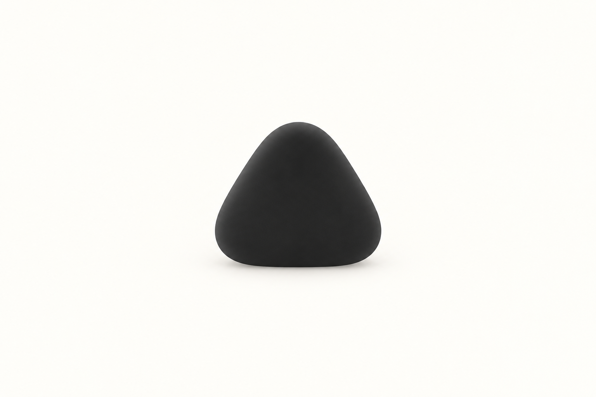

**观察：** 单一圆角三角体，顶部与底边关系保留；占幅较小，留白充分，没有添加饭团或脸部。

**可研究的方法：** 对比单体的画布占比与圆角，不用增加配件来补识别。

[原图档案](REFERENCES.md) · [实际输入](references/catalog-onigiri.png) · [原尺寸](generated/A11.png)

### A12 · Sabbath

**观察：** 六瓣数量正确，尖端向内，中央星形空隙清楚；扁平化后仍保持放射节奏。

**可研究的方法：** 同时设计花瓣实体与中心空隙，材质服从放射结构。

[原图档案](REFERENCES.md) · [实际输入](references/catalog-sabbath.png) · [原尺寸](generated/A12.png)

## B · 功能与界面隐喻

### B01 · The Radio

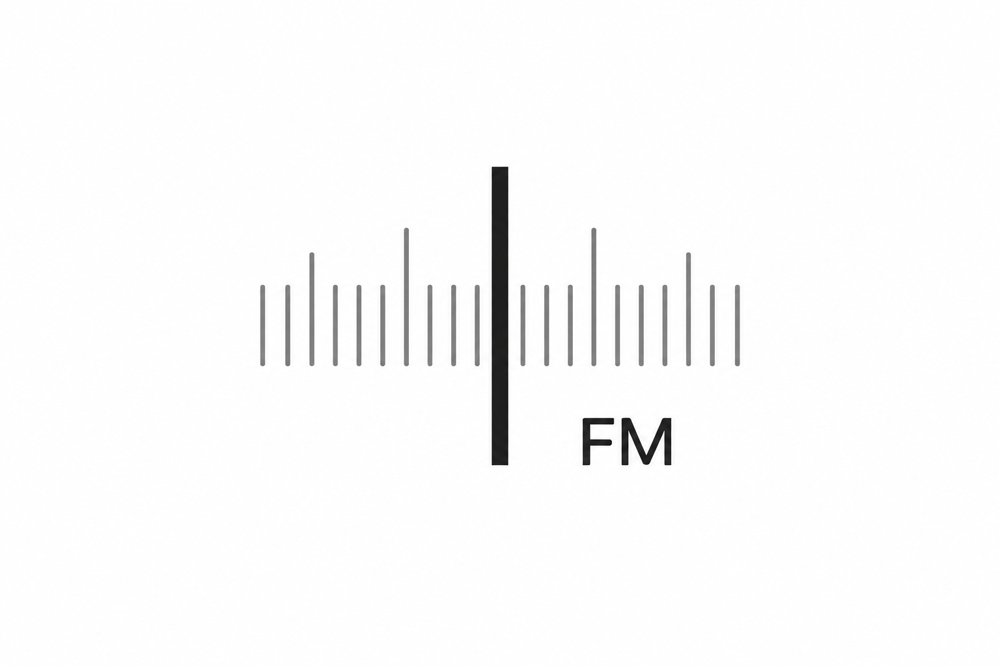

**观察：** 主指针明显强于灰色刻度，FM 字样正确，横向调频关系完整；去除外框后仍可辨。

**可研究的方法：** 用一个强焦点统领弱刻度，测试细节缩小时的合并。

[原图档案](REFERENCES.md) · [实际输入](references/catalog-the-radio.png) · [原尺寸](generated/B01.png)

### B02 · Quick Journal

**观察：** 双开引号与三条不等长圆端段落线保留，左侧对齐，图形层级和留白清楚。

**可研究的方法：** 从内容类型提取一个标点与少量段落结构。

[原图档案](REFERENCES.md) · [实际输入](references/catalog-quick-journal.png) · [原尺寸](generated/B02.png)

### B03 · Calc

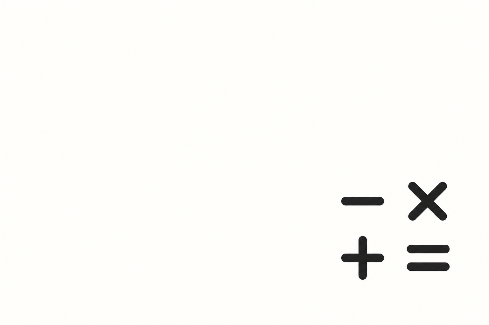

**观察：** 按实图保留减、乘、加、等号的 2×2 顺序与右下偏置；源文档的加减乘除描述与原图不符，生成以图中等号为准。

**可研究的方法：** 让功能符号的关系与位置参与识别，验证偏置小主体。

[原图档案](REFERENCES.md) · [实际输入](references/catalog-calc.png) · [原尺寸](generated/B03.png)

### B04 · Not Evil Sudoku

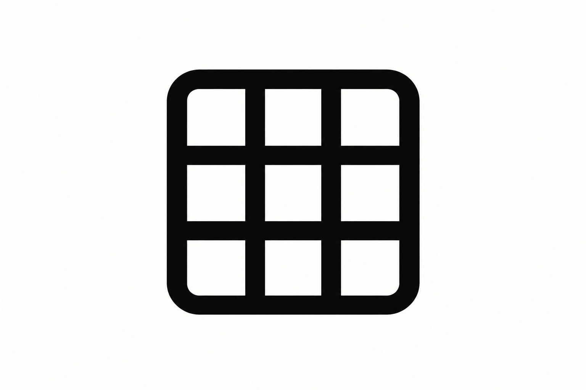

**观察：** 外圆角方框及两纵两横分隔保留，九个空白宫格清楚，无额外数字。

**可研究的方法：** 把任务的空间结构压缩为可读网格，检查孔隙。

[原图档案](REFERENCES.md) · [实际输入](references/catalog-not-evil-sudoku.png) · [原尺寸](generated/B04.png)

### B05 · The Life Calendar

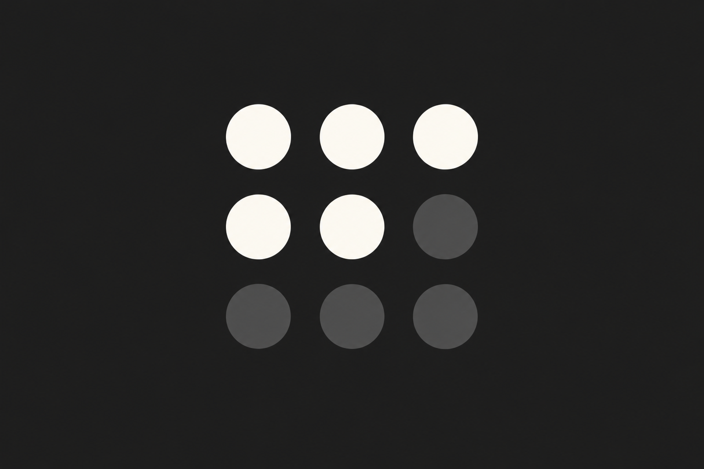

**观察：** 九个圆点、三行三列与五亮四暗状态顺序正确；深色底上剩余四点仍可见。

**可研究的方法：** 用相同元素的状态差表达进度，避免依赖文字解释。

[原图档案](REFERENCES.md) · [实际输入](references/catalog-the-life-calendar.png) · [原尺寸](generated/B05.png)

### B06 · Corner Time

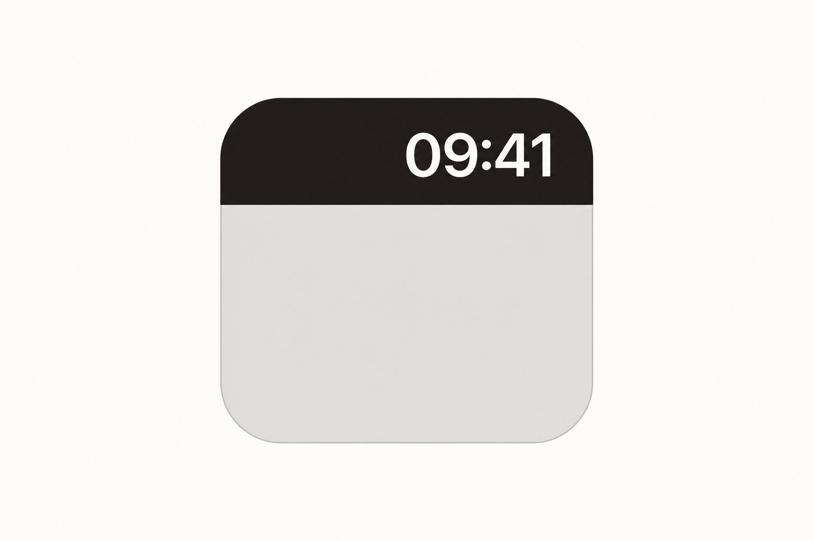

**观察：** 09:41 字样和右上位置正确，上深下浅的屏幕区域分工保留，未添加虚构 UI。

**可研究的方法：** 从功能发生的位置取构图，区分数字内容和固定几何。

[原图档案](REFERENCES.md) · [实际输入](references/catalog-corner-time.png) · [原尺寸](generated/B06.png)

### B07 · Fliqlo

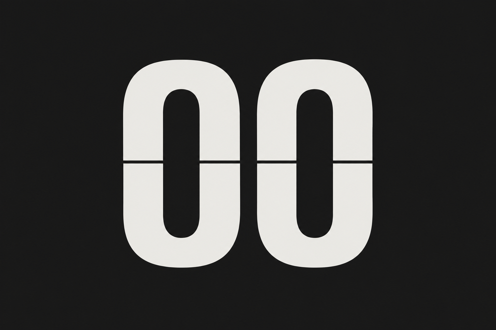

**观察：** 两个 0、开放字腔和横向中缝保留；数字完整可读，深底留白清楚。

**可研究的方法：** 将显示机制与数字结合；更换数字不等于新品牌构思。

[原图档案](REFERENCES.md) · [实际输入](references/catalog-fliqlo.png) · [原尺寸](generated/B07.png)

### B08 · Notion Calendar

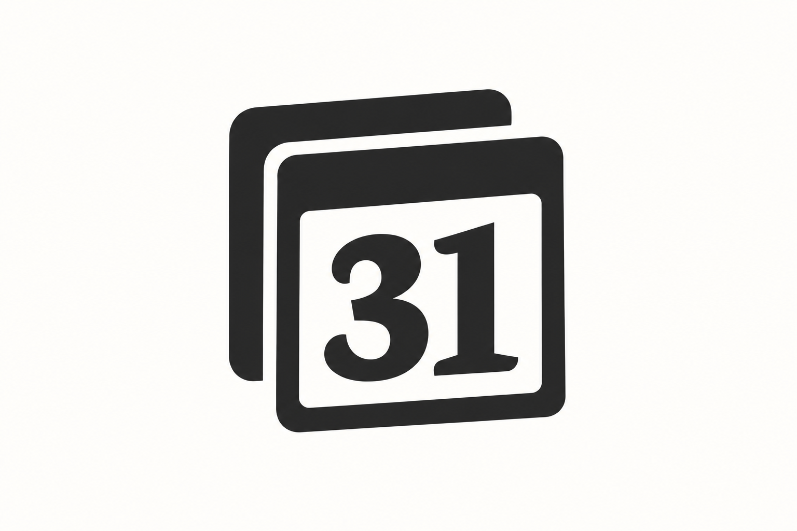

**观察：** 31 拼写正确，双页向左上错位、前页粗页眉与黑白轮廓完整，没有额外日期。

**可研究的方法：** 用叠页与日期建立工具联想，记录家族品牌共用语言。

[原图档案](REFERENCES.md) · [实际输入](references/catalog-notion-calendar.png) · [原尺寸](generated/B08.png)

### B09 · Lazy Weather

**观察：** 左上右下两箭头方向正确，线宽与端点一致，独立间隙清楚。

**可研究的方法：** 用成对方向表达比较关系，检查普通符号的独特性。

[原图档案](REFERENCES.md) · [实际输入](references/catalog-lazy-weather.png) · [原尺寸](generated/B09.png)

### B10 · Hidden Bar

**观察：** 左侧竖条与右侧折角分离；右尖端内的深浅折面仍可辨，未变成普通播放三角。

**可研究的方法：** 从隐藏、展开与边界关系提取标志，再检查交叠层级。

[原图档案](REFERENCES.md) · [实际输入](references/catalog-hidden-bar.png) · [原尺寸](generated/B10.png)

## C · 字母与排版

### C01 · Instapaper

**观察：** 大写衬线 I、宽上下衬线和粗主干保留；背景文章纹理已精简，字母成为清楚主角。

**可研究的方法：** 字母为主、内容纹理为辅；新品牌应重新设计字形比例。

[原图档案](REFERENCES.md) · [实际输入](references/catalog-instapaper.png) · [原尺寸](generated/C01.png)

### C02 · WikiTok

**观察：** 白色大写 W、交叉斜笔与顶部衬线清楚，字面宽度和深底留白形成安静对比。

**可研究的方法：** 用字面的宽度、衬线和留白组织气质，不靠纹理。

[原图档案](REFERENCES.md) · [实际输入](references/catalog-wikitok.png) · [原尺寸](generated/C02.png)

### C03 · Google Arts & Culture

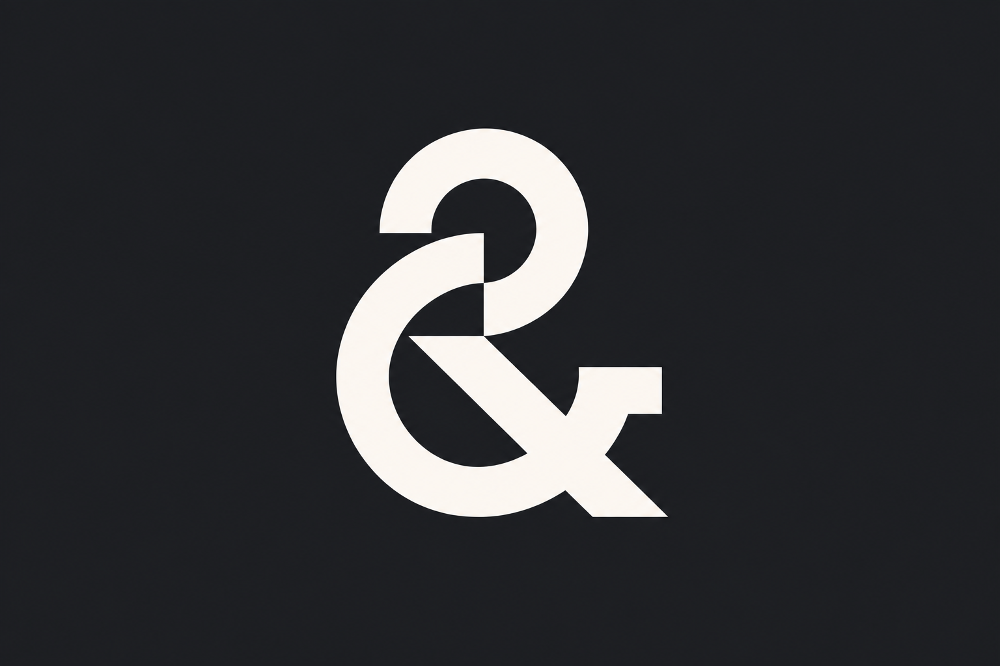

**观察：** 保留上小环、下大环与右下斜笔的几何 &，开口和交接清楚，未变为普通手写连字。

**可研究的方法：** 探索标点自身的连续路径与交叉方式。

[原图档案](REFERENCES.md) · [实际输入](references/catalog-google-arts-culture.png) · [原尺寸](generated/C03.png)

### C04 · Menu

**观察：** MENU 保持 ME/NU 两行，四字完整，方底 U 与粗无衬线结构保留。

**可研究的方法：** 通过断行和字面密度建立短词标志，保持阅读顺序。

[原图档案](REFERENCES.md) · [实际输入](references/catalog-menu.png) · [原尺寸](generated/C04.png)

### C05 · Stoic

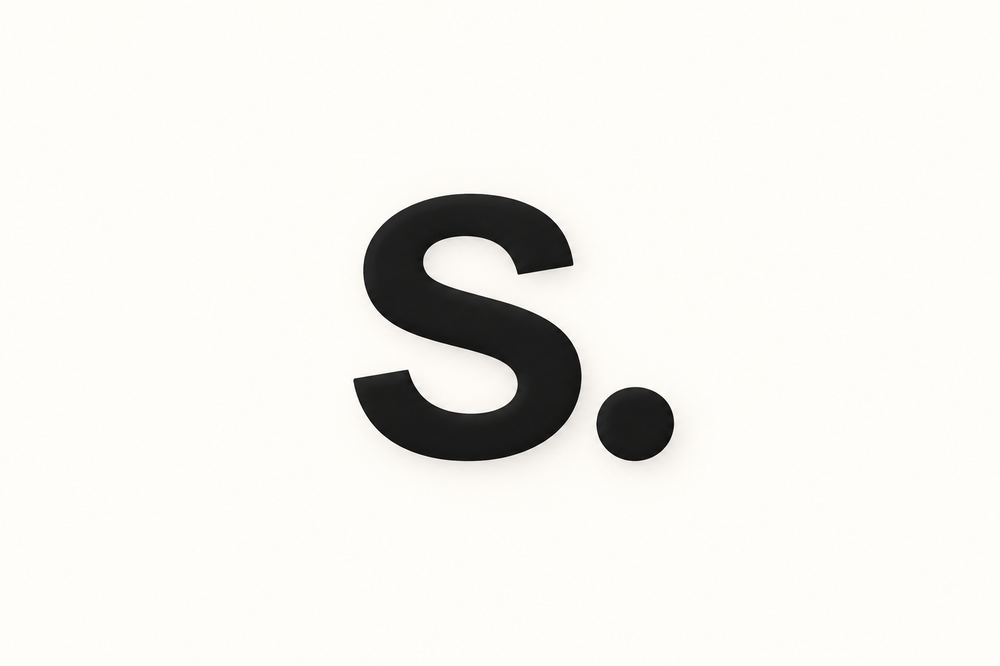

**观察：** S 形曲线与右下独立圆句点保留，深色轻体积收敛，字形与点的间隔清楚。

**可研究的方法：** 让一个标点成为节奏点；材质与字形分别决策。

[原图档案](REFERENCES.md) · [实际输入](references/catalog-stoic.png) · [原尺寸](generated/C05.png)

### C06 · Vocabulary

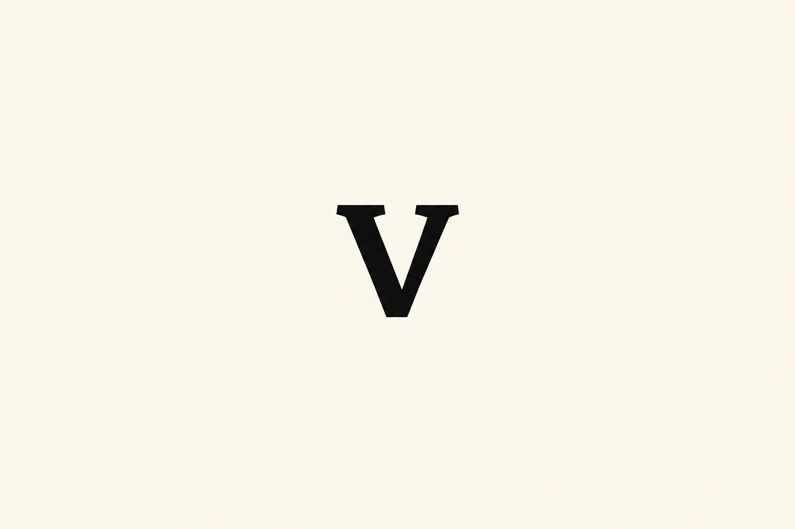

**观察：** 小型衬线 v 保留粗斜笔、宽上衬线和平底交接，暖白画布留白充分。

**可研究的方法：** 研究单字母的安静尺度；暖底与中性灰底分别比较。

[原图档案](REFERENCES.md) · [实际输入](references/catalog-vocabulary.png) · [原尺寸](generated/C06.png)

### C07 · Notion

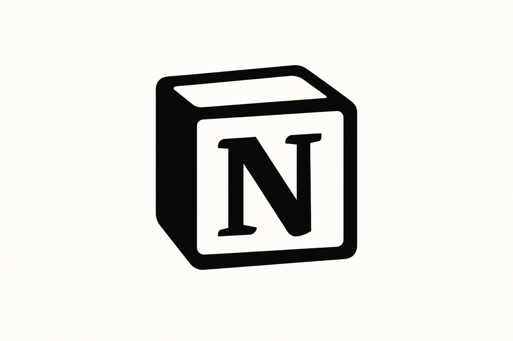

**观察：** 已逐张查看实际输出：黑色厚轮廓保留立方体的顶面、深色左侧及正面衬线 N；暖白留白清楚，主体完整，未增加其它字样。

**可研究的方法：** 让字母与载体形成独有结合，不直接借用原盒形。

[原图档案](REFERENCES.md) · [实际输入](references/catalog-notion.png) · [原尺寸](generated/C07.png)

### C08 · Dumb Phone

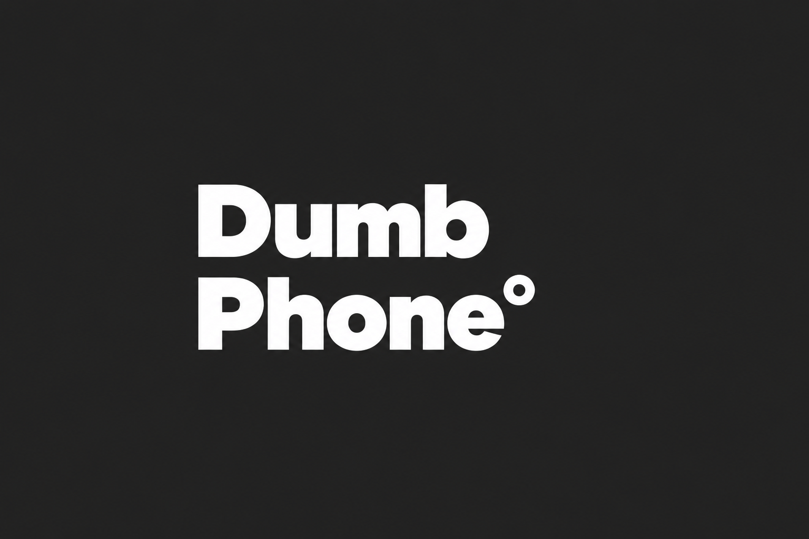

**观察：** 已逐张查看实际输出：Dumb / Phone 两行粗白字拼写准确，左缘对齐，Phone 右上小圆环清楚；深灰底保留充足留白，未添加外围图标框。

**可研究的方法：** 以词语为主体时处理行长和节奏，小尺寸另做识别检查。

[原图档案](REFERENCES.md) · [实际输入](references/catalog-dumb-phone.png) · [原尺寸](generated/C08.png)

### C09 · Motivation

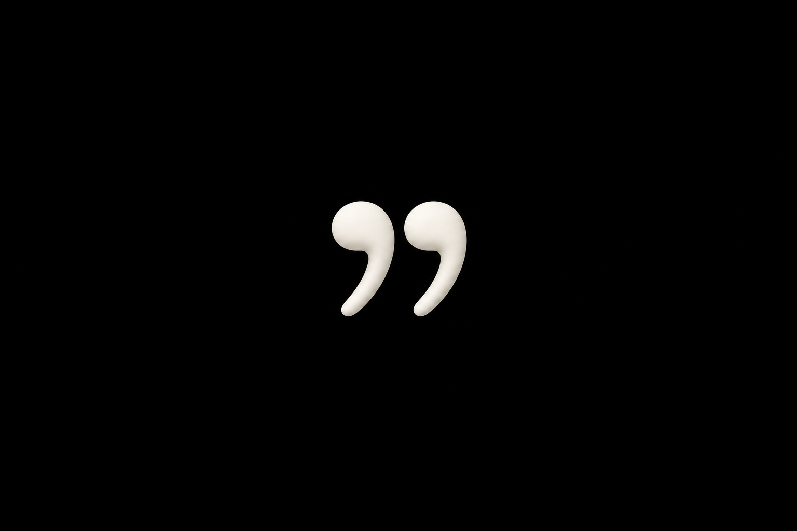

**观察：** 已逐张查看实际输出：两个浅白色弯引号并列，头部饱满、尾部向左下收细；深黑底和较小占比保持安静留白，浅哑光体积未遮蔽标点轮廓。

**可研究的方法：** 内容语义可由标点承载，同时防止与通用引用符号混同。

[原图档案](REFERENCES.md) · [实际输入](references/catalog-motivation.png) · [原尺寸](generated/C09.png)

### C10 · Matter

**观察：** 已逐张查看实际输出：五个白圆节点由四条粗线依序连成 M，中央谷点与两端圆点清楚；结构对称，已移除原参考的弱背景文字和发光。

**可研究的方法：** 把字母骨架与连接关系结合；辨识应先于背景内容。

[原图档案](REFERENCES.md) · [实际输入](references/catalog-matter.png) · [原尺寸](generated/C10.png)

## D · 抽象几何

### D01 · Neuecast

**观察：** 已逐张查看实际输出：三柱共底且偏置于画面右下，左柱中高、中柱最短、右柱最高；按实际源图保留前两柱实白与第三柱白描边深色内芯，留白占主导。

**可研究的方法：** 通过占比与偏置制造安静感，同时验证目标尺寸。

[原图档案](REFERENCES.md) · [实际输入](references/catalog-neuecast.png) · [原尺寸](generated/D01.png)

### D02 · Slate

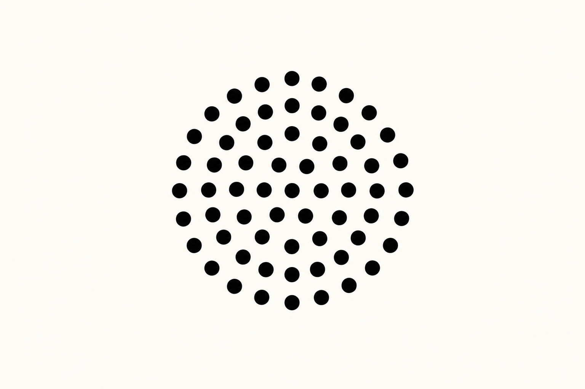

**观察：** 已逐张查看实际输出：等大小黑色圆点错列聚成近圆形，外缘自然收拢，点间保留间隙；暖白画布只呈现单个完整点团。

**可研究的方法：** 比较规则点阵与有机边界的关系，保留整体轮廓。

[原图档案](REFERENCES.md) · [实际输入](references/catalog-slate.png) · [原尺寸](generated/D02.png)

### D03 · Mist

**观察：** 已逐张查看实际输出：三个外角尖、内侧圆润的黑色瓣形与右下圆形保持四象限组合；中心白色楔形间隙清楚，圆形与瓣形差异可辨，整体完整且周围留白充足。

**可研究的方法：** 在共同曲率中设置一个不同元素，建立可记忆差异。

[原图档案](REFERENCES.md) · [实际输入](references/catalog-mist.png) · [原尺寸](generated/D03.png)

### D04 · Box Breathe

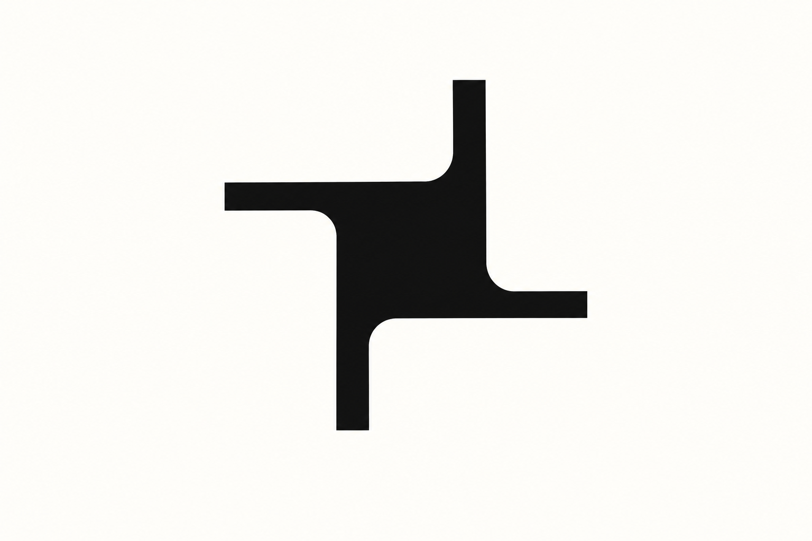

**观察：** 已逐张查看实际输出：四个错位黑臂连成单一实心中心，四处内凹圆角与旋转关系保留；四个末端完整停在画布内，未误成空心框或普通十字。

**可研究的方法：** 同时控制边缘延伸与中心负空间，避免只看单根线。

[原图档案](REFERENCES.md) · [实际输入](references/catalog-box-breathe.png) · [原尺寸](generated/D04.png)

### D05 · Thrum

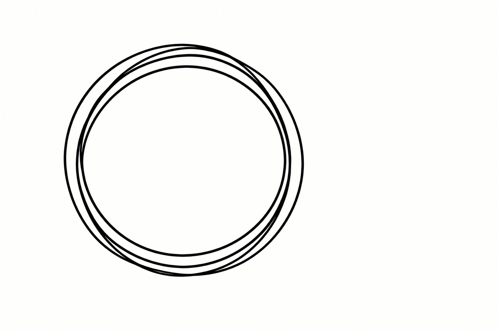

**观察：** 已逐张查看实际输出：多条细黑圆环轻微错位、局部贴近，环间距离随周向变化；中央留白完整，未变成规则同心靶或密集涂鸦，保留重复与偏差的节奏。

**可研究的方法：** 用重复与轻微偏差形成节奏，避免自动磨成完美同心圆。

[原图档案](REFERENCES.md) · [实际输入](references/catalog-thrum.png) · [原尺寸](generated/D05.png)

### D06 · Kipkam

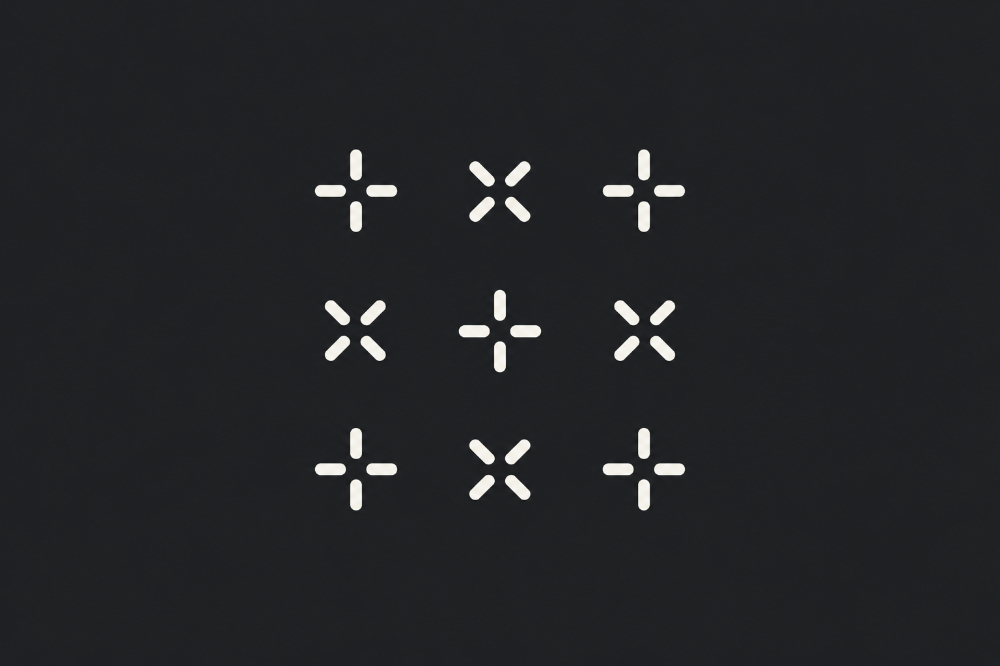

**观察：** 已逐张查看实际输出：九个浅色符号组成 3×3 方阵，正十字与斜十字按棋盘交替；每符号四段圆头短线在中心断开，数目、方向和间距关系清楚。

**可研究的方法：** 用方向变化建立整体纹样，先测试缩小后的图团。

[原图档案](REFERENCES.md) · [实际输入](references/catalog-kipkam.png) · [原尺寸](generated/D06.png)

### D07 · Blank Spaces

**观察：** 已逐张查看实际输出：深黑画布仅保留一根浅白圆头横线，水平居中、留白广阔；边缘清楚，未增加文字、边框或其它元素。

**可研究的方法：** 把留白与位置当作构图变量；极少元素仍需独特性检查。

[原图档案](REFERENCES.md) · [实际输入](references/catalog-blank-spaces.png) · [原尺寸](generated/D07.png)

### D08 · Oppie

**观察：** 已逐张查看实际输出：浅色画布右下保留单枚完整近黑实心圆，左上大片留白强化偏置；圆形未裁断，也未添加阴影或球体高光。

**可研究的方法：** 研究元素少到极限时，位置与尺度能承担多少识别。

[原图档案](REFERENCES.md) · [实际输入](references/catalog-oppie.png) · [原尺寸](generated/D08.png)

### D09 · SyncTasks

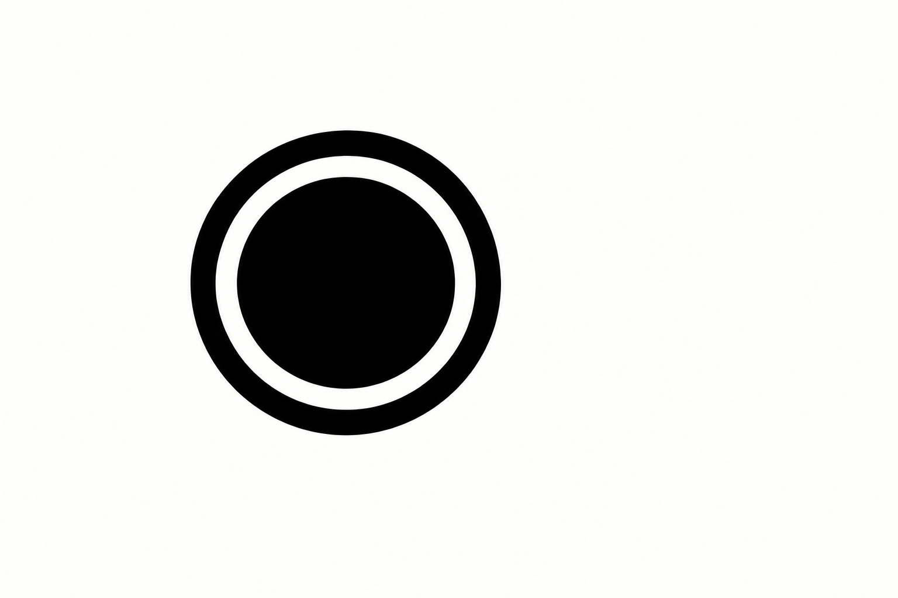

**观察：** 已逐张查看实际输出：实心黑圆、连续白环隙和外侧黑环关系完整，三层轮廓同心，环隙未粘连；画布留白清楚且没有额外图标外框。

**可研究的方法：** 通过环隙宽度与图底反转建立关系，检查小尺寸粘连。

[原图档案](REFERENCES.md) · [实际输入](references/catalog-synctasks.png) · [原尺寸](generated/D09.png)

### D10 · Endel

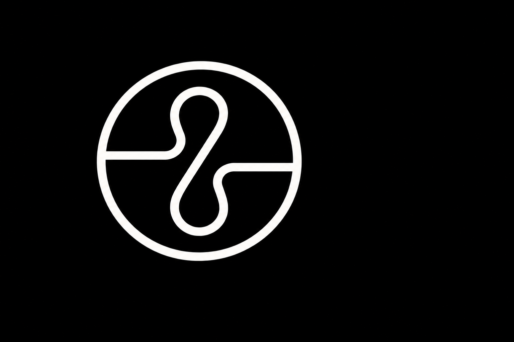

**观察：** 已逐张查看实际输出：白色外圆完整，内部连续曲线由左侧横线进入上部回弯、斜穿中央到下部回弯，再接右侧横线；两处暗色内区和弯曲拓扑保留，未误成普通阴阳图。

**可研究的方法：** 先设计曲线与内部分区的拓扑，再调整圆角和线宽。

[原图档案](REFERENCES.md) · [实际输入](references/catalog-endel.png) · [原尺寸](generated/D10.png)
