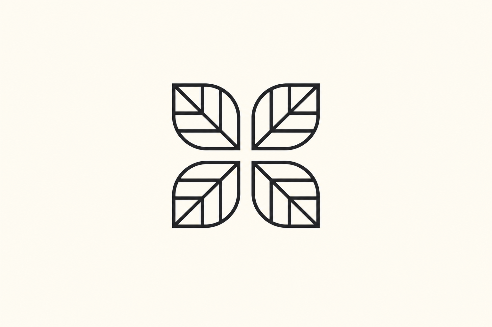
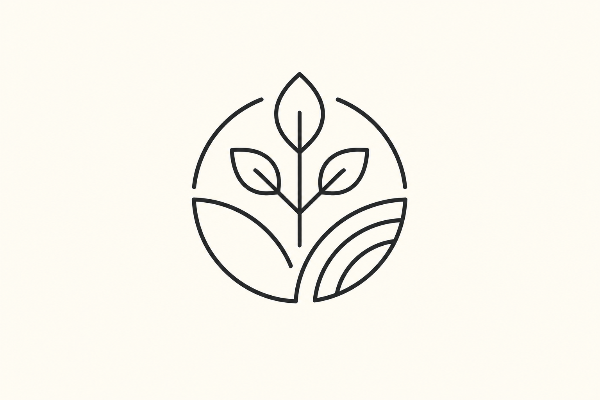
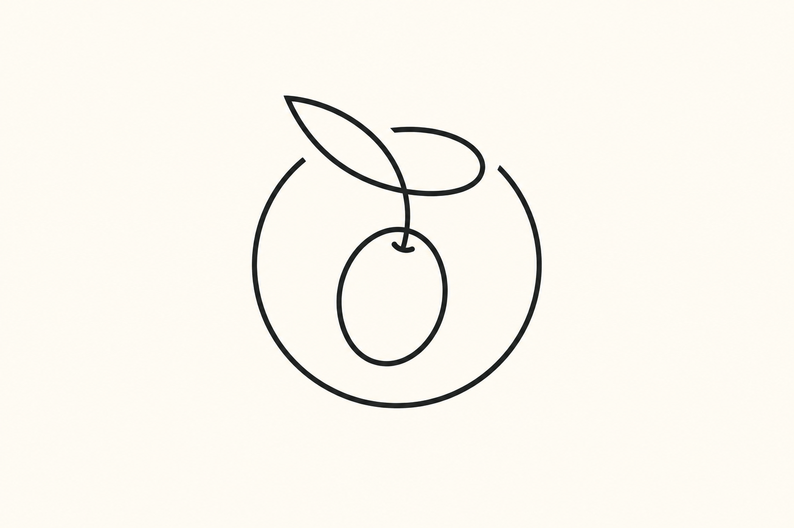
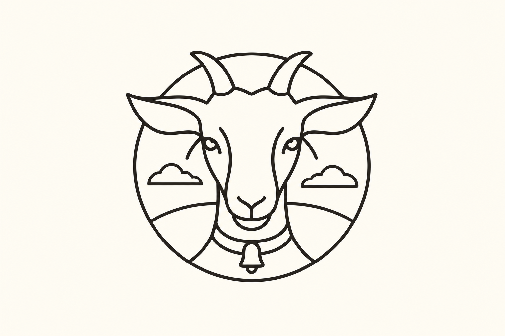
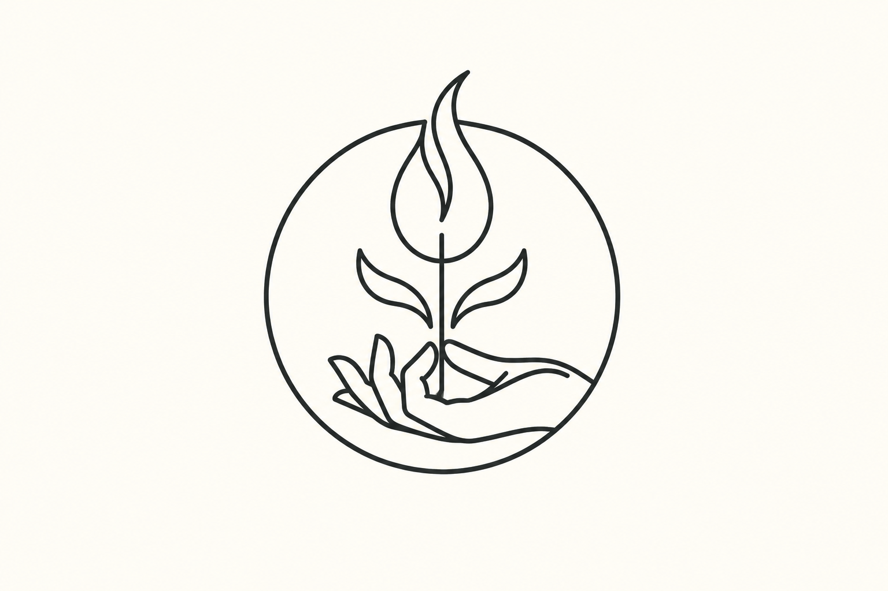
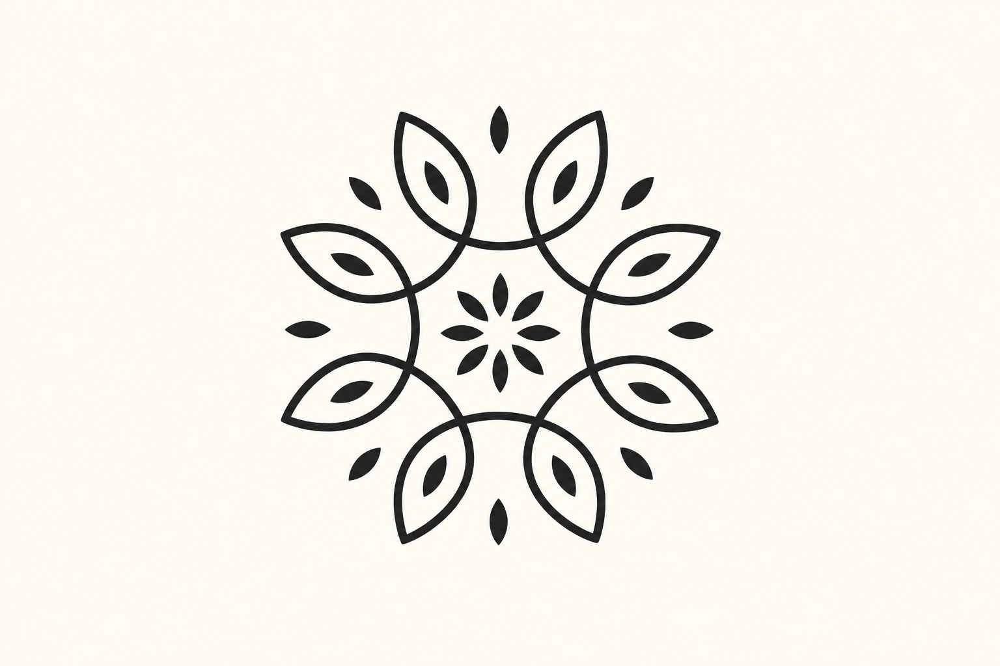
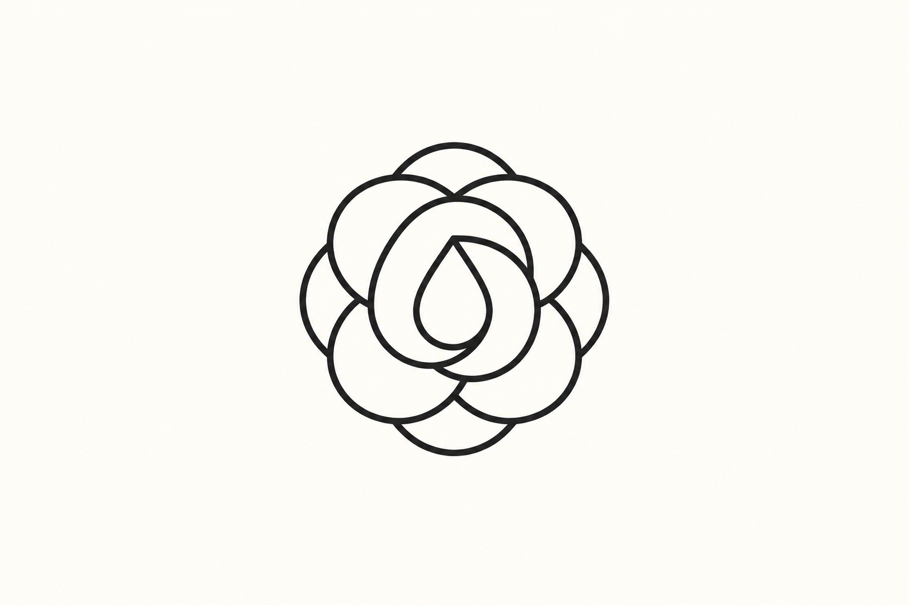

# 单线与轮廓图形 · 10 张 AI 研究图

本包展示 **10 张来源重新演绎**。每张均由内置 imagegen 单独生成；颜色、几何、字体与生产应用按实际用途另验。方法见 [STYLE](STYLE.md)，共同展示取向见[艺术方向](../ART-DIRECTION.md)。

来源重新演绎见 [generated.json](generated.json)，原图与事实见 [REFERENCES](REFERENCES.md) / [sources.json](sources.json)。 参考、生成与正式资产的验证范围分开，包保持 provisional。

### L01 · Hearty Heritage

**观察：** 狗、另一动物侧面、心形与双圆框完整，线条简洁且相互共边；剥离字标后识别构思仍清楚。

**可研究的方法：** 先规划动物与附属符号的共用线，再处理字标层级。

[原图档案](REFERENCES.md) · [实际输入](references/L01.png) · [原尺寸](generated/L01.png)

### L02 · Nuteese

**观察：** 人脸、三根竖线、右下叶与双圆框保持，五官完整，线宽清楚无冗余文字。

**可研究的方法：** 通过少数必要线条区分五官与主题元素，避免增加写实阴影。

[原图档案](REFERENCES.md) · [实际输入](references/L02.png) · [原尺寸](generated/L02.png)

### L03 · Karma

**观察：** 四片叶与中心十字白隙清楚，内叶脉数量克制，几何线条平衡。

**可研究的方法：** 用重复单元和内线形成节奏，检查中心交汇处不过密。

[原图档案](REFERENCES.md) · [实际输入](references/L03.png) · [原尺寸](generated/L03.png)

### L04 · Native Joy Superfoods

**观察：** 三叶植物、上方开口圆弧和下方曲面田垄保留，开口与线距清楚，单线气质保持。

**可研究的方法：** 让外框开口与对象方向配合，不强制所有图形封口。

[原图档案](REFERENCES.md) · [实际输入](references/L04.png) · [原尺寸](generated/L04.png)

### L05 · Artemis Fragrances

**观察：** 日月相对侧面及交错射线完整；面部和线条密度已收敛，保留自然非对称感，无额外文字。

**可研究的方法：** 以主体关系确定重点；缩小时先简化放射线等次要内容。

[原图档案](REFERENCES.md) · [实际输入](references/L05.png) · [原尺寸](generated/L05.png)

### L06 · Takatu Road Olives

**观察：** 一枚橄榄、叶和开口圆弧完整，流动线条与上方留口可辨；暖白底单主体。

**可研究的方法：** 用连接关系表达植物结构，不依赖颜色区分叶与果。

[原图档案](REFERENCES.md) · [实际输入](references/L06.png) · [原尺寸](generated/L06.png)

### L07 · Best Goat Milk

**观察：** 正面山羊、双角、宽耳、两朵云和圆框完整；田野与领圈收敛，取消环排文字，构思保持。

**可研究的方法：** 将主体越框作为层次手段，控制文字圈和背景线的距离。

[原图档案](REFERENCES.md) · [实际输入](references/L07.png) · [原尺寸](generated/L07.png)

### L08 · Shire City Herbals

**观察：** 托举手、直立植物与超出圆框的长叶完整，手指与叶片分界可读；以轻线条保留生长主题。

**可研究的方法：** 先保证手与植物分别可认，再简化连接处的线条。

[原图档案](REFERENCES.md) · [实际输入](references/L08.png) · [原尺寸](generated/L08.png)

### L09 · Super Seeds

**观察：** 八叶放射、中心八种子和线/面对比保持，外围小种子从密集装饰缩为每隙一枚，白隙充足。

**可研究的方法：** 用重复和少量实心强调形成节奏；它不是全图严格等粗的纯线稿。

[原图档案](REFERENCES.md) · [实际输入](references/L09.png) · [原尺寸](generated/L09.png)

### L10 · Damascene Essential Oils

**观察：** 中央水滴与环绕花瓣线保持；环排文案和下方字标去除，主体成为单个清楚的紧凑轮廓。

**可研究的方法：** 把中心闭合形与环绕路径区分，再处理环排与横排信息层级。

[原图档案](REFERENCES.md) · [实际输入](references/L10.png) · [原尺寸](generated/L10.png)
