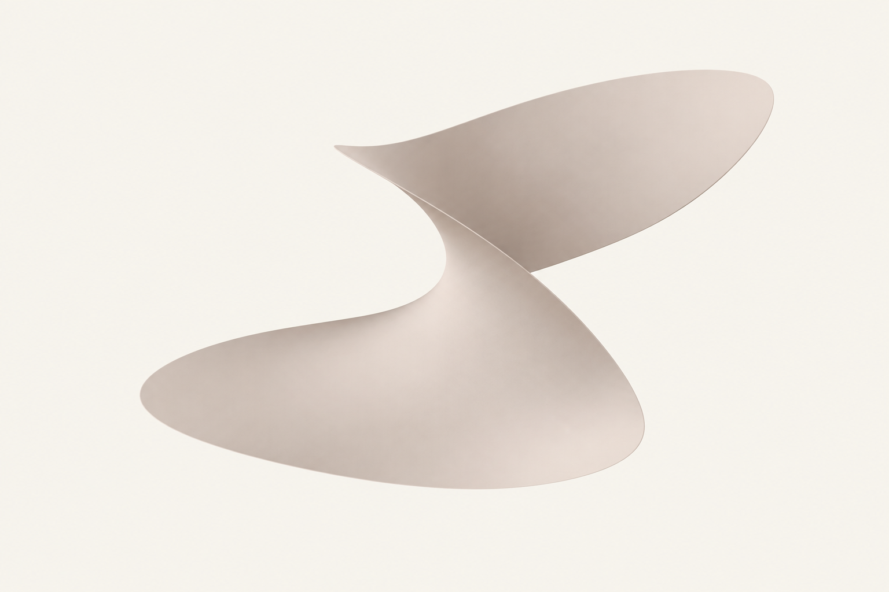
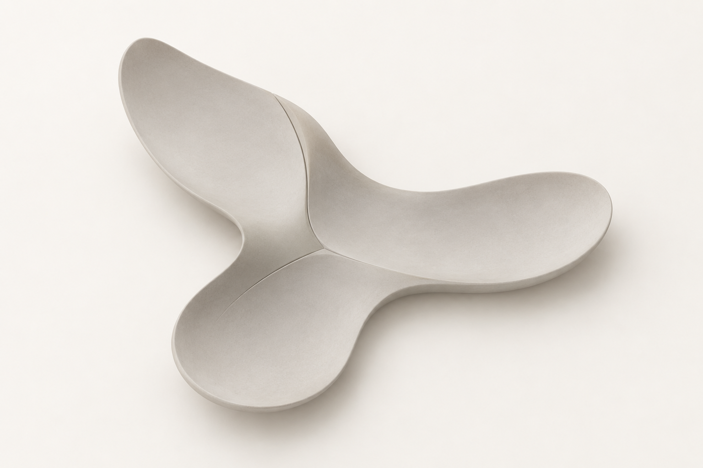
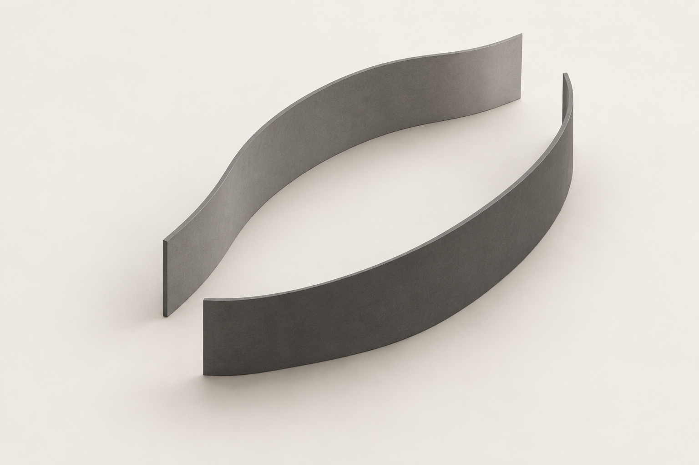
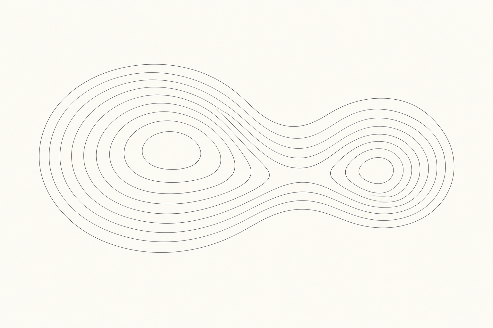
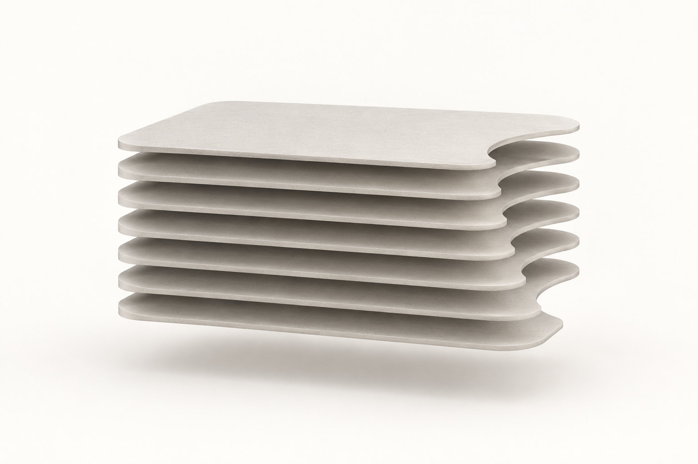
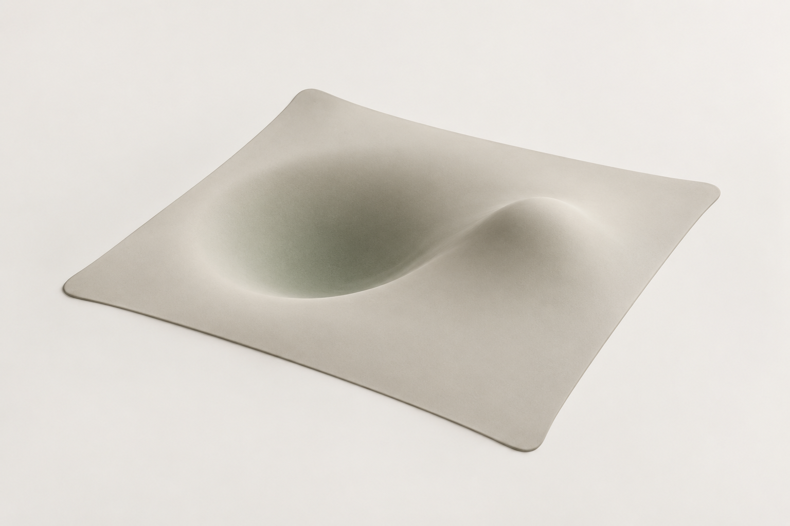
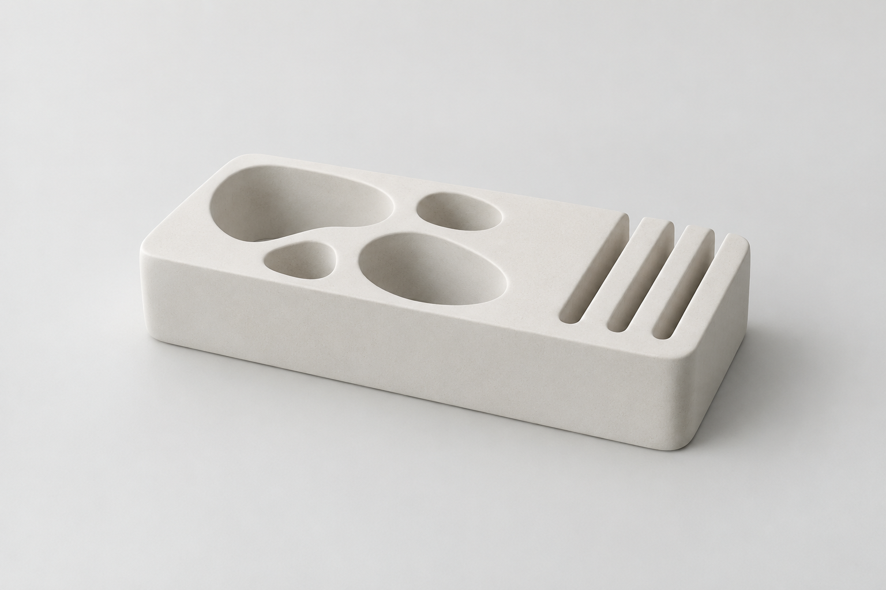
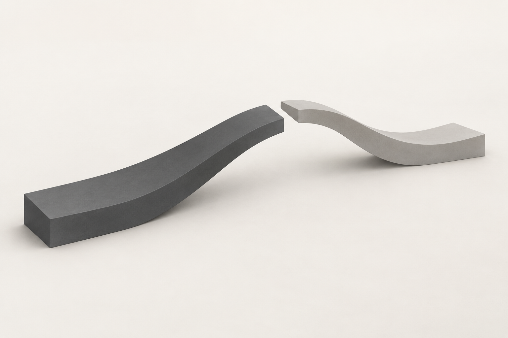

# 参数化科学图形 · 10 张 AI 研究图

本包展示 **2 张来源重新演绎、8 张独立原创研究**。每张均由内置 imagegen 单独生成；颜色、几何、字体与生产应用按实际用途另验。方法见 [STYLE](STYLE.md)，共同展示取向见[艺术方向](../ART-DIRECTION.md)。

来源重新演绎见 [generated.json](generated.json)，原图与事实见 [REFERENCES](REFERENCES.md) / [sources.json](sources.json)。独立原创的简报、构思、实际 Prompt 与目检见 [originals.json](originals.json)；这些是本库提出的新研究主题，没有第三方原作或官方采用事实。 参考、生成与正式资产的验证范围分开，包保持 provisional。

## 来源重新演绎

保留源样本 ID；这些图不是原作者作品或官方改版。

### PS01 · Secondmind

**观察：** 完整哑光浅陶土曲面与凹形开口清楚，淡光塑造体积且没有装饰光效。源图是裁切，本图完整外轮廓含AI推演；仅作曲面方法研究。

**可研究的方法：** 先为新品牌定义曲面关系，再选择裁切和材质；不复制来源符号或函数。

[原图档案](REFERENCES.md) · [实际输入](references/PS01-secondmind-surface.jpg) · [原尺寸](generated/PS01.png)

### PS02 · Covariant

**观察：** 单一连续S形边界与浅浮雕关系可辨，强珊瑚色改为浅陶土与暖白；色阶细腻。是静态艺术边界图，不是数据图或可执行参数模型。

**可研究的方法：** 先约束内容区，再调边界变化；没有真实数据时只标为品牌概念图。

[原图档案](REFERENCES.md) · [实际输入](references/PS02-covariant-boundary.jpg) · [原尺寸](generated/PS02.png)

## 独立原创研究

每个 ID 对应一个不同的产品问题与构思，由文字简报生成，不绑定第三方样本。这里的“原创”说明构思与生成来源，不等于商标检索、独创性法律判断或正式品牌验收。

### PS-O01 · Taper · 资源分配谷

**简报：** 虚构推理服务 Taper 需要表达把高峰请求分配到可承载路径的能力，本图仅为静态概念研究。

**方法：** 将五片厚薄一致的平行曲面组织为逐步变宽的通道，用开口宽度与截面坡度表达资源疏导。

**目检：** 五片递增高度的平行截面形成清楚的通道节奏，淡蓝灰哑光与留白克制；生成结果用并列通道表达疏导，未声称精确容量映射。

[原尺寸](generated/PS-O01.png) · [实际 Prompt 与记录](originals.json)

### PS-O02 · Confluence · 证据汇合面

**简报：** 虚构研究助手 Confluence 需要表达把三条来源线索汇成可读结论的能力，本图仅为静态概念研究。

**方法：** 用三片宽而浅的扇形凹面在中央连接成一个不对称的汇合区域，通过面与凹槽的连续性表达证据合流。

**目检：** 三块不等长浅凹面在偏心节点汇合，轮廓完整、沟缝和浅体积清楚；是证据合流的抽象静态意象。

[原尺寸](generated/PS-O02.png) · [实际 Prompt 与记录](originals.json)

### PS-O03 · Veilspace · 隔离边界

**简报：** 虚构隐私计算服务 Veilspace 需要表达共享空间中的独立计算边界，本图仅为静态概念研究。

**方法：** 用两道不相接的起伏隔墙围出狭长留白，并以错开的入口表现受控通行与相互隔离。

**目检：** 两道独立弧墙与错位端口清楚，中央留白完整，没有锁、盾牌或第三方标志；分离关系来自结构而非颜色。

[原尺寸](generated/PS-O03.png) · [实际 Prompt 与记录](originals.json)

### PS-O04 · Nearpath · 语义邻域

**简报：** 虚构语义检索工具 Nearpath 需要表达相隔概念之间可发现的邻近关系，本图仅为静态概念研究。

**方法：** 将两组疏密不同的等高边界并为一个偏心双盆地，用中间的平缓鞍部组织概念邻域。

**目检：** 大小不同的两组闭合曲线通过中间边界连接，平面构图和留白清楚；右侧少量细线局部柔化，只适合作为全幅静态概念图，不是矢量或测量等高线。

[原尺寸](generated/PS-O04.png) · [实际 Prompt 与记录](originals.json)

### PS-O05 · Traceplane · 版本截面

**简报：** 虚构模型版本工具 Traceplane 需要表达多次修订仍可比较的结构关系，本图仅为静态概念研究。

**方法：** 把七层圆角截面错位层叠，并令同一缺口逐层平移，使差异与共同基准同时可见。

**目检：** 七层截面及逐层后移的右侧缺口可辨，左侧共同基准稳定；阴影用于分离层面，没有伪数据标注。

[原尺寸](generated/PS-O05.png) · [实际 Prompt 与记录](originals.json)

### PS-O06 · Pulsewell · 弹性容量

**简报：** 虚构弹性基础设施 Pulsewell 需要表达系统吸收短时压力后恢复的能力，本图仅为静态概念研究。

**方法：** 以一个边缘平整的薄膜连接偏心凹陷与局部隆起，用张力过渡表达容量吸收和回弹。

**目检：** 完整连续薄膜中的偏心凹陷与邻近隆起可辨，浅灰哑光和软光说明曲率；无破洞或量化坐标，仅表达弹性概念。

[原尺寸](generated/PS-O06.png) · [实际 Prompt 与记录](originals.json)

### PS-O07 · Clarify · 数据净化筛

**简报：** 虚构数据整理服务 Clarify 需要表达从杂乱输入中形成一致出口的过程，本图仅为静态概念研究。

**方法：** 用一块低矮多孔实体承接不等宽入口，并在另一侧收束为三条等距狭缝，以孔隙关系表达整流。

**目检：** 四个不同大小的圆滑开孔和右侧三条等距狭缝清楚，单一低矮实体与留白稳定；内部连通仅为概念意向，未验证实际流动。

[原尺寸](generated/PS-O07.png) · [实际 Prompt 与记录](originals.json)

### PS-O08 · Relaymind · 人机交接

**简报：** 虚构协作助手 Relaymind 需要表达自动处理与人工判断之间清楚的交接位置，本图仅为静态概念研究。

**方法：** 用两片相向的悬挑曲面在中央保留一道错位窄缝，通过接近但不相接的端面表达责任交接。

**目检：** 两片不同长度曲面在中央保持清楚的错位间隙，深浅中性色辅助区分交接双方；没有额外符号或镜面高光。

[原尺寸](generated/PS-O08.png) · [实际 Prompt 与记录](originals.json)
