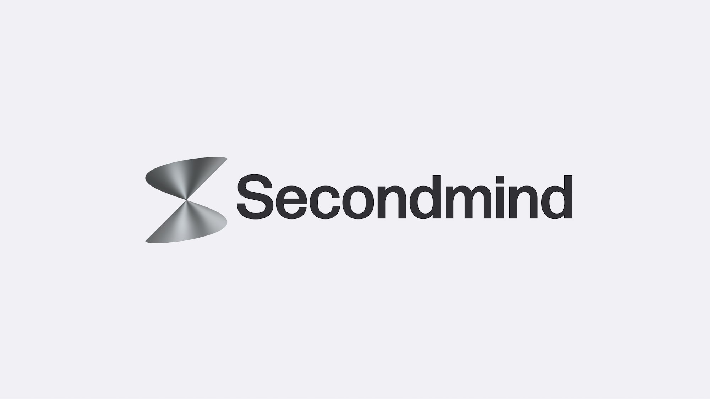
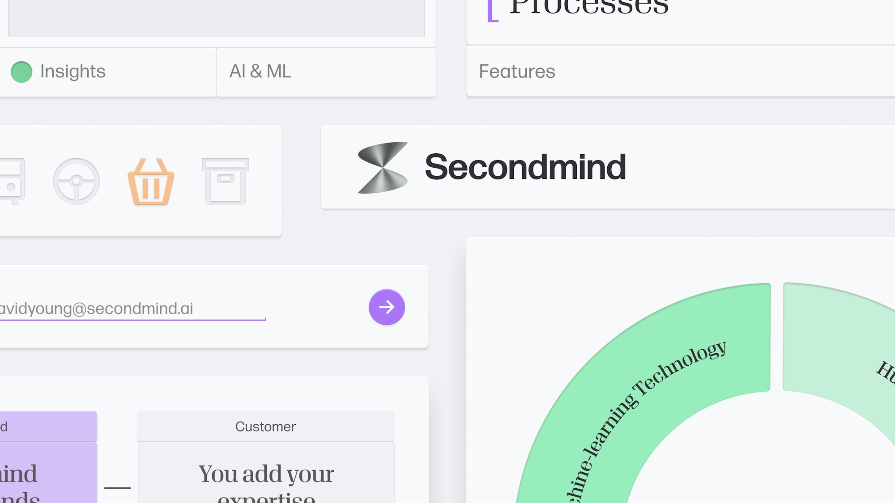
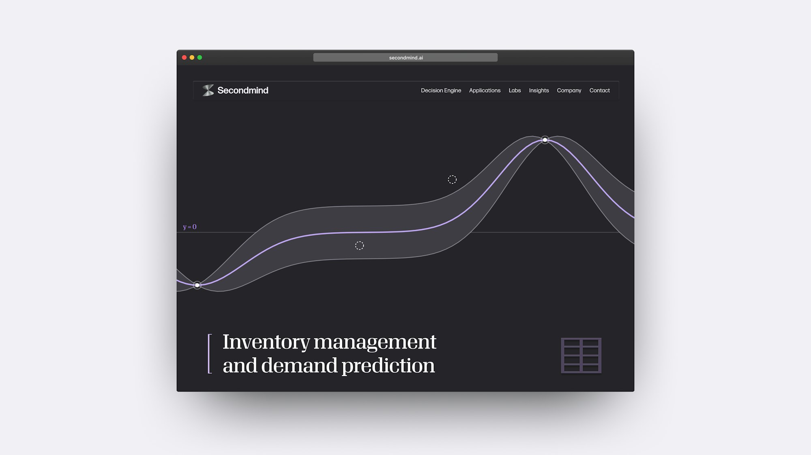
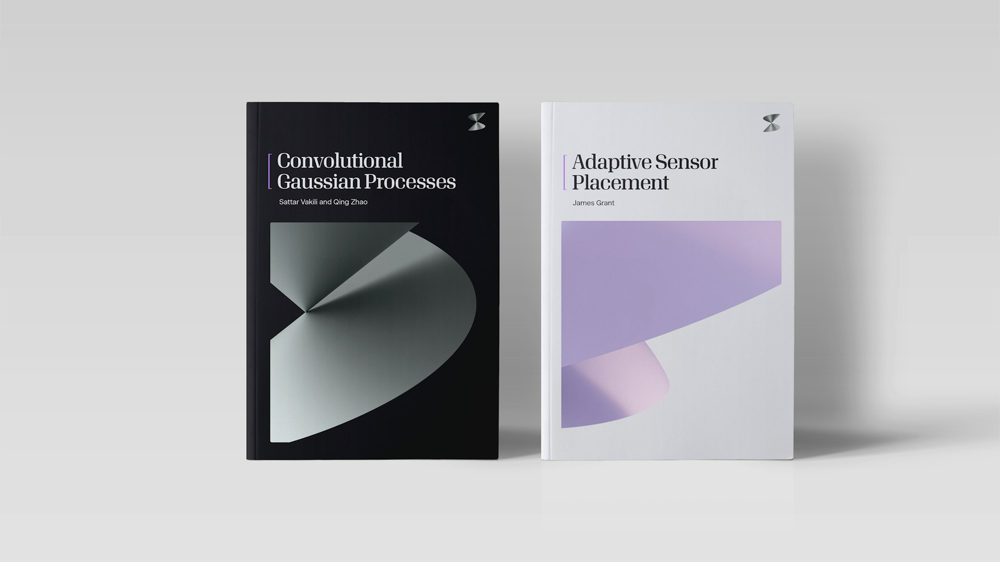
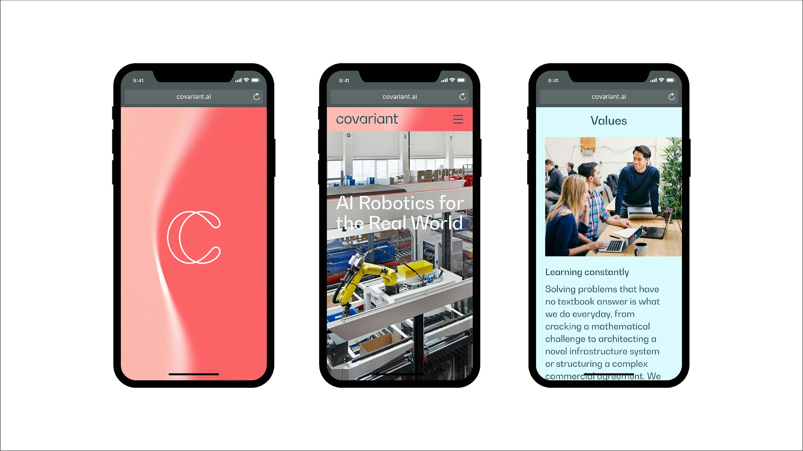
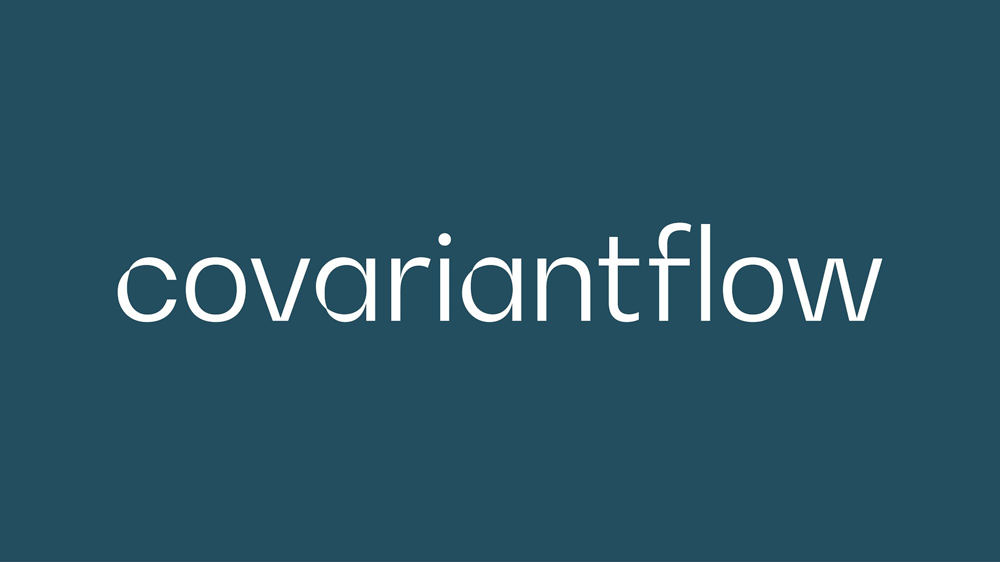
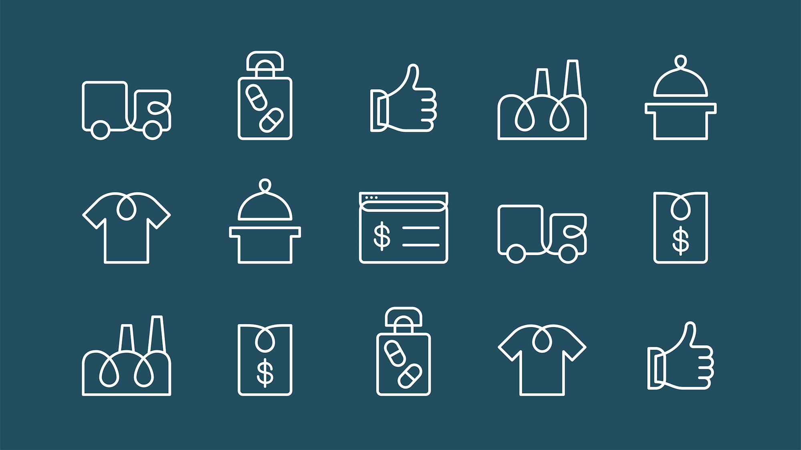
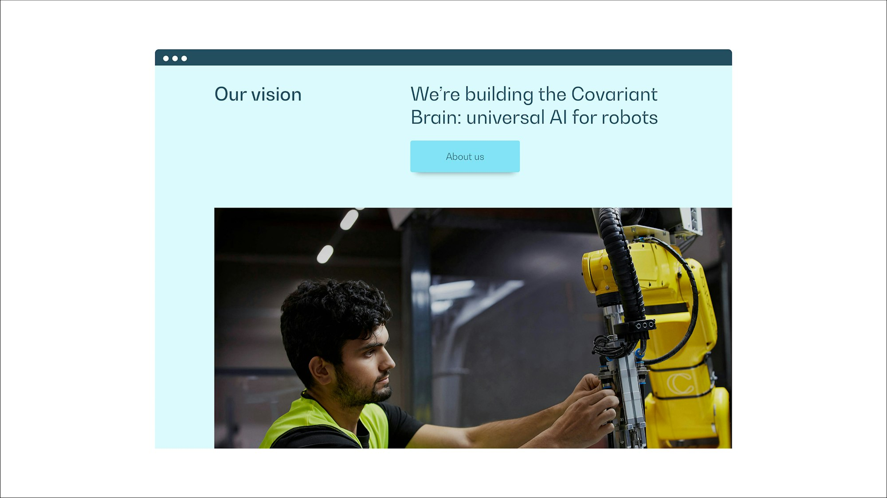
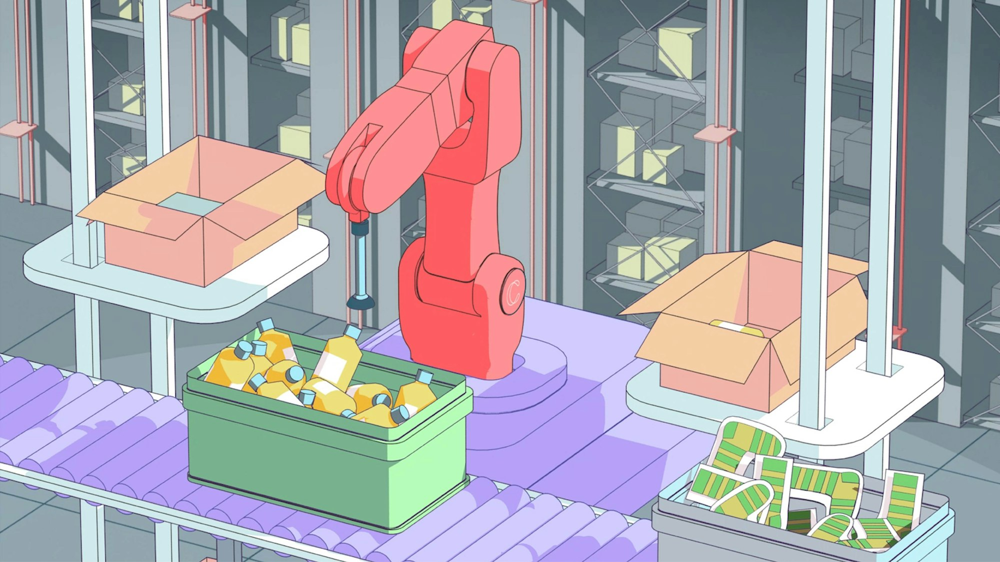

# 参数化科学图形 · 两个项目

本页是第三方来源档案。当前统一展示使用[逐例 AI 重新演绎](EXAMPLES.md)；这里保留原图、来源事实与观察，不把生成变化归给原作者。

以下均为官方项目页公开参考，2026-10-05 核对。实际保留 12 张 JPEG，每项目 6 张，按项目计为 2 例。原字节同时作为默认展示文件，未裁切、转码或 AI 清晰化；完整 URL、格式、像素尺寸和 SHA-256 见 [sources.json](sources.json)。

来源事实、图像观察与本库建议分别列出。静态图像只证明可见外观，不证明生成算法、连续动画效果或当下品牌使用情况。

## PS01 · Secondmind

**来源事实简述**：[Pentagram 官方项目页](https://www.pentagram.com/work/secondmind)介绍为 AI 公司设计的识别系统，符号使用三维数学函数，扩展图像来自符号形态。

**图像观察**：传播图中紫色曲面与浅底形成开口、交叠和大面积渐变；图文组合则使用灰色曲面符号与黑色名称。局部放大和完整组合承担不同观看任务。

**本库迁移建议**：先为新品牌定义曲面结构与识别轮廓，再从同一自有结构选相机和裁切。传播图可以放大转折；小标必须另查完整轮廓。材质改为平面明暗后若形状关系消失，先改结构。不要复用来源 S 形、函数、字标或具体色值。

**清晰度复核**：两张均为 2000 × 1125；以原图查看，传播图关键边缘和开口、组合图名称与符号均可辨。通过的是参考观察用途，未据此认定小图标适配。

### 从主形到完整应用

[原图](references/PS01-secondmind-icons.jpg)。观察：图标有较厚竖画、较细横画与轻微体积效果，语义涵盖搜索、日历和消息等；同一笔画方法落在不同对象上。官方页说明图标受到数学字体笔画的启发。图板不能证明所有轮廓能在 16px 下识别或达到产品对比度要求。

[原图](references/PS01-secondmind-components.jpg)。观察：完整品牌组合、衬线内容标题、无衬线分类和轻体积控件各有角色。页面明确列出标题 Algebra Display Regular 2、副标题／引文 Algebra Display Regular、正文 Forma DJR；本包未取得字体文件、中文覆盖或许可。此图是案例组件展示，边缘截断不是完整页面，不据它量实际 token。

[原图](references/PS01-secondmind-web.jpg)。观察：曲线图像与衬线长标题共享深色内容区，固定识别保留在页头；主要标题与图像层次可辨。原图中的曲线和数字是源案例内容，新任务不能把它改上自己的标题就当真实预测数据。

[原图](references/PS01-secondmind-reports.jpg)。观察：两份封面都把小标志、标题、作者和大幅曲面分开，深浅背景与曲面裁切变化，标题仍处于同一信息区域。图像证明的是案例物料展示，未核验印刷实物。

迁移到新科学产品时，可借的是这条连接：**自有主形 → 特征裁切 → 字体角色 → 内容尺度**。例如报告用放大的曲面解释主题，小标保持完整，功能图标用与主形相容的线条；无需把每个控件都做成立体。已有品牌只需要补报告封面时，保留其 Logo 和字体选择。

## PS02 · Covariant

**来源事实简述**：[Pentagram 官方项目页](https://www.pentagram.com/work/covariant)介绍机器人 AI 品牌的抽象决策边界视觉。团队制作工具控制形状、速度、复杂度和颜色，输出静态及动态图像。

**图像观察**：边界图以红色域、浅色渐变和一条明亮弯曲分界组织画面；手机应用里装饰、符号和内容页各占不同层级。

**本库迁移建议**：为新品牌重新定义边界分区和变化范围，先放置真实内容，再约束边界活动区域。柔和渐变可用于传播背景，但不能据此将模糊边界用作可点击控件。没有真实数据输入时，记录为概念性品牌图，禁止把形态变化标成产品模型的实测结果。

**清晰度复核**：两张均为 2000 × 1125；边界与明暗过渡可辨，手机图足以核对视觉层级。柔边为来源表现特征，不以锐化改变它。手机内的小字不作为字体鉴定、正文可读性或移动端验收证据。

### 从抽象主题到具体说明

[原图](references/PS02-covariant-wordmark.jpg)。图中实际字样为 `covariantflow`；观察其笔画粗细与局部转折，不据一个词推断新产品名称或完整品牌架构。官方页将字标、符号和图标与边界曲线联系起来，但未给出此图可核验的字体家族。

[原图](references/PS02-covariant-icons.jpg)。观察：车辆、衣物、袋子、药品等不同对象里反复出现回环线条；一致性来自曲线处理，各图仍需表达自己的对象。这是局部方法参考，不要求新品牌的每个图标都插入环圈。

[原图](references/PS02-covariant-web.jpg)。观察：文字和按钮占上部浅蓝面，人与机械臂的照片承接真实场景；抽象主题没有覆盖所有信息区域。网页为案例展示，本轮没有执行其交互或响应式验证。

[原图](references/PS02-covariant-illustration.jpg)。来源为插画注明 **Geoffroy de Crécy**。观察：机械臂、容器与货物关系具体，前景、设备与背景用色区分；它承担用途解释，与抽象边界图的角色不同。本包只保留静态图，不能宣称已验证循环动画或完整操作流程。

迁移到新 AI 产品时，先给视觉分工：抽象图表达品牌主题，摄影或叙事插画解释具体场景，界面图呈现真实操作。不能用同一段渐变代替产品说明，也不能把装饰边界标为模型准确率。字体、图标和正文的实际可用性仍分别测试。

新增八图均为 2000×1125，已逐张查看主要文字、图标路径、组件关系与场景对象；清晰度足以支持上述研究，不扩展成目标产品验收。

## 共用限制

本页仅收录这两项官方案例；其他页面图像、公式与动画不作为本包已验证产物。素材属于第三方参考，不用于新品牌直接交付。通用 Prompt 模板与完整品牌迁移尚未实测；已执行的原创静态研究见 [originals.json](originals.json)。执行入口见 [STYLE.md](STYLE.md)，模板见 [PROMPTS.md](PROMPTS.md)。
