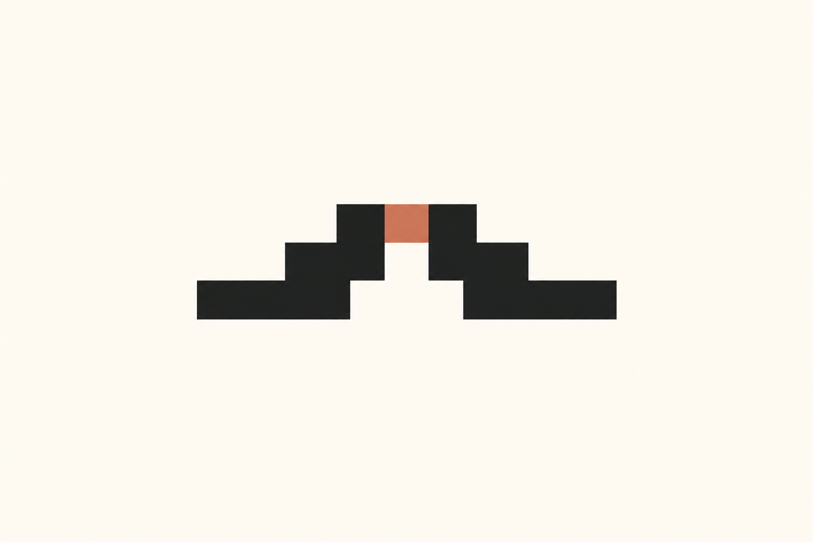
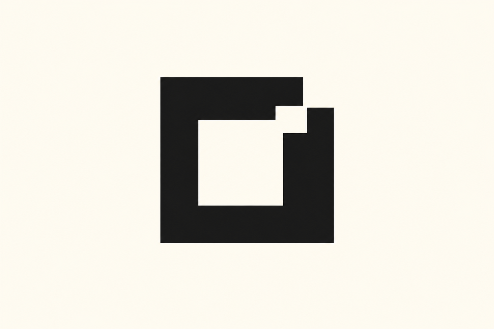
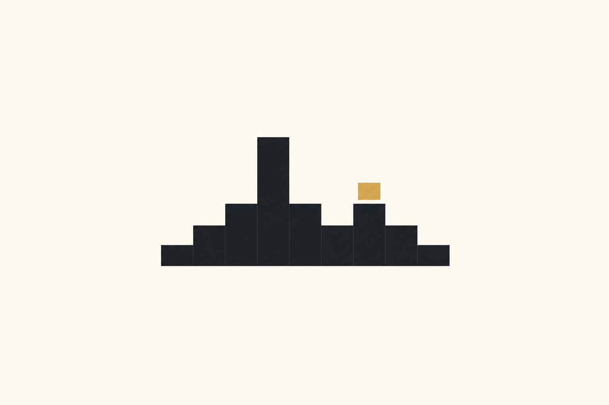
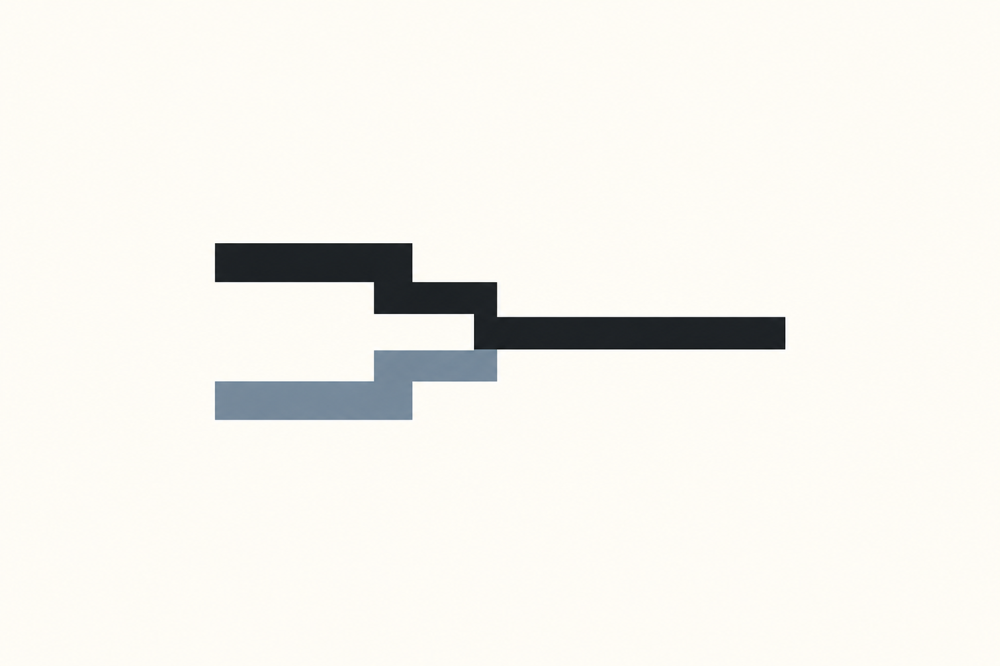
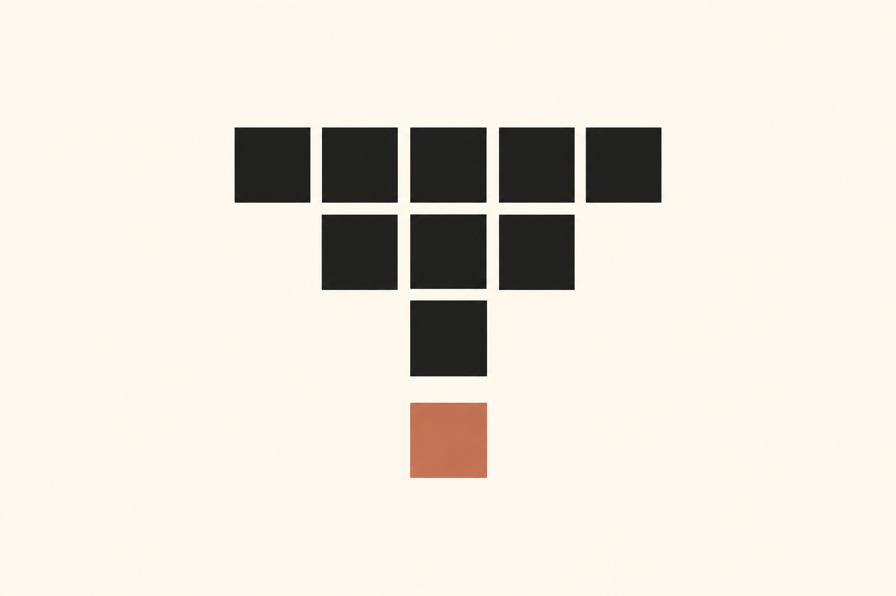

# 像素网格与离散图形 · 10 张 AI 研究图

本包展示 **2 张来源重新演绎、8 张独立原创研究**。每张均由内置 imagegen 单独生成；颜色、几何、字体与生产应用按实际用途另验。方法见 [STYLE](STYLE.md)，共同展示取向见[艺术方向](../ART-DIRECTION.md)。

来源重新演绎见 [generated.json](generated.json)，原图与事实见 [REFERENCES](REFERENCES.md) / [sources.json](sources.json)。独立原创的简报、构思、实际 Prompt 与目检见 [originals.json](originals.json)；这些是本库提出的新研究主题，没有第三方原作或官方采用事实。 参考、生成与正式资产的验证范围分开，包保持 provisional。

## 来源重新演绎

保留源样本 ID；这些图不是原作者作品或官方改版。

### PG01 · Mistral

**观察：** 像素M的阶梯、底脚与双孔仍可读，Mistral文字准确；双色陶土取代源色带。字样和几何只作AI视觉研究，未作官方或精确矢量复刻。

**可研究的方法：** 把自有品牌的固定符号、产品家族图标、辅助背景分开设计，先限定网格单位和轮廓可读性，再选择颜色和应用密度。

[原图档案](REFERENCES.md) · [实际输入](references/PG01-lockup.webp) · [原尺寸](generated/PG01.png)

### PG02 · MediaViz

**观察：** 采用同源条带图案重新构图：三组错位阶梯清楚，墨色与蓝灰统一。不是原MediaViz符号复刻，主体改为该项目已有的条带语法。

**可研究的方法：** 由自己产品的选择、分组或匹配动作导出网格关系；在固定符号、内容窗口与背景条带中分别声明变化范围。

[原图档案](REFERENCES.md) · [实际输入](references/PG02-pattern.webp) · [原尺寸](generated/PG02.png)

## 独立原创研究

每个 ID 对应一个不同的产品问题与构思，由文字简报生成，不绑定第三方样本。这里的“原创”说明构思与生成来源，不等于商标检索、独创性法律判断或正式品牌验收。

### PG-O01 · 续桥 · 断点恢复

**简报：** 虚构工作流 SaaS「续桥」需要表达任务中断后仍可从准确断点接续。

**方法：** 用两段相向的离散阶梯和连接缺口的一枚强调方块，把断点恢复转译成像素桥。

**目检：** 相向阶梯与中央陶土色连接块形成完整桥形；底部白色拱口可辨，暖白留白充分，构思与来源字母标志不同。

[原尺寸](generated/PG-O01.png) · [实际 Prompt 与记录](originals.json)

### PG-O02 · 页栈 · 检索归位

**简报：** 虚构知识检索工具「页栈」需要让被检索的证据在有序资料库中有明确归属。

**方法：** 用三条同宽的网格书脊和上移的一枚方块，形成资料归档与单项定位的关系。

**目检：** 三层同向资料脊线与蓝灰单块清楚，层距安静且单项位置突出；纯平面无文本或重复变体。

[原尺寸](generated/PG-O02.png) · [实际 Prompt 与记录](originals.json)

### PG-O03 · 隐窗 · 有界共享

**简报：** 虚构数据共享工具「隐窗」需要只向协作者开放被许可的信息范围。

**方法：** 用厚重像素边界包住偏置矩形留白，并在一角打开阶梯缺口，表达有界开放。

**目检：** 偏置矩形白窗通过右上阶梯开口连接外部，厚重外边与有限开口形成明确正负形关系；单色主体清楚。

[原尺寸](generated/PG-O03.png) · [实际 Prompt 与记录](originals.json)

### PG-O04 · 声格 · 有用信号

**简报：** 虚构语音整理 AI「声格」需要从连续录音中识别并保留一段有价值的语音。

**方法：** 以一条整合的阶梯波形配合一枚分离采样方块，表达连续语音的离散筛选。

**目检：** 阶梯波形包含单一主峰和右侧独立采样方块，底线连贯；无坐标或数据标注，仅作概念图形研究。

[原尺寸](generated/PG-O04.png) · [实际 Prompt 与记录](originals.json)

### PG-O05 · 合渠 · 数据合流

**简报：** 虚构数据管道服务「合渠」需要把两路重复来源合并成一条可信输出。

**方法：** 用两条平行起步、逐阶靠拢的直角路径汇成单一出口，区分输入并强调去重后的合流。

**目检：** 两条错位直角路径在单一交点汇成右向出口，蓝灰输入与黑色输出分工清楚；无交叉臂或附加装饰。

[原尺寸](generated/PG-O05.png) · [实际 Prompt 与记录](originals.json)

### PG-O06 · 凝核 · 信息蒸馏

**简报：** 虚构 AI 摘要工具「凝核」需要从散开的信息片段提炼一个稳定核心。

**方法：** 以宽行离散方块逐级收束到一枚实心方核，呈现从多到少的信息压缩过程。

**目检：** 5、3、1 的离散方块逐级收束到独立陶土方核，数量递减与间隔清楚；与其他图的连续轮廓明显不同。

[原尺寸](generated/PG-O06.png) · [实际 Prompt 与记录](originals.json)

### PG-O07 · 时隙 · 原子调度

**简报：** 虚构计算调度器「时隙」需要表达任务在可控时间窗口内逐步执行。

**方法：** 用上下两片相向阶梯与中央独立方块构成离散沙漏，强调一个明确执行时隙。

**目检：** 上下相向四阶块面与中央独立赭黄方块形成清楚时隙，三部分互不粘连；沙漏只保留建筑式几何关系。

[原尺寸](generated/PG-O07.png) · [实际 Prompt 与记录](originals.json)

### PG-O08 · 叶算 · 低碳计算

**简报：** 虚构云计算工具「叶算」需要把减少计算浪费表达为可辨的生长与节制。

**方法：** 用阶梯叶片外轮廓和留白方格叶脉，将有机生长转译为有限计算单元。

**目检：** 阶梯叶片、对角白色像素叶脉和短深色茎可辨；橄榄绿克制，主脉与短白缺口形成数字化植物关系，未使用现有品牌形状。

[原尺寸](generated/PG-O08.png) · [实际 Prompt 与记录](originals.json)
