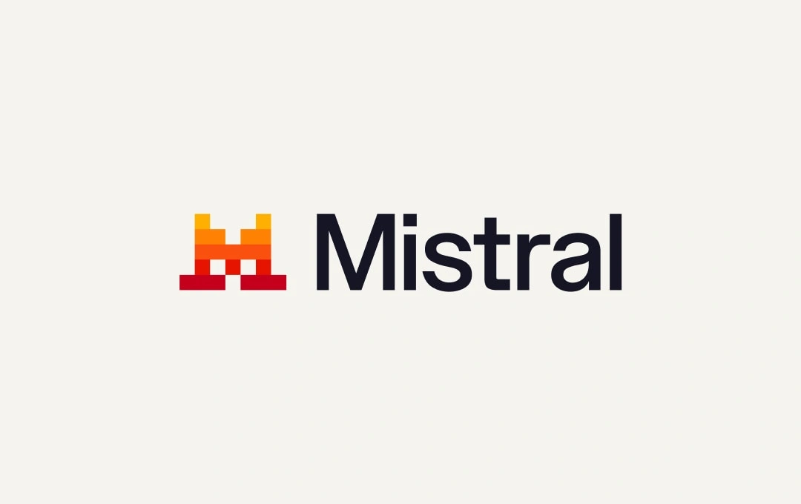
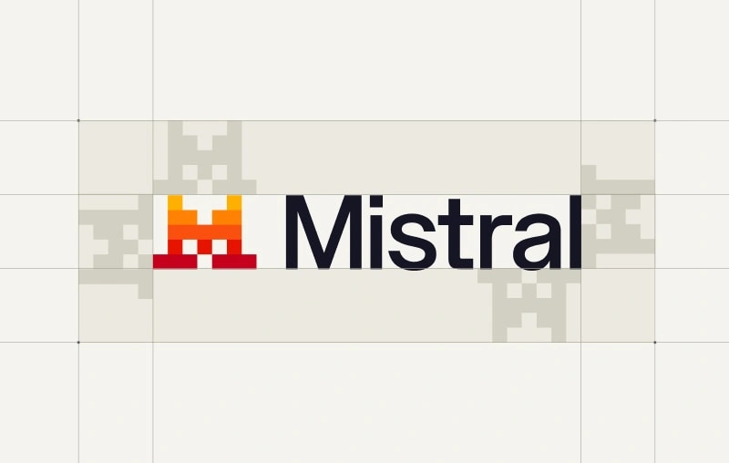
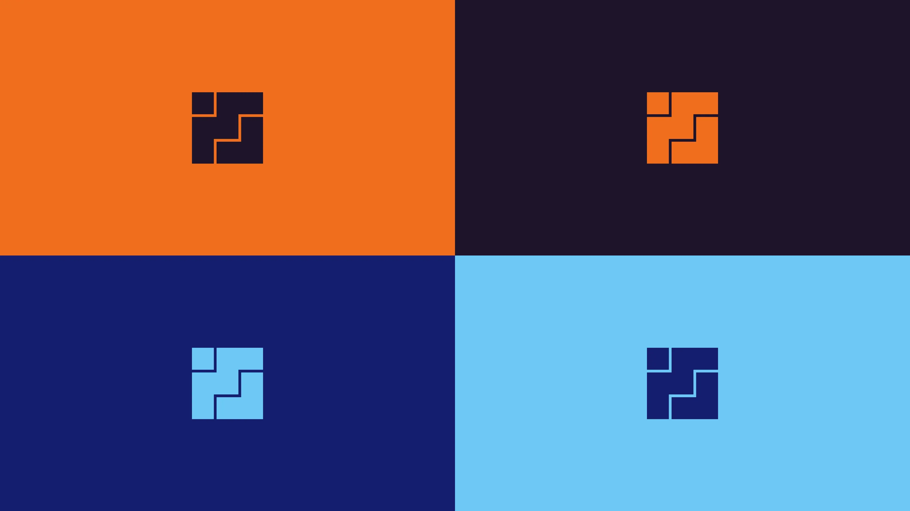
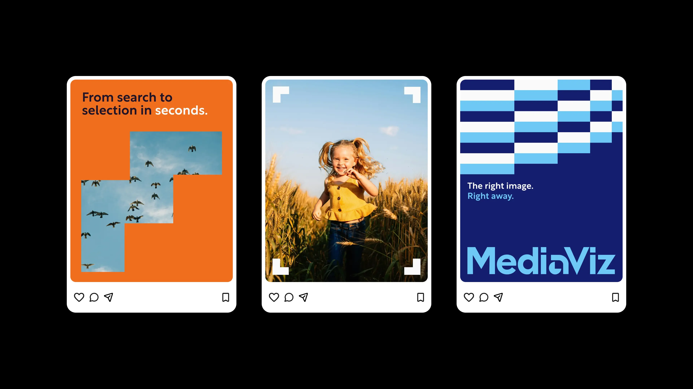

# 像素网格与离散图形 · 逐例参考

本页是第三方来源档案。当前统一展示使用[逐例 AI 重新演绎](EXAMPLES.md)；这里保留原图、来源事实与观察，不把生成变化归给原作者。

**PG01 Mistral、PG02 MediaViz：2 个独立项目，10 份原采集资产。** 两份 SVG 与一份 AVIF 另有等尺寸 PNG 预览，共 13 个图像文件。模型图标、色版、不同应用与预览不重复计为新项目。

“来源”是公开一手页面的说明；“观察”是本轮逐图目检；“迁移”与任务样例由本库编写。两项目字体家族与文件许可均未确认。本页 Tracewell、Indexlane 两份文字任务均为**未执行、未生成**。本库另有实际原创研究，见 [originals.json](originals.json)，不能归给参考作者。

## PG01 · Mistral：固定符号与像素家族

### 来源与构思

[Mistral 官方品牌页](https://mistral.ai/brand/)将徽记解释为抽象像素猫，并将模型图标说明为该符号的系统延展。[Brightscout 的 Mistral 案例](https://www.brightscout.com/work/mistral)描述在已有品牌基础上开展网站与营销材料设计。前者未列原始标志作者；后者不能当作原 Logo 作者证据。

此处研究方块构造、字标分工和家族扩展；猫的来源解释属于 Mistral 自身，不是 AI 品牌通用叙事。

### 1. 标志与字标角色

[原采集图](references/PG01-lockup.webp) · 1080×680 WEBP。观察：左侧以少量方块形成紧凑徽记，暖色色阶按横向区域分层；右侧名称以平滑无衬线字形承担阅读。图形承担性格，整词承担名称识别，字标本身没有像素化。准确字体未知。

### 2. 组合的留白规则

[原采集图](references/PG01-clearspace.webp) · 800×508 WEBP。观察：浅色重复徽记作为周围间隔的图示单位，辅助格线与正式组合分开。只可证明原品牌有明确组合规范，不能把本图中的相对数值直接指定给新品牌。

### 3. 系列成员保留同一种离散边缘

[原 SVG](references/PG01-codestral.svg) · [160×160 等尺寸 PNG](references/PG01-codestral.png)。观察：米色终端外壳、深色屏幕及内部暖色徽记共同形成代码相关对象；内部图形与外框的单位尺度不同，但都保留直角阶梯。

[原 SVG](references/PG01-large.svg) · [160×160 等尺寸 PNG](references/PG01-large.png)。观察：另一成员为蓝色色阶的向上三角形体，轮廓、主体和颜色都与终端不同。由此可研究“共同画法、不同主体”，不能据文件名或外观推断模型真实功能与设计隐喻。

### 4. 网站应用中的分工

[原 AVIF](references/PG01-mobile.avif) · [1920×1080 等尺寸 PNG](references/PG01-mobile.png)。观察：三个手机宽度的版面切片以淡网格组织内容，品牌符号、箭头和局部小图形保留像素特征，标题与说明仍为平滑字形。橙色展示背景与页面浅底分开。源图顶部/底部已有裁切，不能据此声称取得完整页面、全部正文或真实响应式行为。

### 迁移到新品牌

先从自身产品含义建立主标志，再决定系列图标是否使用相同像素画法；同时为宣传与产品界面分配不同密度。Mistral 的猫形、M 字关系、暖色色阶、终端内嵌徽记与具体页面组合不能直接移植。允许借用的是“固定身份—系列成员—应用强调”的角色分工。

**可执行任务样例，未生成：** 为虚构本地日志检索工具 **Tracewell** 研究离散图形方向。产品动作是“把分散事件串成可读路径”；用阶梯轨迹与间隔表达连接，排除动物、M 字与终端中的猫形。输出一个单色主符号草案、代表采集/检索/回放的三款系列图标，以及一张含“把零散事件读成完整路径”的 1200×630 公告图。主符号是固定资产，系列图标仅共享网格单位与边缘语言。目标尺寸为 24px 与 64px 的图标，公告文字另以可编辑文字排版。检查三成员在灰度下仍可区分、24px 缝隙不粘连；数值是本任务条件，不是原品牌规范。

清晰度：五份素材均逐张目检。两份 SVG 的原尺寸 PNG 中终端、内嵌符号与蓝色形体可辨，网页主内容清楚；微小代码和被原图截断的正文不作字体或布局测量依据。没有使用 AI 清晰化。

## PG02 · MediaViz / Bodkin：从选择与识别到网格系统

### 来源与构思

[Bodkin 官方案例](https://www.bodkin.studio/case-study/mediaviz)列项目年份 2025，职责覆盖品牌策略、身份、标志、艺术指导、视觉系统与规范；以相机胶卷/缩略图选择和人眼为构思来源，将 M、V 融于网格符号。案例应用是否实际投放，本轮未核实。

### 1. 紧凑符号中的正负形

[原采集图](references/PG02-mark.webp) · 1536×2048 WEBP。观察：一个孤立方块与相邻阶梯体块形成方形视觉边界；细的直角空隙切开不同部分。符号依靠轮廓与开口识别，不能用增加随机像素来替代语义构造。

### 2. 固定符号的色版

[原采集图](references/PG02-colors.webp) · 3840×2160 WEBP。观察：四格展示同一符号的图底换色，并无字标。它们是一份色版图板，不是四个独立设计项目。可研究的是固定结构与色彩角色分离，不能据图直接推定所有配对满足小尺寸或界面对比标准。

### 3. 摄影成为网格内容

[原采集图](references/PG02-photo.webp) · 3840×2160 WEBP。观察：人像只在阶梯窗口中出现，独立色块与窗口共享直角边界；左下品牌文字保持独立且平滑。内容本身与用于组织内容的形状是两层，不需要把照片逐像素打散。

### 4. 从边界发展出辅助图形

[原采集图](references/PG02-pattern.webp) · 3840×2160 WEBP。观察：不同宽度的横向色带通过上下错位形成阶梯，单个条带并不等同于标志。它支持在长幅中研究节奏、连续性与裁切，不能据此宣布原作采用某种算法或精确比例。

### 5. 跨内容的传播应用

[原采集图](references/PG02-social.webp) · 3840×2160 WEBP。观察：三张卡片分别让裁切摄影、完整照片和文字成为主角；第一张的窗口、第二张的角标、第三张的条带提供共同关系。字标及标题未整体像素化。字样局部改造可见，但基础字体、是否专用字体及授权未知。

### 迁移到新品牌

由自己的产品动作决定网格承担什么：选择窗口、分类单元或可追踪关系，而不是把全页填满方块。固定符号保持稳定，图像窗口可随内容变化，条带只用于辅助节奏。不能照搬 M/V 组合、阶梯孔隙分布、字标局部造型、图中人物摄影或整组蓝橙配色。

**可执行任务样例，未生成：** 为虚构技术文档检索平台 **Indexlane** 建立网格辅助语言，已有自有字标保持不变。核心动作是“从多份文档中选出可追溯片段”；用平行网格轨道与一个开口窗口表达定位，不创建 M/V 方形符号。产出“导入文档”“定位片段”“回到出处”三张 1080×1080 内容卡片和一个 1600×900 横幅。输入为自有文档示意图与精确中英文标题；卡片共享边缘单位及标题位置，窗口随内容改变。正文与品牌名使用可编辑文字。检查关键来源标记不被遮挡、长中文标题仍完整、装饰窗口与真实选择状态不混淆。此例只研究辅助系统，不把改字标列为隐含工作。

清晰度：五张图均逐张目检，主体开口、阶梯边界、字标及社交标题清楚。查看器展示长边约 2048px，未宣称逐原始像素测量或已验证每个小字。

## 证据与使用边界

具体 URL、采集方法、实际 MIME、尺寸与 SHA-256 见 [sources.json](sources.json)。公开页面图片属于研究素材，不能代替新品牌可编辑母版；字体文件、再分发授权、真实界面行为和新品牌迁移都未验证。

Mistral 下载按钮的 PNG 在本轮返回 HTTP 403，使用同一官方页面公开显示的图片 `src` 作为来源，未取得其完整 brand kit。所有预览转换都保留原文件与转换记录，未使用截图、补绘或插值放大冒充原作。
