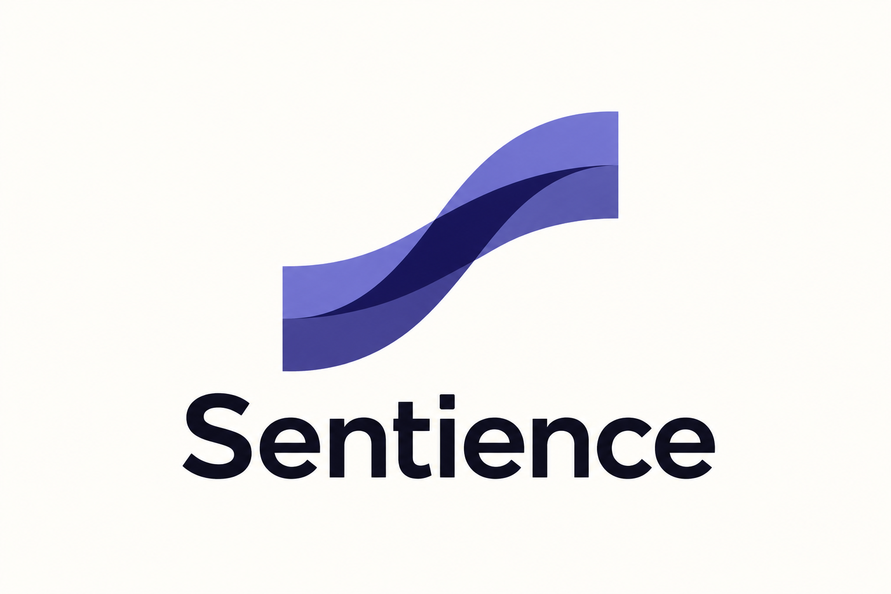
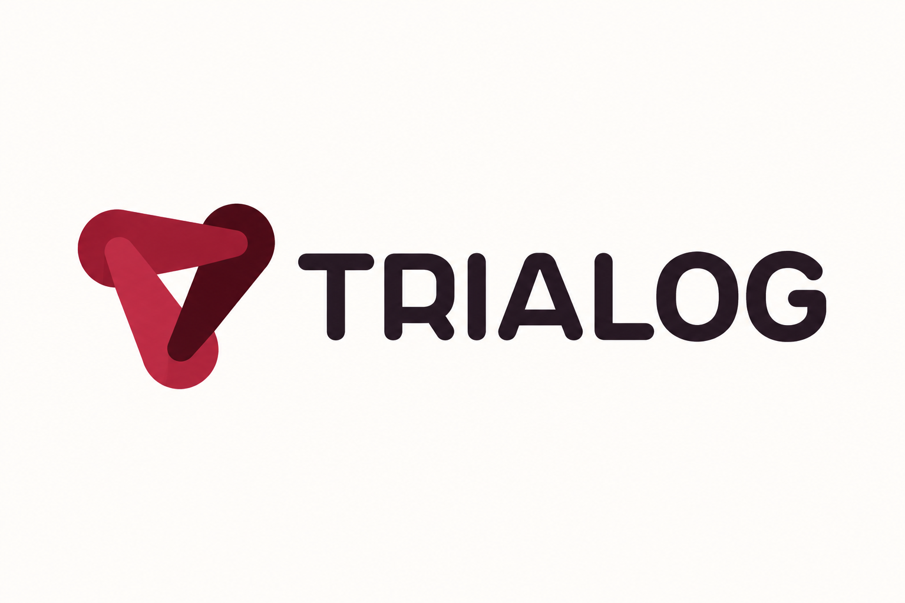
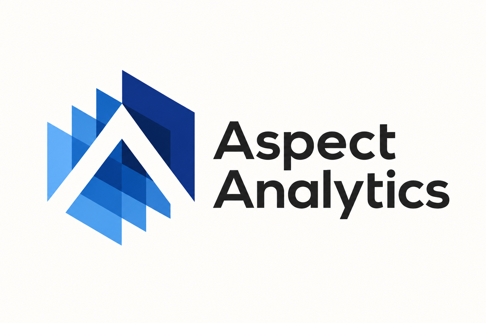
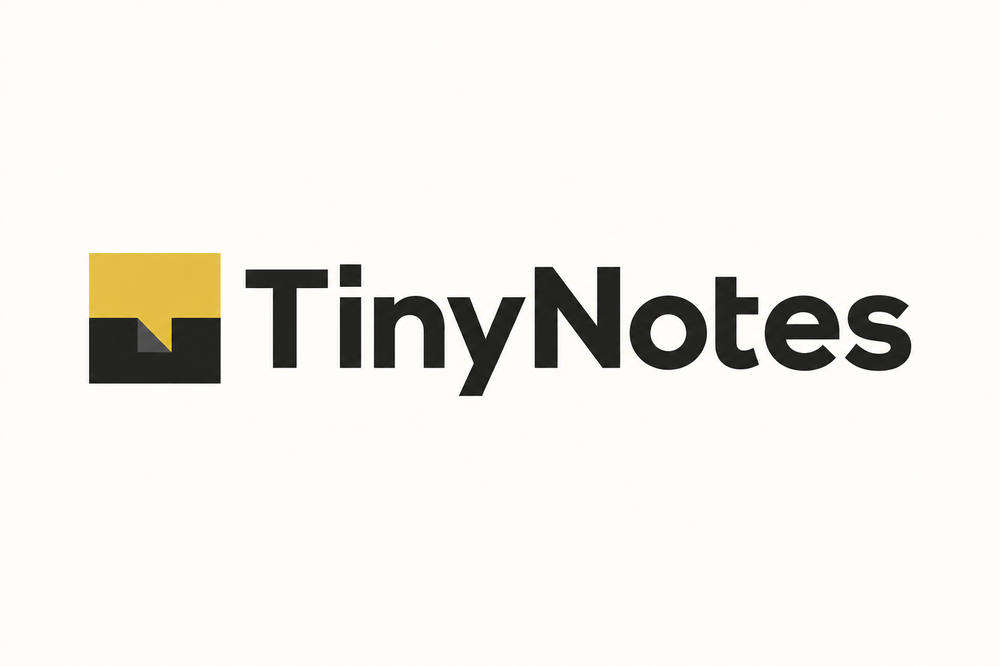
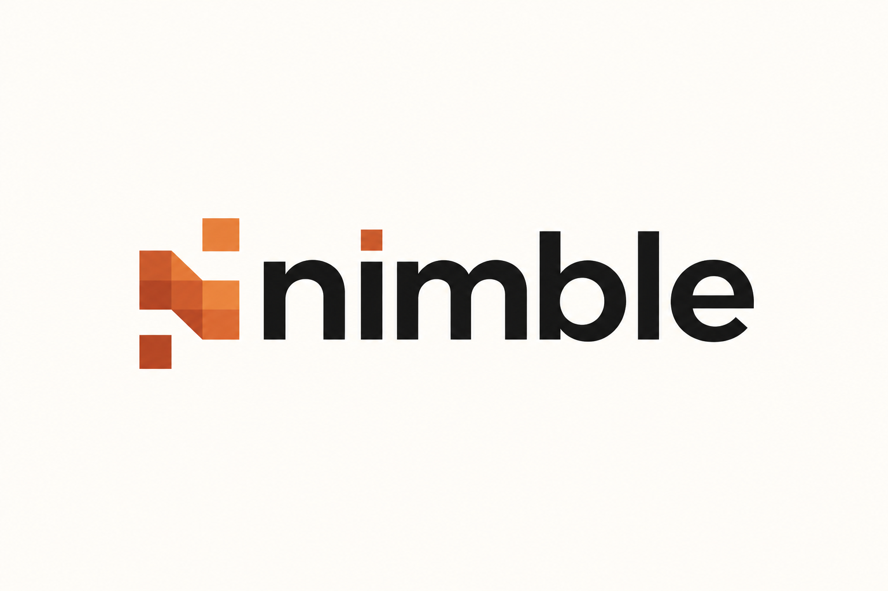
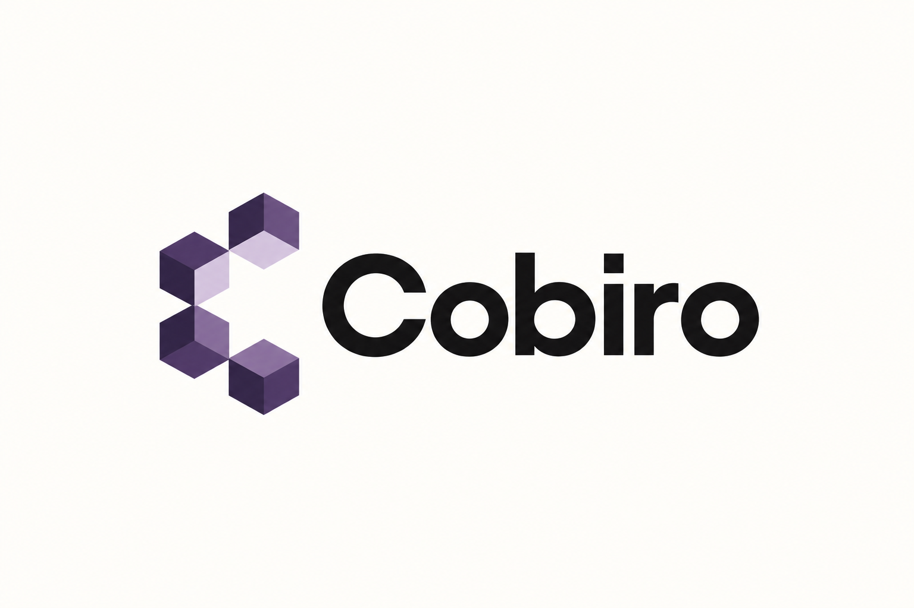
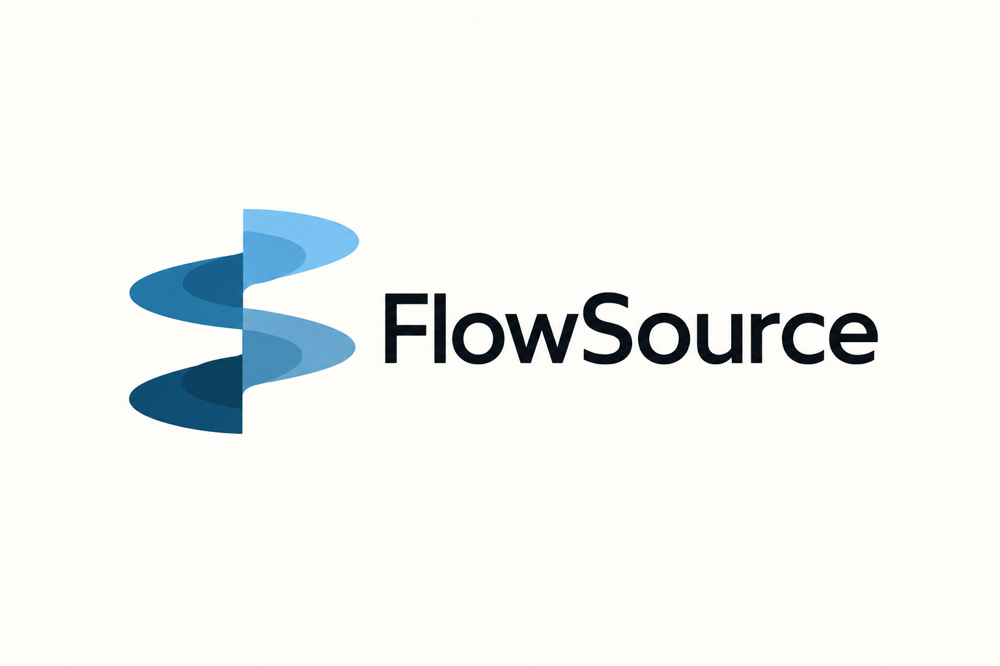
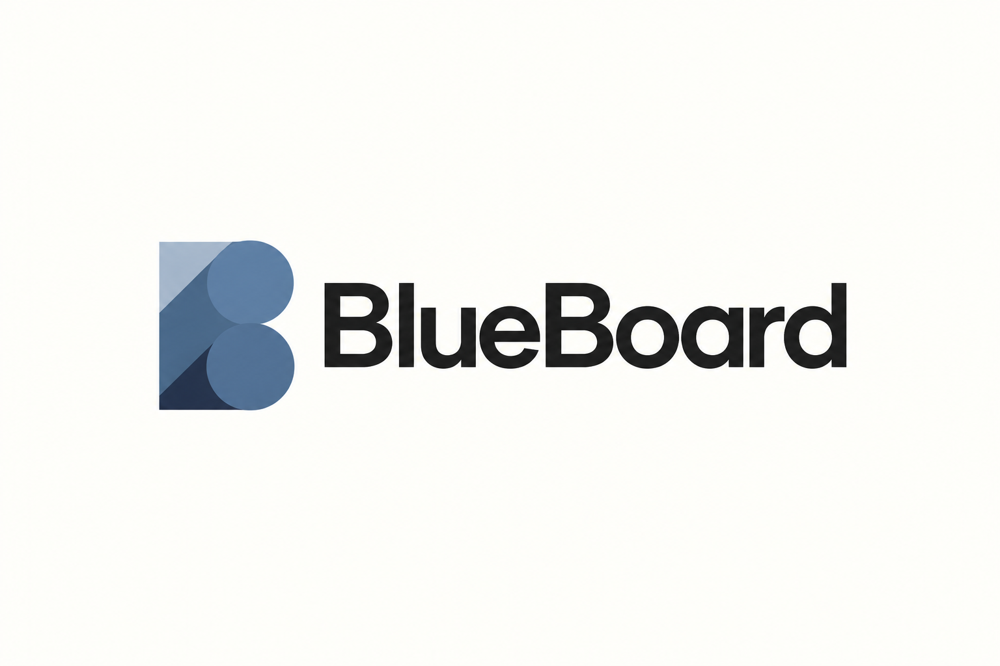

# 科技语义与字母融合 · 10 张 AI 研究图

本包展示 **10 张来源重新演绎**。每张均由内置 imagegen 单独生成；颜色、几何、字体与生产应用按实际用途另验。方法见 [STYLE](STYLE.md)，共同展示取向见[艺术方向](../ART-DIRECTION.md)。

来源重新演绎见 [generated.json](generated.json)，原图与事实见 [REFERENCES](REFERENCES.md) / [sources.json](sources.json)。 参考、生成与正式资产的验证范围分开，包保持 provisional。

### T01 · Cirrus

**观察：** 已逐张查看：开口 C 式带状主体、内凹曲线与两个尖端保留，Cirrus 拼写清楚；暖白留白、近黑字标与低饱和蓝色折面统一，属于重新演绎而非精确复原。

**可研究的方法：** 适合研究首字母与具体服务动作合成；飞行意象只迁移到有相应业务含义的品牌。

[原图档案](REFERENCES.md) · [实际输入](references/T01.png) · [原尺寸](generated/T01.png)

### T02 · Sentience

**观察：** 已对照原图：双波带上扬并交错形成 S 式关系，Sentience 拼写完整；高饱和双色改为同一靛蓝色相的层次，留白清楚。

**可研究的方法：** 用两种信息的交汇表达转换关系，再检验新首字母是否成立；重复图案作为延展。

[原图档案](REFERENCES.md) · [实际输入](references/T02.png) · [原尺寸](generated/T02.png)

### T03 · Trialog

**观察：** 已对照原图：三段圆头带保留三角闭合关系和中央留白，TRIALOG 拼写完整；酒红折面与近黑文字的横向组合简洁，未声称精确复原。

**可研究的方法：** 研究多个参与方汇合的关系；先检验新产品确有此语义，再决定是否保留三向结构。

[原图档案](REFERENCES.md) · [实际输入](references/T03.png) · [原尺寸](generated/T03.png)

### T04 · Aspect Analytics

**观察：** 已对照原图：递升平面、白色 A 式通道和两行 Aspect Analytics 均保留且可辨，蓝色层次统一到一个色相；版面清楚，未作精确几何复原声明。

**可研究的方法：** 研究首字母与数据分层关系；缩小时先减少层数并保护主开口。

[原图档案](REFERENCES.md) · [实际输入](references/T04.png) · [原尺寸](generated/T04.png)

### T05 · Vast Conference

**观察：** 已对照原图：两个圆端斜带与底部圆角形成 V，交叠关系清楚；保留纯符号范围，同一靛蓝色相与暖白背景，未增加字样。

**可研究的方法：** 从沟通双方的汇合关系构造首字母；保持单色时也能读出外轮廓。

[原图档案](REFERENCES.md) · [实际输入](references/T05.png) · [原尺寸](generated/T05.png)

### T06 · TinyNotes

**观察：** 已对照原图：黄黑方块与折页式缺口、TinyNotes 的大小写拼写均保留；强调色收敛为暖黄，粗重字标与大留白清楚。

**可研究的方法：** 将笔记、对话等一个核心动作压缩进紧凑轮廓；检查小尺寸下转折是否消失。

[原图档案](REFERENCES.md) · [实际输入](references/T06.png) · [原尺寸](generated/T06.png)

### T07 · nimble

**观察：** 已对照原图：N 式模块及上下分离方块保留，nimble 全小写且 i 的方点呼应图形；橙红多色收敛为土橙单色相，主体清楚。

**可研究的方法：** 用有限模块表达搭建或灵活组合，先让字母骨架成立，再决定是否需要游离小块。

[原图档案](REFERENCES.md) · [实际输入](references/T07.png) · [原尺寸](generated/T07.png)

### T08 · Cobiro

**观察：** 已对照原图：四个立方模块围成右侧开口 C，Cobiro 名称完整；多色面改为同一茄紫色相，模块结构和留白可辨。

**可研究的方法：** 研究可组合模块与建站功能的关系；图标阶段减少模块内部细分，保留开口。

[原图档案](REFERENCES.md) · [实际输入](references/T08.png) · [原尺寸](generated/T08.png)

### T09 · FlowSource

**观察：** 已对照原图：四个左右交替的椭圆带片围绕竖轴构成旋转关系，FlowSource 拼写完整；彩虹色改为蓝色层次，横向组合清楚。

**可研究的方法：** 用层叠与流向表达信息流转；字母融合是否可读需单独验证，不能靠解释代替识别。

[原图档案](REFERENCES.md) · [实际输入](references/T09.png) · [原尺寸](generated/T09.png)

### T10 · BlueBoard

**观察：** 已对照原图：直立矩形、上下两圆及斜向分区仍构成 B，BlueBoard 拼写正确；低饱和蓝灰与近黑字标、留白一致。

**可研究的方法：** 从一个强字母骨架起步，将板面或信息分区作为次级含义，避免依赖颜色才读出字母。

[原图档案](REFERENCES.md) · [实际输入](references/T10.png) · [原尺寸](generated/T10.png)
